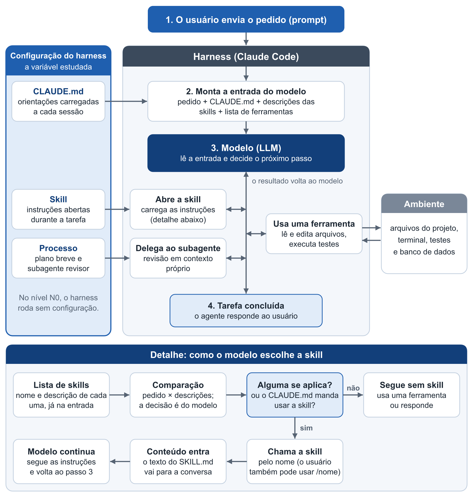
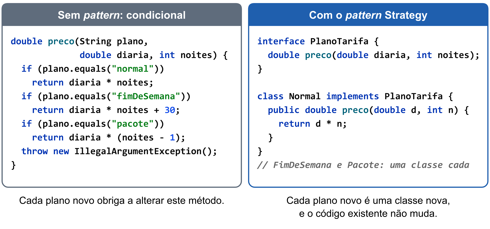
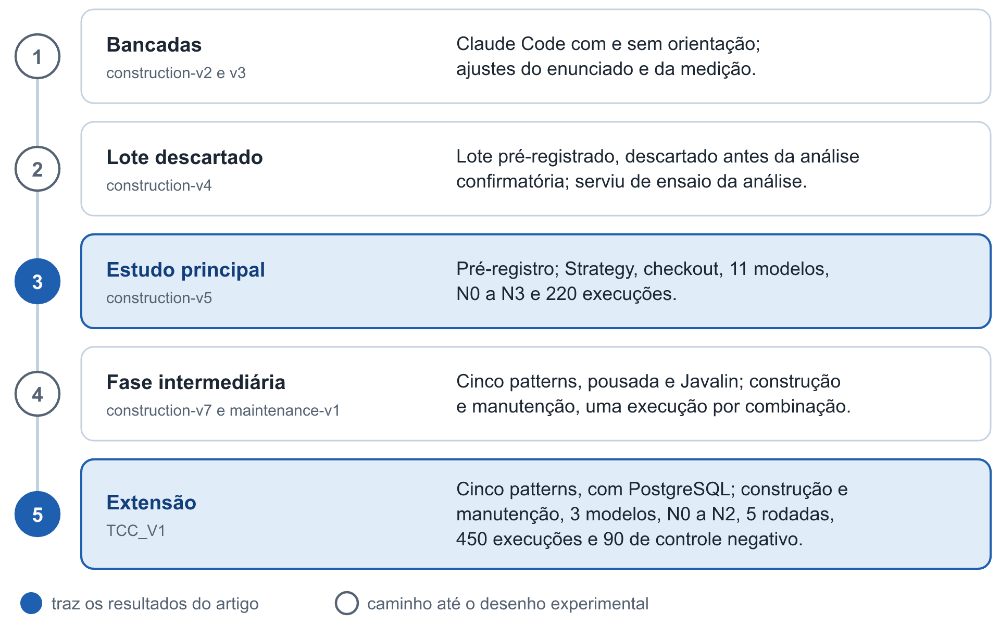
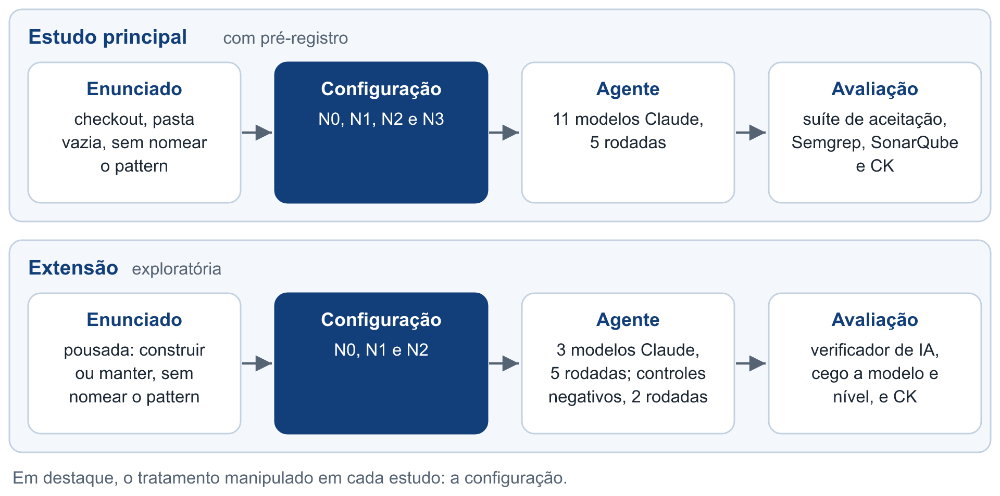
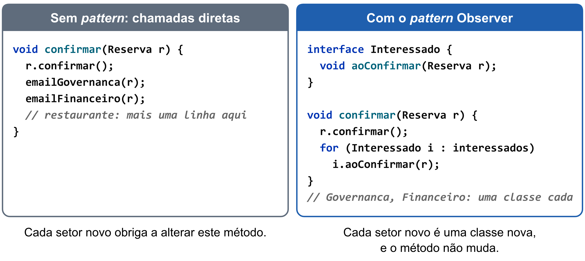
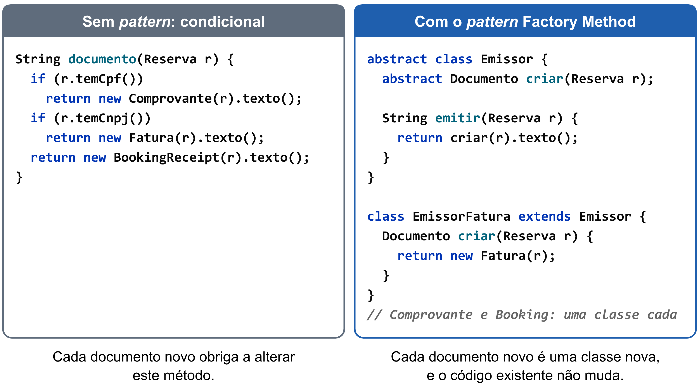
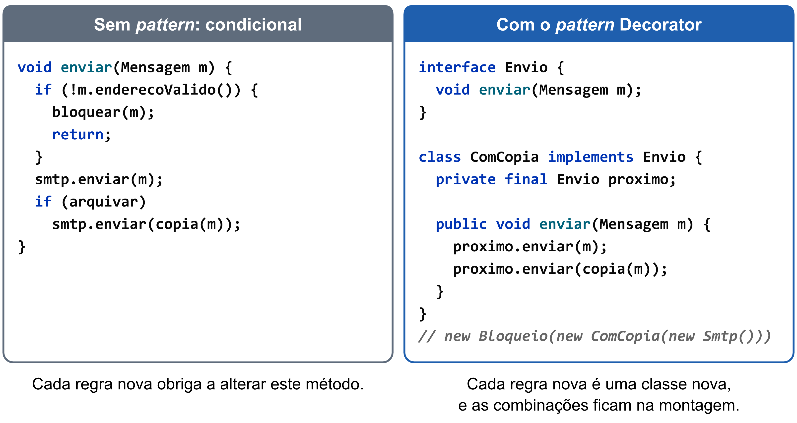
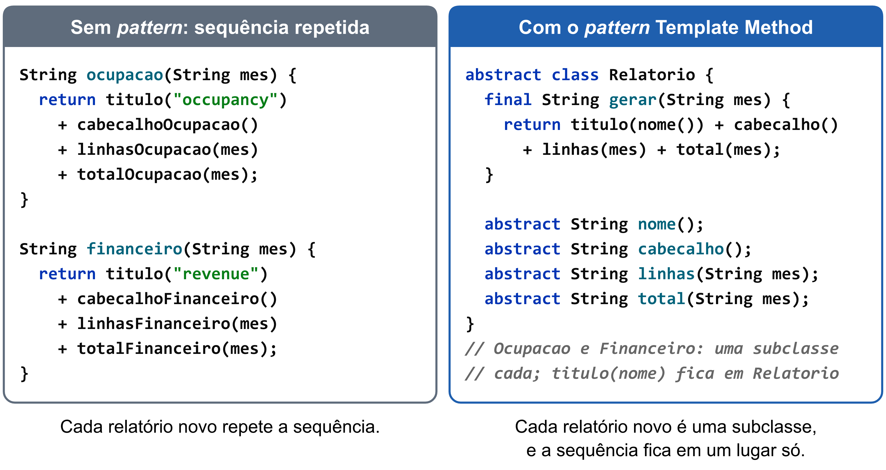
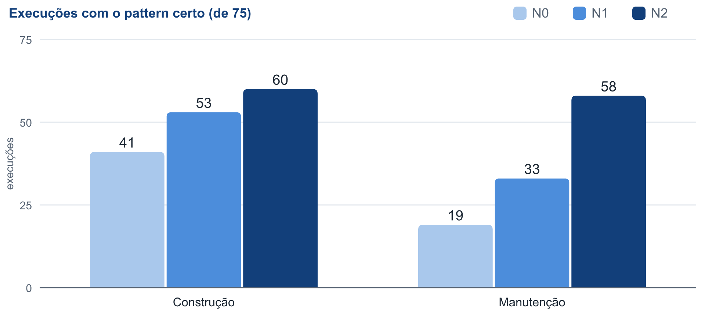
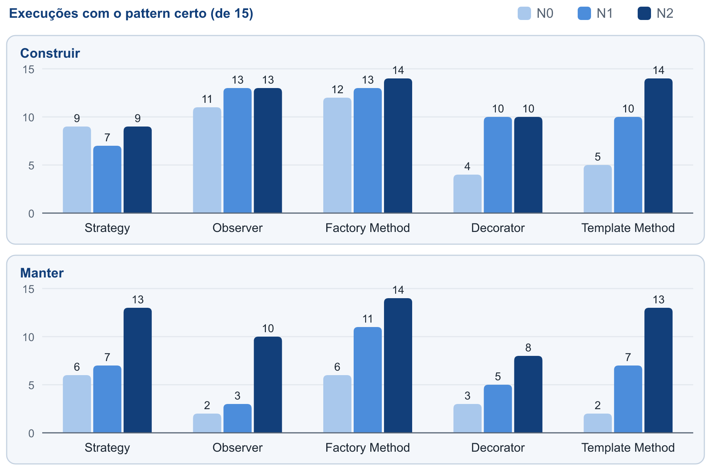

# Orientações de projeto e *design patterns* em agentes de programação: um estudo com pré-registro e sua extensão à manutenção

**Lucas Felipe Gomes Pedrosa**^[Trabalho de conclusão de curso, sob orientação do professor Rodrigo Rebouças de Almeida, submetido ao Curso de Licenciatura em Ciência da Computação do Centro de Ciências Aplicadas e Educação (CCAE) da Universidade Federal da Paraíba, como parte dos requisitos necessários para obtenção do grau de Licenciado em Ciência da Computação.]

Departamento de Ciências Exatas (DCX)

Universidade Federal da Paraíba (UFPB) – Campus IV

CEP 58297-000 – Rio Tinto – PB – Brasil

`lucas.gomes@dcx.ufpb.br`

## Resumo

Agentes de programação baseados em grandes modelos de linguagem (LLMs) recebem orientações persistentes, em arquivos de projeto e *skills* (conjuntos de instruções sobre um assunto), cujo efeito sobre o *design* do código é pouco estudado. Este trabalho investiga como essas orientações alteram o uso de *design patterns* por esses agentes. Em estudo pré-registrado, 11 modelos Claude construíram o mesmo serviço em quatro níveis de orientação (220 execuções). Um arquivo de princípios elevou de 67% para 93% as execuções que aplicaram o Strategy no ponto mais complexo do enunciado, sem alteração detectada no uso do *pattern* onde ele não se justificava (exagero) e sem piora da corretude no conjunto, embora o modelo mais fraco, o Haiku 4.5, tenha piorado. O ganho apareceu nos seis modelos que não acertavam sempre sem orientação. Em extensão exploratória com três dos 11 modelos (450 execuções, avaliadas por verificador de IA), o uso correto aumentou, do nível sem orientação ao mais orientado, em nove de dez combinações de cinco *patterns* e duas tarefas, com exceção do Strategy na construção. No total, subiu de 19 para 58 execuções em 75 na manutenção, que partiu de um nível menor, e de 41 para 60 na construção. Na manutenção, o comportamento pela API caiu de 61 para 54 em 75. Em 90 controles negativos na manutenção, pedidos em que o *pattern* não se justifica, 88 execuções mantiveram a mudança pequena, mas, na construção com a *skill*, a estrutura criada sem necessidade subiu de 4 para 9 execuções em 75.

## Abstract

Coding agents based on large language models (LLMs) receive persistent guidance, in project files and skills (instruction sets on a subject), whose effect on code design is little studied. This work investigates how this guidance changes the use of design patterns by these agents. In a preregistered study, 11 Claude models built the same service at four guidance levels (220 runs). A file of principles raised from 67% to 93% the runs that applied Strategy at the most complex point of the task, with no detected change in the use of the pattern where it was not justified (overengineering) and no loss of correctness overall, although the weakest model, Haiku 4.5, got worse. The gain appeared in the six models that did not always succeed without guidance. In an exploratory extension with three of the 11 models (450 runs, graded by an AI verifier), correct use increased, from the unguided level to the most guided one, in nine of ten combinations of five patterns and two tasks, except for Strategy in construction. Overall, it rose from 19 to 58 runs out of 75 in maintenance, which started from a lower level, and from 41 to 60 in construction. In maintenance, behavior through the API fell from 61 to 54 out of 75. In 90 negative controls in maintenance, requests where the pattern is not justified, 88 runs kept the change small, but, in construction with the skill, structure created without need rose from 4 to 9 runs out of 75.

## 1. Introdução

A Inteligência Artificial (IA) é o campo que estuda a síntese e a análise de agentes computacionais que agem de modo inteligente [Poole e Mackworth 2023]. Entre os sistemas de IA usados no desenvolvimento de software, destacam-se os Grandes Modelos de Linguagem (*Large Language Models*, LLMs), modelos baseados na arquitetura Transformer [Vaswani et al. 2017; Brown et al. 2020], treinados com grandes volumes de texto e capazes de gerar texto, inclusive código-fonte, a partir de uma entrada chamada *prompt* [Hou et al. 2024]. Uma característica desses modelos é executar tarefas novas especificadas apenas por texto, sem ajuste de seus
parâmetros internos [Brown et al. 2020]. Assim, o que é escrito na entrada influencia o resultado produzido, e é nesse ponto que este trabalho se concentra.

Quando um LLM passa a agir sobre um ambiente, surge a figura do agente: uma entidade que percebe o ambiente, toma
decisões e executa ações [Xi et al. 2025], em um ciclo de raciocinar, agir e observar o resultado [Yao et al. 2023]. Os
agentes de programação aplicam esse ciclo ao desenvolvimento de software: leem arquivos, escrevem código, executam
testes e usam o retorno obtido para decidir o passo seguinte. Esse laço iterativo com retorno do ambiente é o que os
distingue de um LLM usado de forma isolada [Liu et al. 2026]. O agente empregado neste trabalho é o Claude Code^[https://code.claude.com/docs. Acesso em 09/11/2026.],
ferramenta da empresa Anthropic que recebe um pedido em linguagem natural e altera o projeto com autonomia.

O modelo, contudo, não opera sozinho. As camadas de software em torno dele, que conduzem o ciclo do agente, montam a
entrada de cada chamada e oferecem as ferramentas disponíveis, formam o que se denomina *harness* [Galster et al. 2026].
Os desenvolvedores podem personalizar o *harness* de um projeto por meio de mecanismos de configuração, e é essa
configuração a variável estudada neste trabalho. Três mecanismos são considerados. O primeiro é o arquivo `CLAUDE.md`,
um texto com orientações do projeto que o Claude Code carrega a cada sessão, tratado como contexto, e não como regra
imposta [Anthropic 2026a]. O segundo é a *skill*, um conjunto de instruções sobre um assunto; sua descrição fica sempre
disponível ao agente, enquanto o conteúdo só é carregado quando ela é usada [Anthropic 2026b]. O terceiro é o processo,
aqui composto por um plano breve de *design* anterior ao código e por um subagente revisor, isto é, um agente separado, com
contexto próprio, ao qual o agente principal delega uma tarefa [Anthropic 2026c]. Essas orientações são persistentes
porque acompanham o projeto e valem para todos os pedidos, ao contrário do *prompt*, que vale para um único pedido. Por isso, este trabalho chama a configuração estudada também de orientações persistentes. Em 2.853 repositórios públicos que já usam ferramentas de agente, os arquivos de contexto predominam, enquanto *skills* (5,5%) e subagentes (4,6%) ainda são pouco
adotados [Galster et al. 2026].

A Figura 1 mostra o caminho de um pedido, do *prompt* à resposta, e os pontos em que a configuração estudada atua no *harness*, o software em torno do modelo. O *harness* junta o *prompt*, o `CLAUDE.md` e as descrições das *skills* e envia o conjunto ao modelo. A cada passo, o modelo decide se abre uma *skill*, delega a um subagente ou usa uma ferramenta, e o resultado volta a ele até a conclusão da tarefa. A escolha da *skill* cabe ao próprio modelo, a partir da descrição de cada uma [Anthropic 2026b].

**Figura 1.** O fluxo de um pedido no agente, a escolha da *skill* e os pontos em que a configuração estudada atua. Fonte: elaboração própria.

Essas orientações podem tratar de como o código deve ser organizado, e os padrões de projeto (*design patterns*, aqui
chamados de *patterns*) oferecem um caso propício para observar esse efeito. Um *pattern* é uma solução conhecida e
nomeada para um problema recorrente de projeto em orientação a objetos [Gamma et al. 1995]. O *pattern* Strategy, por
exemplo, coloca cada variação de um algoritmo em uma classe própria, atrás de uma interface comum, de modo que um novo
caso não obrigue a alterar uma cadeia de condicionais. Sua aplicação, porém, envolve uma decisão. Os próprios autores do
catálogo alertam que os *patterns* não devem ser aplicados indiscriminadamente, pois a flexibilidade custa indireção
[Gamma et al. 1995], e Fowler (2018) chama de generalidade especulativa (*speculative generality*) a flexibilidade criada para necessidades que talvez nunca surjam. Neste trabalho, o uso de um *pattern* onde ele não se justifica é chamado de exagero.
A evidência empírica com pessoas também não é uniforme: o efeito varia conforme o *pattern* e a tarefa [Prechelt et al.
2001; Vokáč et al. 2004], e uma revisão publicada em 2012, com a literatura até 2009, concluiu que faltava conhecimento para julgar, com base em evidências, quando cada um deve ser usado [Zhang e Budgen 2012].

A decisão pode ocorrer em duas situações de desenvolvimento. Na construção, o agente parte de uma pasta vazia e cria o
sistema. Na manutenção, entendida como a modificação de um software existente que preserva suas funções principais
[Boehm 1976], o agente recebe um sistema pronto e um pedido de mudança. As duas situações são distintas porque, na
segunda, já existe um código que o agente pode apenas estender.

O tema é relevante porque o uso dessas ferramentas tem consequências observáveis sobre a qualidade do código. Em 806
repositórios que adotaram o Cursor^[https://cursor.com/. Acesso em 09/11/2026.], outra ferramenta de programação com IA, o ganho de velocidade durou cerca de dois
meses, enquanto o aumento de alertas de análise estática e da complexidade cognitiva persistiu [He et al. 2026]. Ao
mesmo tempo, o *design* de software recebe pouca atenção: em uma revisão de 395 artigos sobre LLMs em engenharia de
software, essa atividade responde por apenas 0,92% das tarefas registradas, 4 de 436 [Hou et al. 2024]. Quanto às orientações persistentes, o efeito das regras
dadas a essas ferramentas é apontado como uma questão em aberto [Jiang e Nam 2026], e ainda faltam estudos controlados
sobre a contribuição de configurações mais ricas [Galster et al. 2026].

Diante desse cenário, este trabalho parte do seguinte problema de pesquisa: como a configuração do *harness* de um
agente de programação muda a forma como ele aplica *design patterns* quando o pedido não os menciona? Para responder a
essa pergunta, o objetivo geral é avaliar experimentalmente o efeito de orientações persistentes sobre a decisão do
agente de aplicar um *pattern*, tanto na construção quanto na manutenção. O trabalho foi desenvolvido como Trabalho de Conclusão de Curso da Licenciatura em Ciência da Computação da Universidade Federal da Paraíba, e foram realizados dois estudos. O estudo principal tem pré-registro, isto é, o protocolo e as regras de decisão foram fixados antes da coleta dos dados
[Ernst e Baldassarre 2023]. Nele, 11 modelos da família Claude construíram o mesmo serviço de *checkout* em quatro níveis de configuração, do N0, sem configuração, ao N3, em 220 execuções, e o enunciado incluiu um controle negativo, ou seja, um ponto em que aplicar o
*pattern* seria exagero. A extensão, de caráter exploratório, abrange cinco *patterns*, três modelos e as tarefas de
construção e manutenção, em 450 execuções, mais 90 de controle negativo na manutenção, avaliadas por um verificador de IA.

Os objetivos específicos são formulados como oito perguntas de pesquisa. As quatro primeiras têm hipóteses pré-registradas no estudo principal e evidência complementar na extensão; as hipóteses principais servem às três primeiras, e as da P4 são todas secundárias. P1: como a configuração muda o uso do *pattern* esperado? P2: como ela muda o exagero, a corretude e a qualidade do código? P3: como o efeito varia entre os modelos? P4: como cada componente da configuração contribui para o efeito, e a que custo? As duas seguintes são exploratórias e respondidas pela extensão. P5: como o tipo de tarefa, construção ou manutenção, muda o efeito em cinco *patterns*? P6: como respondem as demais dimensões de qualidade, a saber, o *design* do restante do código, a arquitetura, os testes, o banco de dados e o comportamento? As duas últimas são descritivas, nos dois estudos. P7: quão estáveis são os resultados quando a mesma tarefa se repete? P8: como muda a estrutura orientada a objetos do código, em polimorfismo, tamanho das classes, acoplamento e coesão? Na P8, o acoplamento e a coesão têm hipótese no estudo principal. Na manutenção, a extensão inclui também um controle negativo, que verifica se o agente mantém a mudança pequena quando o *pattern* não se justifica, tratado em conjunto com a P2.

As contribuições deste trabalho são um experimento com pré-registro sobre o *pattern* Strategy, com 11 modelos e quatro
níveis de configuração; a extensão a cinco *patterns*, na construção e na manutenção, com banco de dados; um verificador de qualidade que avalia a categoria do *pattern* e cinco dimensões, calibrado em casos de resposta conhecida na categoria do *pattern* e em quatro das dimensões (comportamento, arquitetura, testes e banco); e a medida da estabilidade dos resultados em
cinco rodadas. Do ponto de vista prático, os resultados informam quem escreve orientações para agentes de programação
sobre o que esperar delas e sobre o custo que podem trazer.

O restante deste artigo está organizado da seguinte forma: a Seção 2 apresenta os conceitos de orientação a objetos
usados para ler os resultados; a Seção 3 discute os trabalhos relacionados; a Seção 4 apresenta uma visão geral do processo; a Seção 5 descreve o estudo principal; a
Seção 6 descreve a extensão; a Seção 7 responde às perguntas de pesquisa; a Seção 8 apresenta as limitações; a Seção 9 conclui o trabalho; e o Apêndice A reúne os dados por modelo.

## 2. Fundamentação: orientação a objetos e *design patterns*

O estudo principal trata do *pattern* Strategy, e a extensão, de cinco *patterns*. Todos resolvem o mesmo problema de fundo: uma regra que muda conforme o caso (por exemplo, o plano de tarifa ou o tipo de cliente) e que receberá novos casos. A resposta sem *pattern* costuma ser uma condicional (`if` ou `switch`) que pergunta qual é o caso em cada lugar onde a regra aparece, ou uma cópia do código para cada caso; cada caso novo obriga a alterar todos esses trechos ou a escrever mais uma cópia. Os conceitos de orientação a objetos apresentados a seguir explicam por que a resposta com *pattern* é a esperada quando a variação vai crescer, e dão as
medidas usadas nos dois estudos.

O primeiro conceito é o encapsulamento do que varia: a parte que muda de um caso para outro fica separada da parte estável, em um objeto ou em uma subclasse própria [Gamma et al. 1995]. É a ideia comum aos cinco *patterns*: o Strategy encapsula um algoritmo; o
Factory Method, a criação; o Observer, o conjunto dos interessados em um aviso; o Decorator, um comportamento adicional em torno de outro; e o
Template Method, os passos que mudam dentro de uma sequência fixa.

O segundo conceito é a substituição da condicional por polimorfismo: em vez de verificar qual é o caso, o código chama um método, e cada caso responde à sua maneira [Fowler 2018]. O mecanismo em Java é uma
interface (ou classe abstrata) com uma implementação por caso.

A Figura 2 ilustra essa diferença em um exemplo simplificado, no qual o preço de uma reserva varia conforme o plano de tarifa: à esquerda, a regra está em uma condicional; à direita, cada plano é uma classe que implementa o *pattern* Strategy.

**Figura 2.** A mesma regra com uma condicional e com o *pattern* Strategy (exemplo simplificado; em código real, o preço usaria `BigDecimal`). Fonte: elaboração própria.

O princípio aberto/fechado estabelece que um caso novo deve ser acrescentado em uma classe nova, sem alterar o código que já funciona. O princípio vem de Meyer (1997), que o resolve com herança; Martin (2003) o enuncia como a abertura para extensão com fechamento para modificação, creditando-o a Meyer, e o realiza por abstrações, como classes abstratas e interfaces. É esse o critério que os enunciados dos cenários procuram acionar ao afirmar que a variação crescerá.

Quanto ao acoplamento e à coesão, uma boa estrutura tem módulos que dependem pouco uns dos outros (baixo acoplamento) e cujos
elementos servem a um mesmo propósito (alta coesão) [Yourdon e Constantine 1978]. Os conceitos são
anteriores à orientação a objetos, e aplicá-los a classes é uma adaptação; a LCOM (*Lack of Cohesion of Methods*), apresentada adiante, mede apenas um aspecto da coesão, o
compartilhamento de campos. Um *pattern* aplicado sem necessidade, o exagero, traz flexibilidade que custa indireção
[Gamma et al. 1995]; que isso apareça nas métricas de acoplamento é uma hipótese deste trabalho.

Para medir essa estrutura, os dois estudos empregam a ferramenta CK [Aniche 2015], que implementa versões das
métricas de Chidamber e Kemerer (1994), com regras próprias em alguns casos. O CBO (*Coupling Between Objects*) indica com quantas outras classes uma classe se acopla. A LCOM é, no original, o número de pares de métodos sem campo em comum menos o de pares com algum em comum, com piso zero. O WMC (*Weighted Methods per Class*) é a complexidade somada dos métodos de uma classe. O DIT (*Depth of Inheritance Tree*) é a profundidade de herança. Somam-se as contagens de tipos (classes, interfaces, *enums*, *records*)
e, na extensão, de métodos abstratos, que mostram o uso de polimorfismo, e, no estudo principal, as de constantes de *enum* com corpo próprio e de classes anônimas. Na versão usada da ferramenta (*commit* 8a1ef916), o CBO conta as dependências da classe [Aniche 2015].

O estudo principal mede ainda a complexidade cognitiva, que soma pontos a cada desvio do fluxo linear do código, como condicionais e laços, com peso maior quando estão aninhados [Campbell 2018], e a duplicação, a proporção de linhas repetidas em blocos iguais, ambas obtidas com o SonarQube [SonarSource 2026]. Como a complexidade cognitiva conta as condicionais, sua queda com o *pattern* não é independente da troca de condicionais por polimorfismo.

## 3. Trabalhos relacionados

A capacidade de LLMs aplicarem *patterns* foi avaliada por Kim (2025), que comparou cinco modelos de empresas diferentes
na refatoração de dois programas Java sem *pattern*. O resultado foi comparado com propriedades de cada *pattern*
escritas em lógica de predicados, e a etapa que recebe nota nomeia o *pattern* e o local em que ele deve ser aplicado.
Kjellberg et al. (2026) investigaram estratégias para orientar 13 modelos de seis famílias a usar o *pattern* Singleton,
sempre nomeado no pedido e com a orientação dada no *prompt*, sem agente, sem controle negativo e sem manutenção. Zisa
et al. (2026) avaliaram a refatoração baseada em *patterns* com dois modelos, também com o *pattern* nomeado e sem
orientação persistente. O presente trabalho difere desses estudos em dois pontos: compara, para um mesmo modelo, níveis
de configuração, e não menciona o *pattern* no pedido, de modo que mede a decisão de usá-lo, e não apenas a qualidade da
implementação quando ele é solicitado. Em contrapartida, Kim (2025), Kjellberg et al. (2026) e Zisa et al. (2026) cobrem modelos de mais de
uma empresa, o que este trabalho não faz, e o critério por propriedades de Kim (2025) mostra qual parte do *pattern*
falhou, com uma resolução que as categorias aqui adotadas não têm.

Ampatzoglou et al. (2026) estudaram a refatoração para *patterns* e princípios de projeto em um experimento em
cruzamento com dez desenvolvedores juniores. O uso do LLM aumentou a corretude da implementação, enquanto os
participantes sem o LLM foram superiores na identificação do problema; na escolha da prática, não houve diferença. Neste
trabalho, não há uma pessoa conduzindo o modelo: um agente executa a tarefa sozinho, e avalia-se se a configuração o
leva a reconhecer a necessidade do *pattern*. No estudo principal, há ainda um ponto em que o *pattern* seria exagero,
situação ausente naquele estudo.

Os arquivos de contexto, como o `CLAUDE.md`, foram caracterizados por Chatlatanagulchai et al. (2026), em 2.303 arquivos
de 1.925 repositórios. O estudo descreve o que os desenvolvedores escrevem nesses arquivos, mas não mede, em experimento
controlado, o efeito deles sobre a qualidade do código. Arabat e Sayagh (2026) compararam 148 projetos antes e depois da
criação do arquivo, com resultado misto na aceitação de *pull requests* e sem medir o *design* do código, e Jiang e Nam
(2026) apontam o efeito de regras persistentes como questão em aberto. Este trabalho aborda essa questão ao manipular a
configuração e aplicar a mesma tarefa em cada nível.

Kim (2026) comparou três formas de organizar agentes (nove, quatro ou um), definidos por papel, objetivo e história, em
nove tarefas, das quais uma produz a implementação em Java e outra a suíte de testes. Nenhuma configuração foi superior em todas as tarefas, e o autor sugere,
sem variar o modelo, que a capacidade do LLM pesa mais que a orquestração. Aqui, a variável não é a organização dos
agentes, mas o conteúdo de *design* das orientações, avaliado em vários modelos de uma mesma família.

Em conjunto, nenhum dos trabalhos lidos mede o efeito de orientações persistentes sobre a decisão de aplicar um
*pattern* não nomeado no pedido. Este trabalho faz essa medida em um estudo principal com pré-registro e com um controle
negativo para o exagero (220 execuções de 11 modelos), e em uma extensão a cinco *patterns*, na construção e na
manutenção (450 execuções), à qual se acrescenta um controle negativo na manutenção (90 execuções).

## 4. Visão geral do processo

A investigação percorreu diversas fases até chegar aos dois estudos cujos resultados são relatados neste artigo. A Figura 3 apresenta essas fases em ordem: as bancadas de testes ajustaram o enunciado e a medição; o lote descartado serviu de ensaio da análise; o estudo principal, pré-registrado, mediu o efeito da configuração no *pattern* Strategy; a fase intermediária introduziu cinco *patterns*, um novo domínio e a tarefa de manutenção; e a extensão produziu 450 execuções e, depois delas, 90 execuções de controle negativo. Os números das fases preparatórias não são somados aos dos dois estudos, uma vez que o enunciado, o *framework*, o uso de banco de dados e a forma de avaliação se alteraram entre elas. Os nomes indicados em cada fase da figura são os das pastas do repositório do trabalho. A pasta `construction-v6`, também presente no repositório, guarda um desenho anterior, baseado na loja, que foi substituído pela `construction-v7` e não tem resultados neste artigo.

**Figura 3.** As fases do trabalho, até os dois estudos que trazem os resultados; sob cada fase, o nome da pasta no repositório. Fonte: elaboração própria.

A Figura 4 compara o desenho experimental dos dois estudos. O bloco escuro é o tratamento manipulado, a configuração, nos dois estudos; os demais blocos mostram o que muda de um estudo para o outro: na extensão, o domínio, as duas tarefas, o número de modelos e a avaliação por um verificador de IA.

**Figura 4.** O desenho experimental do estudo principal e o da extensão. Fonte: elaboração própria.

Todo o material do trabalho está em um repositório público^[https://github.com/FLucasF/TCC. Acesso em 09/11/2026.], que reúne o código da bancada, os enunciados, os arquivos de orientação e as *skills*, os dados brutos das execuções, os *scripts* de análise e o pré-registro do estudo principal.

O autor definiu o desenho experimental, as hipóteses e as decisões registradas no repositório, e os enunciados, os arquivos de orientação e a *skill* própria são de sua responsabilidade. O orientador, Rodrigo Rebouças de Almeida, propôs a sequência de níveis de configuração e orientou escolhas metodológicas, como a redação dos enunciados em linguagem não técnica e o uso de um teste de tendência; para esse fim, o autor adotou o teste de Page, adequado a dados pareados (Seção 5.1). O único leitor humano foi o autor, que conferiu a classificação do Semgrep (Seção 5.1) em 44 execuções sorteadas com semente registrada, uma por modelo e nível, às cegas: as cópias vieram sem comentários e sem README, com códigos anonimizados, e o leitor não teve acesso ao resultado do Semgrep.

Agentes de IA também participaram do trabalho, e a Tabela 1 informa, para cada etapa, o modelo, o nível de esforço e como o resultado foi conferido. O esforço é um parâmetro do Claude Code que regula o grau de raciocínio do modelo. Modelos da mesma família dos agentes estudados ajudaram a desenhar os instrumentos, operaram, por meio do Claude Code, o disparo das execuções e a coleta dos dados e conduziram o ensaio da análise com os dados do lote descartado. Nesse ensaio, um desses modelos ocupou o lugar do leitor humano e classificou às cegas as execuções do lote descartado, apenas para testar o fluxo da análise; essa leitura não entrou em nenhum resultado, e a conferência humana do estudo principal foi feita pelo autor, com execuções do próprio estudo principal. No estudo principal, nenhum modelo avaliou o código; na extensão, a avaliação coube ao verificador de IA descrito na Seção 6.2. O autor supervisionou essas etapas: congelou o pré-registro antes da primeira execução, autorizou as rodadas, registrou as decisões no repositório e conferiu a classificação do Semgrep na leitura humana. Cada lote passou ainda por conferências automáticas, como o *script* `verify.mjs`, que recusa execuções interrompidas ou fora do desenho experimental.

**Tabela 1.** Modelo, nível de esforço e conferência de cada etapa em que houve IA (todos os modelos são da família Claude, da Anthropic).

| etapa | modelo | esforço | como foi conferido |
|---|---|---|---|
| agentes estudados, estudo principal (220 execuções) | Haiku 4.5 e 5.5; Sonnet 4.5, 4.6, 5 e 5.5; Opus 4.6, 4.7, 4.8, 5 e 5.5 | *medium* | suíte de aceitação, Semgrep (conferido pelo autor em 44 execuções), SonarQube e CK |
| subagente revisor do N3 (Tabela 2) | o mesmo modelo do agente | o mesmo do agente | chamada registrada na transcrição de cada execução |
| agentes estudados, extensão e controles negativos (540 execuções) | Haiku 4.5, Sonnet 4.5 e Sonnet 5.5 | *medium* | verificador de qualidade, `mvn verify` e CK |
| apoio ao desenho dos instrumentos e às bancadas | Opus 5 e Opus 5.5 | *high* e *xhigh* | revisão do autor e decisões registradas no repositório |
| revisão dos textos dos controles negativos (dois ajustes de redação) | Fable (versão não registrada) | não registrado | ajustes registrados no repositório, aplicados sem revisão do autor |
| disparo, coleta, ensaio da análise e análise final, estudo principal | Opus 5.5 | *high* e *xhigh* | `verify.mjs`; regras de decisão aplicadas por *script*, como fixadas no pré-registro |
| disparo, coleta e análise, extensão e controles negativos | Opus 5.5 | *high* | metadados de cada execução conferidos pelo `run_rounds.py`; números do texto recalculados a partir dos dados brutos |
| verificador de qualidade (540 revisões e 42 de calibração: 26 na primeira passagem, 10 na segunda e 6 dos controles) | Opus 5.5 | *high* | calibração em casos de resposta conhecida e segundo verificador |
| segundo verificador (30 revisões) | Fable 5.1 | *high* | comparação com as notas do verificador oficial |

Fonte: elaboração própria.

A Tabela 2 mostra o que cada nível de configuração contém em cada estudo e tarefa. Os rótulos são os mesmos, mas o N1 e o N2 não correspondem ao mesmo tratamento nos dois estudos.

**Tabela 2.** Conteúdo de cada nível de configuração, por estudo e tarefa (N1 e N2 não são o mesmo tratamento nos dois estudos).

| nível | estudo principal (construção) | extensão, construção | extensão, manutenção |
|---|---|---|---|
| N0 | Claude Code sem configuração | Claude Code sem configuração | Claude Code sem configuração |
| N1 | `CLAUDE.md` com princípios sobre o que varia | `CLAUDE.md` próprio da construção | `CLAUDE.md` próprio da manutenção, que orienta a reorganizar antes da mudança e a testar o que é novo |
| N2 | N1 e *skill* pública, sem instrução de uso | `CLAUDE.md` com a instrução de usar a *skill* no último item, e *skill* escrita para o trabalho | `CLAUDE.md` com a instrução de usar a *skill* no primeiro item, e *skill* escrita para o trabalho |
| N3 | N2, plano curto de *design* e subagente revisor | não avaliado | não avaliado |

Fonte: elaboração própria.

A Tabela 3 reúne as tecnologias empregadas, com a versão e o papel de cada uma^[Java: https://openjdk.org/projects/jdk/21/; Spring Boot: https://spring.io/projects/spring-boot; Javalin: https://javalin.io; PostgreSQL: https://www.postgresql.org; Flyway: https://github.com/flyway/flyway; Maven: https://maven.apache.org; Docker: https://www.docker.com; Python: https://www.python.org; Node.js: https://nodejs.org; jdeps: https://docs.oracle.com/en/java/javase/21/docs/specs/man/jdeps.html; pg_dump: https://www.postgresql.org/docs/18/app-pgdump.html. Acesso em 09/11/2026.].

**Tabela 3.** Tecnologias usadas nos dois estudos.

| tecnologia | versão | papel | estudo |
|---|---|---|---|
| Claude Code | 2.1.288 | agente de programação | ambos |
| Java | 21 | linguagem fixada pelos enunciados | ambos |
| Spring Boot | 4.1.1 | *framework* fixado pelo enunciado | principal |
| Javalin | 6.7.0 | *framework* fixado pelo enunciado | extensão |
| PostgreSQL | 18.6 | banco de dados de cada execução | extensão |
| Flyway | 12.4.0 | migrações do sistema da manutenção | extensão |
| Maven | 3.9.16 | compilação e testes | ambos |
| Docker | 29.7.2 (versão instalada em 09/11/2026, dia dos controles negativos; a das execuções anteriores não foi registrada) | isolamento de cada execução | ambos |
| Semgrep | 1.95.0 | classificação do *design* | principal |
| SonarQube | 26.9.0.129388 Community | complexidade, linhas, classes, duplicação e *code smells* | principal |
| CK | *commit* 8a1ef916 | métricas de orientação a objetos | ambos |
| JaCoCo | 0.8.14 | cobertura de testes | extensão |
| jdeps e `pg_dump` | JDK 21 e PostgreSQL 18 | dependências entre pacotes e esquema do banco | extensão |
| Node.js | 24 | *scripts* de coleta e de análise, incluindo o teste de Page, implementado no próprio *script* | principal |
| Python | 3.12 | *scripts* de disparo, coleta e revisão, incluindo o kappa de Cohen, implementado no próprio *script* | extensão |

Fonte: elaboração própria.

Cada execução ocorreu em um contêiner próprio, criado a partir de uma mesma imagem, sem acesso às demais execuções, aos critérios de avaliação ou às soluções de referência. O enunciado foi entregue ao Claude Code em modo não interativo, e a transcrição gerada registra os *tokens*, o custo e o tempo, resumidos em um arquivo de metadados por execução. No estudo principal, os *scripts* `run-levels.sh` e `run-one.sh` dispararam os quartetos (as quatro execuções simultâneas de um modelo, descritas na Seção 5.1), e `extract-meta.mjs`, `acceptance.sh`, `aggregate.mjs` e `verify.mjs` coletaram e conferiram os resultados. Na extensão, `run_rounds.py` e `run_one_scenario.py` dispararam as execuções, e `run_database.py` criou, para cada uma, um banco PostgreSQL em uma rede Docker exclusiva; a compilação final, com o comando `mvn verify`, que compila o projeto e roda os testes, foi feita em outro contêiner, sem a credencial do agente. Os *scripts* estão nas pastas `construction-v5/infra/scripts` e `TCC_V1` do repositório.

## 5. Estudo principal: o Strategy com pré-registro

### 5.1 Método

Em cada execução, o agente recebeu uma pasta vazia e o enunciado de um serviço de *checkout* de uma loja virtual, a ser construído em Java 21 e Spring Boot 4.1.1, tecnologias fixadas pelo enunciado. O Strategy foi escolhido por ser um *pattern* bastante difundido e pela adequação ao domínio: no *checkout*, as regras de frete, cupom e pagamento variam conforme o caso, que é o problema que o Strategy resolve. O enunciado foi redigido na voz do proprietário do negócio, que conhece apenas o básico de programação, e descreve as regras de negócio e, em anexo, o contrato da interface de programação (*Application Programming Interface*, API) em linguagem simples, sem termos de arquitetura. O texto contém quatro pontos em que a variação pode ser resolvida com o *pattern* Strategy: o frete, o cupom, a forma de pagamento e o nível do clube de fidelidade. No pagamento, porém, o enunciado não diz que novas formas virão, ao contrário dos outros três pontos, de modo que uma condicional sobre as três formas não contraria o enunciado, embora conte como erro no Semgrep. O frete, o cupom e o pagamento são pontos secundários, sem conferência humana. O nível do clube é o mais complexo, porque um mesmo caso afeta três regras, e é denominado neste trabalho ponto do clube. O enunciado contém, ainda, um controle negativo, o seguro por região, em que apenas a porcentagem varia e a aplicação do *pattern* constituiria exagero, denominado ponto do seguro.

A variável estudada é a configuração, organizada em quatro níveis cumulativos. O nível N0 corresponde ao Claude Code sem configuração; o N1 acrescenta um arquivo `CLAUDE.md` de 14 linhas com princípios gerais, sem nomear *patterns*; o N2 acrescenta ao N1 uma *skill* pública de *patterns* [Grndlvl 2026]; e o N3 acrescenta ao N2 um processo, composto de um plano curto de *design* anterior ao código e de um subagente revisor do mesmo modelo. A *skill* pública foi escolhida por ter sido escrita sem conhecer as tarefas: um rascunho de *skill* própria repetia uma frase do enunciado, o que entregaria a resposta. Os princípios do `CLAUDE.md` deste estudo orientam o agente a levantar o que muda de caso para caso, a manter o comportamento de cada caso em um lugar próprio, sem uma sequência de condições para escolher entre eles, a definir a assinatura considerando todos os casos e a tratar assim apenas o que o enunciado descreve como variando. No N3, o arquivo pede ainda o registro de um plano curto de *design* antes do código e uma revisão antes do término. No pré-registro, que está congelado, essa configuração é denominada *harness*, ao passo que este artigo emprega o termo no sentido técnico definido na Introdução. Os textos do `CLAUDE.md` e das *skills* dos dois estudos estão no repositório público^[https://github.com/FLucasF/TCC. Acesso em 09/11/2026.], em `construction-v5/experiment/harnesses`, `TCC_V1/construction/experiment/harnesses` e `TCC_V1/maintenance/experiment/harnesses`.

Participaram do estudo 11 dos modelos Claude disponíveis no Claude Code em 10/10/2026: Haiku 4.5 e 5.5; Sonnet 4.5, 4.6, 5 e 5.5; e Opus 4.6, 4.7, 4.8, 5 e 5.5. Ficou de fora apenas o Claude Fable, em razão do custo e da expectativa de que já acertasse sem orientação. Para cada modelo, os quatro níveis foram executados ao mesmo tempo, formando um quarteto, de modo que o horário e a carga do servidor fossem os mesmos nas comparações entre níveis. Cada quarteto foi repetido em cinco rodadas, número que dá mais pares por comparação do que as três rodadas usadas nas bancadas, o que totaliza 220 execuções e 55 pares em cada comparação entre níveis vizinhos. A ordem dos 55 quartetos foi sorteada com semente registrada. O Claude Code, na versão 2.1.288, igual para todos os modelos, foi executado sem alterações, em um contêiner. O esforço foi *medium*, escolhido para que todas as execuções coubessem na cota de uso.

Foram consideradas medidas de corretude, *design*, qualidade e custo. A corretude foi aferida por uma suíte de aceitação pela API, com 21 casos (12 de cálculo e 9 de recusa), cuja capacidade de detecção foi verificada com 17 versões defeituosas, cada uma com um erro plantado em uma regra que tem armadilha, três delas a partir de erros observados em uma bancada, todas reprovadas por ela. A suíte, essas versões e as regras do Semgrep foram escritas com apoio de IA, na etapa de desenho dos instrumentos (Tabela 1). Na pontuação da suíte, cada caso de cálculo vale 1 ou 0, e cada caso de recusa vale 1 com o código e o *status* de recusa certos, 0,5 com o código certo e *status* de sucesso e 0 nos demais casos, de modo que o máximo é 21; quem não compila ou não sobe tem 0. Entre os 21 casos, os de borda são os de fronteira, de precedência entre erros e de colisão entre regras. A execução da suíte registrou também se o projeto compila e se o serviço sobe, o que define o *build*. O *design* foi classificado pelo Semgrep [Semgrep 2026], ferramenta de análise estática que procura formas no código por meio de regras, aqui escritas para este trabalho. A ferramenta foi escolhida porque, sem IA, o mesmo código recebe sempre a mesma resposta. Nos quatro pontos com variação, foram usados dois critérios: cada caso isolado e nenhuma condição sobre o caso no cálculo. Um ponto é considerado certo, ou com acerto, quando atende aos dois. No ponto do seguro, as duas perguntas foram a forma da variação e a sua proporção: há exagero quando cada região tem estrutura própria, isto é, uma classe, uma constante de *enum* com corpo próprio ou um mapa ou `switch` que devolve um objeto por região; um valor por região, em dados ou em uma condicional, não é exagero. Essa classificação foi conferida por um leitor humano, às cegas, em 44 execuções. O pré-registro previa ainda que o mesmo leitor relesse 11 delas uma ou duas semanas depois, para medir a estabilidade da sua leitura; essa releitura não foi realizada, porque o estudo foi encerrado como primeiro ciclo e o trabalho seguiu para a extensão; com isso, a estabilidade do leitor não foi medida. A qualidade foi medida pela complexidade cognitiva, pelas linhas, pelas classes, pela duplicação e pelos *code smells*, os problemas de manutenção que a ferramenta aponta, obtidos com o SonarQube [SonarSource 2026], e por CBO, LCOM, WMC e DIT, obtidas com o CK. Essas duas ferramentas foram incluídas por orientação do orientador, porque medem tamanho, complexidade, duplicação, acoplamento e coesão, e não se o *pattern* foi aplicado onde devia. O custo foi medido pelos *tokens* de entrada, que incluem os lidos e gravados no *cache*, e de saída, pelo tempo de API, isto é, o tempo acumulado das chamadas ao modelo registrado pelo Claude Code, e pelo custo em dólares em equivalente de API, valor que o próprio Claude Code estima pelos preços públicos da API; não houve cobrança por uso, porque as execuções consumiram a cota de uma assinatura. O processo de trabalho foi medido pelo número de turnos registrado na transcrição. Das métricas de orientação a objetos, apenas o CBO e a LCOM integram as hipóteses do pré-registro, que indagam se a configuração altera o acoplamento e a coesão; as demais são descritivas.

Considera-se "teto" o modelo que já acerta nas cinco rodadas no nível inferior da comparação (o N0, quando se compara o N1 com o N0), situação em que a orientação só pode empatar ou piorar. As comparações são feitas em pares: cada par reúne duas execuções do mesmo modelo, na mesma rodada, em níveis vizinhos. O saldo de uma comparação é o número de pares melhores menos o de pares piores. Cada hipótese recebeu, antes das execuções, uma de quatro regras de decisão. Na regra direcional, a hipótese é apoiada quando a maioria dos modelos fora do teto melhora e nenhum piora. Na de não inferioridade, é apoiada quando o saldo não é inferior a −7 em 55 pares, limite de 13% dos pares fixado no pré-registro, porque, mesmo sem efeito da configuração, alguns pares diferem por acaso; a proporção de 13% corresponde a 2 em 15 pares, diferença que, nas versões anteriores do desenho, não se separava do acaso. Na de alteração, sem direção prevista, é apoiada, nas medidas contínuas, quando ao menos 36 dos 55 pares vão na mesma direção, porque 36 é o menor número cuja chance de ocorrer só por acaso, somados os dois lados, fica abaixo de 5% (3,0%). Nas medidas binárias, contam só os pares não empatados: são necessários ao menos 5, e o lado maior precisa ter chance de ocorrer por acaso de no máximo 6,3% no teste do sinal (por exemplo, 5 de 5 ou 8 de 9), limite maior que 5% porque o exagero é raro e a maioria dos pares empata. Na regra de comparação entre modelos, a hipótese é apoiada quando o modelo que menos acerta no N0 tem o maior saldo de pares. A hipótese é inconclusiva quando o resultado não atinge nem a condição de apoio nem a de rejeição; nas medidas contínuas de alteração, por exemplo, 34 ou 35 pares do mesmo lado são indício sem prova, e 33 ou menos levam à rejeição.

As condições de rejeição são as seguintes. Na regra direcional, a maioria dos modelos fora do teto tem mais pares piores que melhores. Na de não inferioridade, o saldo passa do limite. Na de alteração binária, há no máximo 2 pares não empatados, como em H2, que teve um só, ou os pares não empatados se dividem, e o lado menor tem ao menos um terço deles. Na de comparação entre modelos, outro modelo tem saldo maior; com empate no maior saldo, a hipótese é inconclusiva. Nas medidas contínuas, como a complexidade e os *tokens*, cada par é melhor ou pior conforme o valor se move no sentido previsto, e nenhum modelo está no teto; no exagero, está no teto o modelo sem exagero nas cinco rodadas do nível inferior. Quando a hipótese conta só parte dos modelos, como H19 e H20, que olham os cinco modelos no teto, o limite de não inferioridade é a mesma proporção sobre os pares deles, isto é, 3 em 25.

A Tabela 4 lista as 28 hipóteses calculadas, com a regra de decisão e a pergunta de pesquisa a que cada uma serve. As cinco primeiras são as principais, isto é, as que respondem diretamente à pergunta do pré-registro; as demais são secundárias e não sustentam conclusão sozinhas. As principais comparam o N1 com o N0, isto é, o `CLAUDE.md` contra nenhuma configuração, por ser, segundo o pré-registro, o contraste mais limpo entre os níveis. As de custo são todas secundárias, por orientação do orientador, porque o custo depende do *cache* e de outras variáveis fora do experimento. Outras quatro questões registradas são apenas descritivas: a semelhança entre rodadas, a mudança do sinal do custo por modelo e o uso efetivo da *skill* e do revisor. A semelhança entre rodadas foi medida pelo número de perfis distintos nas cinco rodadas de cada modelo, no N0 e no N1, em que o perfil de uma execução é o conjunto das respostas do Semgrep nos cinco pontos; quanto menos perfis, mais parecidas as rodadas. Nos dois estudos, a abertura da *skill* e o uso do subagente revisor foram identificados na transcrição que o Claude Code grava em cada execução, pelas chamadas registradas à ferramenta de *skills* e ao subagente e, na extensão, também pela leitura dos arquivos da *skill*; a contagem é feita pelo *script* `extract-meta.mjs`, no estudo principal, e pelo `run_one_scenario.py`, na extensão. O pré-registro chama de contrariada a hipótese que atinge a condição de rejeição; nas hipóteses de alteração, isso significa que a alteração prevista não apareceu, e este artigo usa, nesses casos, a expressão não apoiada. A tendência de N0 a N3 foi examinada pelo teste de Page, um teste de tendência para dados pareados, apenas a título informativo, sem decidir nenhuma hipótese.

**Tabela 4.** Hipóteses pré-registradas do estudo principal: comparação, medida, regra de decisão, resultado e pergunta de pesquisa.

| código | hipótese | comparação | medida | regra | resultado | pergunta |
|---|---|---|---|---|---|---|
| H1 | isola cada caso no ponto do clube | N1 × N0 | acerto no ponto do clube | direcional | apoiada | P1 |
| H2 | altera o exagero no ponto do seguro | N1 × N0 | exagero no ponto do seguro | alteração | não apoiada | P2 |
| H3 | não piora a corretude | N1 × N0 | pontos da suíte | não inferioridade | apoiada | P2 |
| H4 | reduz a complexidade | N1 × N0 | complexidade cognitiva | direcional | apoiada | P2 |
| H5 | o maior efeito é do modelo que menos acerta | N1 × N0 | saldo de pares no ponto do clube | comparação entre modelos | apoiada | P3 |
| H6 | isola cada caso em frete, cupom e pagamento | N1 × N0 | acertos nos três pontos | direcional | apoiada | P1 |
| H7 | não repete o que é comum | N1 × N0 | duplicação | direcional | contrariada | P2 |
| H8 | gera mais arquivos | N1 × N0 | número de classes | direcional | inconclusiva | P2 |
| H9 | altera o acoplamento | N1 × N0 | CBO médio | alteração | não apoiada | P8 |
| H10 | altera a coesão | N1 × N0 | LCOM média | alteração | não apoiada | P8 |
| H11 | não piora os cálculos | N1 × N0 | pontos nos casos de cálculo | não inferioridade | apoiada | P2 |
| H12 | não piora as recusas | N1 × N0 | pontos nos casos de recusa | não inferioridade | apoiada | P2 |
| H13 | não quebra o *build* | N1 × N0 | *build* | não inferioridade | apoiada | P2 |
| H14 | não piora os casos de borda | N1 × N0 | casos de borda aprovados | não inferioridade | apoiada | P2 |
| H15 | reduz os *code smells* | N1 × N0 | *code smells* | direcional | inconclusiva | P2 |
| H16 | altera os *tokens* de entrada | N1 × N0 | *tokens* de entrada | alteração | inconclusiva | P4 |
| H17 | altera o tempo de API | N1 × N0 | tempo de API | alteração | não apoiada | P4 |
| H18 | altera o número de turnos | N1 × N0 | turnos | alteração | não apoiada | P4 |
| H19 | no teto, não piora o *design* | N1 × N0 | acerto no ponto do clube | não inferioridade | apoiada | P3 |
| H20 | no teto, não piora a corretude | N1 × N0 | pontos da suíte | não inferioridade | apoiada | P3 |
| H21 | a *skill* aumenta o acerto | N2 × N1 | acerto no ponto do clube | direcional | inconclusiva | P1 e P4 |
| H22 | a *skill* aumenta os *tokens* | N2 × N1 | *tokens* de entrada | direcional | contrariada | P4 |
| H23 | a *skill* altera o exagero | N2 × N1 | exagero no ponto do seguro | alteração | não apoiada | P2 e P4 |
| H24 | o processo aumenta a corretude | N3 × N2 | pontos da suíte | direcional | inconclusiva | P2 e P4 |
| H25 | o processo aumenta o acerto | N3 × N2 | acerto no ponto do clube | direcional | apoiada | P1 e P4 |
| H26 | o processo reduz o exagero | N3 × N2 | exagero no ponto do seguro | direcional | apoiada | P2 e P4 |
| H27 | o processo aumenta os *tokens* | N3 × N2 | *tokens* de entrada | direcional | inconclusiva | P4 |
| H28 | o processo aumenta o tempo | N3 × N2 | tempo de API | direcional | inconclusiva | P4 |

Fonte: elaboração própria.

### 5.2 Proteção contra decisões posteriores aos dados

Antes da medição, a bancada de testes da pasta `construction-v3` acumulou 119 execuções (62 até 06/10), que serviram para identificar defeitos no enunciado, na suíte e na análise. Uma primeira versão do lote (V4 no repositório) foi executada e descartada antes da análise confirmatória, porque seu pré-registro separava os modelos em dois lotes em decorrência de um mal-entendido sobre quais entrariam nas conclusões; reescrevê-lo posteriormente falsearia a data do registro. O pré-registro do estudo principal foi congelado em 10/10, antes da primeira execução, com o *hash* de cada arquivo do instrumento (122 arquivos) gravado no mesmo repositório (*commit* 54e13fc9), o que permite conferir o conteúdo registrado, embora a data de um *commit* seja declarada por quem o realiza. Antes do congelamento, os dados do lote descartado serviram apenas de ensaio geral da análise, para testar o fluxo. O ensaio revelou um defeito real no Semgrep, em que projetos situados em uma subpasta não eram lidos, corrigido antes do congelamento. O agente de IA que operou o ensaio teve acesso aos resultados; o autor viu apenas informações operacionais, sem a direção de nenhum efeito.

### 5.3 Resultados

Esta seção apresenta os resultados do estudo principal, que respondem às perguntas P1 a P4 e P8 e trazem um dado descritivo para a P7. A Tabela 5 sintetiza os resultados por nível. Os pontos de frete, cupom e pagamento são medidas secundárias, cuja classificação não teve conferência humana.

**Tabela 5.** O estudo principal por nível (55 execuções em cada).

| medida | N0 | N1 | N2 | N3 |
|---|---|---|---|---|
| ponto do frete certo (secundário) | 78% | 96% | 96% | 98% |
| ponto do cupom certo (secundário) | 65% | 93% | 93% | 100% |
| ponto do pagamento certo (secundário) | 55% | 91% | 95% | 98% |
| ponto do clube certo | 67% | 93% | 93% | 98% |
| exagero no controle negativo (ponto do seguro) | 0% | 2% | 5% | 0% |
| suíte de aceitação inteira (21 casos) | 71% | 84% | 80% | 87% |
| complexidade cognitiva (média) | 33,7 | 22,9 | 23,5 | 22,5 |
| linhas de código (média) | 519 | 584 | 614 | 571 |
| custo médio por execução (US$) | 1,32 | 1,52 | 1,47 | 1,98 |

Fonte: elaboração própria.

A conferência humana concordou com o Semgrep em 174 de 176 respostas. As quatro perguntas de *design*, isto é, os dois critérios do ponto do clube e as duas perguntas do ponto do seguro, atenderam à regra de saída do pré-registro: ao menos 40 de 44 respostas iguais, isto é, 90%, a mesma proporção usada nas versões anteriores. Por isso, a classificação do Semgrep foi adotada para as 220 execuções. Das cinco hipóteses principais, que comparam o N1 com o N0, quatro foram apoiadas. Com o `CLAUDE.md`, os casos do ponto do clube ficaram isolados em mais execuções (H1), e a complexidade diminuiu (H4). A corretude não piorou (H3): nos pontos da suíte de cada par, 10 pares melhoraram e 7 pioraram, saldo de +3 em 55, acima do limite pré-registrado de −7. Essa medida difere da proporção de execuções que passam em toda a suíte, apresentada na Tabela 5. A hipótese do modelo (H5) previa que o modelo com menos acertos no N0 teria o maior saldo de pares no ponto do clube. No N0, o Opus 4.7 e o Haiku 4.5 empataram, sem nenhum acerto. Para esse caso, a regra fixada no código e no registro de decisões de 09/10, antes do ensaio com os dados do lote descartado, exige que o maior saldo seja de um dos empatados. O Opus 4.7 teve o maior saldo (+5), e o Haiku 4.5, +1, de modo que a hipótese foi apoiada. A hipótese de que o `CLAUDE.md` alteraria o exagero no ponto do seguro (H2) não foi apoiada: apenas 1 dos 55 pares teve resultado diferente, com exagero no N1.

Quanto à variação entre os modelos (P3), o ganho concentrou-se nos modelos fora do teto, os únicos com espaço para melhorar. Cinco modelos (Sonnet 5.5 e Opus 4.6, 4.8, 5 e 5.5) acertavam o ponto do clube nas cinco rodadas sem orientação. Nos outros seis, o N1 teve 14 pares melhores e nenhum pior. O Opus 4.7 passou de 0 para 5 acertos em 5, e o Haiku 4.5, empatado com ele no N0 e o mais fraco no conjunto dos quatro níveis (6 acertos em 20), passou de 0 no N0 para 1 no N1 e 4 no N3. Na corretude, o Haiku 4.5 piorou nos cinco pares (saldo −5), embora o conjunto tenha ficado acima do limite (Tabela 13).

Quanto ao uso do *pattern* e à qualidade (P1 e P2), na tendência de N0 a N3, publicada a título informativo e sem decidir nenhuma hipótese, o acerto do ponto do clube subiu (teste de Page, p = 0,007) e a complexidade caiu (p < 0,001). A duplicação subiu de 1,2% das linhas no N0 para 2,5% no N1, o que contraria a hipótese de não repetição do que é comum (H7).

Quanto aos componentes da configuração (P4), a comparação da *skill* (N2 contra N1, H21) ficou inconclusiva, pois dez dos 11 modelos já estavam no teto no N1, e a *skill* não foi aberta espontaneamente em nenhuma das 110 execuções que a tinham. A hipótese de que a *skill* alteraria o exagero (H23) não foi apoiada: só 2 pares não empataram, ambos com exagero no N2. O subagente revisor, ao contrário, foi chamado nas 55 execuções do N3. O processo (N3 contra N2) teve efeito apoiado no *design* (H25), decidido por um único modelo fora do teto, o Haiku 4.5, com 3 pares melhores em 5. Teve também efeito apoiado no exagero no ponto do seguro (H26), pela regra direcional, com 3 pares melhores e nenhum pior; a queda, porém, é pequena em números absolutos, de 3 execuções em 55 para nenhuma. Quanto ao custo, o sinal do efeito do `CLAUDE.md` sobre os *tokens* mudou conforme o modelo, com aumento na maioria dos pares em 6 modelos e queda em 5. O estudo principal custou US$ 346 em equivalente de API.

Quanto à estabilidade (P7), as rodadas de cada modelo ficaram mais parecidas entre si com orientação: as cinco rodadas produziram menos perfis distintos no N1 do que no N0 em 7 dos 11 modelos, o mesmo número em 3 e mais no Haiku 4.5.

A Tabela 6 apresenta as métricas do CK por nível, que descrevem a estrutura orientada a objetos dos projetos.

**Tabela 6.** Métricas de orientação a objetos no estudo principal (55 execuções por nível; percentil 90 pelo valor na posição 50 de 55).

| medida | N0 | N1 | N2 | N3 |
|---|---|---|---|---|
| tipos com nome (classes, interfaces, *enums*, *records*), média | 22,0 | 27,9 | 30,2 | 27,7 |
| interfaces, média | 1,8 | 2,9 | 3,4 | 2,9 |
| constantes de *enum* com corpo próprio e classes anônimas, média | 1,9 | 4,0 | 2,7 | 4,0 |
| WMC da maior classe, mediana | 35 | 24 | 22 | 25 |
| CBO médio do projeto, mediana | 2,43 | 2,48 | 2,59 | 2,35 |
| LCOM média do projeto, mediana | 2,97 | 2,48 | 2,78 | 2,69 |
| LCOM média do projeto, percentil 90 | 37,2 | 11,1 | 9,1 | 4,9 |
| DIT máximo, média | 3,8 | 3,6 | 3,7 | 3,8 |

Fonte: elaboração própria.

Com a configuração, os projetos apresentaram mais tipos e mais interfaces, bem como mais constantes de *enum* com corpo próprio, forma do Strategy em que cada constante traz o seu comportamento. A maior classe do projeto tornou-se menor (seu WMC caiu de 35 para 24 na mediana), o que indica que a lógica antes concentrada em uma classe com condicionais se distribuiu por classes menores. O acoplamento médio não se alterou, com o CBO próximo de 2,5 em todos os níveis, e tampouco a herança, com o DIT máximo próximo de 3,8. As hipóteses de que a configuração alteraria o acoplamento (H9) e a coesão (H10) médios não foram apoiadas, pois não houve alteração consistente entre os pares. A mediana da LCOM confirma essa leitura; o que muda é a cauda da distribuição, pois os projetos com as classes menos coesas tornam-se mais raros com orientação: o percentil 90 cai de 37,2 para 11,1 no N1, e seis projetos têm LCOM média de 37,2 ou mais no N0, um no N2 e nenhum no N1 e no N3.

## 6. Extensão: cinco *patterns*, construção e manutenção

### 6.1 Motivação e evolução do desenho experimental

O estudo principal deixou três pontos em aberto: o teto, já que cinco dos 11 modelos não tinham o que melhorar; o exame de um único *pattern*; e a manutenção, que estava fora do recorte. Uma fase intermediária mediu cinco *patterns* (Strategy, Observer, Factory Method, Decorator e Template Method), escolhidos para cobrir as três categorias do catálogo [Gamma et al. 1995]: o Factory Method é de criação, o Decorator é estrutural, e o Strategy, o Observer e o Template Method são comportamentais. A fase os mediu em um domínio novo, o de uma pousada, na manutenção e na construção, com uma execução por combinação e a avaliação realizada por uma IA calibrada.

Essa fase trouxe quatro mudanças para o desenho experimental final. A primeira foi a substituição do *framework*: o Spring Boot, usado no estudo principal, deu lugar ao Javalin ainda durante essa fase, porque o Spring entrega pronta parte dos mecanismos medidos (eventos, contêiner de objetos e aspectos). A segunda decorreu da leitura do princípio "o próximo caso num lugar só" como "num método só" no Decorator, o que levou o `CLAUDE.md` a receber duas precisões. Na primeira, o princípio inicial passou a dizer que acrescentar mais uma condição a um método existente é mexer no que já funciona e, na construção, que os primeiros casos entram na organização do mesmo jeito que os próximos. Na segunda, um item novo passou a dizer que, quando vários casos repetem a mesma sequência de passos, a sequência fica escrita uma vez só, e cada caso muda apenas o que é dele. A terceira envolveu a *skill* pública. Como nenhum agente a abria sem instrução (0 de 110 no estudo principal), o `CLAUDE.md` do N2 passou a mandar consultá-la. Quando a abriu passando uma pergunta como argumento, porém, um modelo respondeu em texto e entregou a pasta vazia. A instrução passou então de "consulte" para "use", e a *skill* foi substituída, também por ser um catálogo extenso que não separa *patterns* vizinhos, por outra escrita para este trabalho, com um processo de decisão curto, uma referência por *pattern* e exemplos fora do domínio da pousada. A quarta mudança consistiu em acrescentar a três dos cinco enunciados (Observer, Decorator e Template Method) uma frase, na voz do proprietário, que torna a variação mais explícita, sem nomear o *pattern*: no Observer, quem é avisado muda com o tempo; no Decorator, cada instalação pode querer outra combinação; e, no Template Method, quando o jeito dos relatórios mudar, a mudança deve valer para todos; os enunciados do Strategy e do Factory Method permaneceram iguais.

### 6.2 Método

O objeto da extensão é o sistema de reservas da Pousada Maré Alta, em Java 21 com Javalin, com os dados armazenados em PostgreSQL 18, tecnologias fixadas pelo enunciado. O banco de dados, ausente no estudo principal, foi incluído para que a avaliação de qualidade cobrisse também o esquema e o acesso aos dados. Na tarefa de construção, o agente recebeu uma pasta vazia e o enunciado do sistema inteiro, na voz do proprietário, sem que os testes fossem solicitados. Na tarefa de manutenção, recebeu o sistema pronto, sem nenhum *pattern*, com o esquema em migrações e 26 testes, além de um pedido de mudança. Cada um dos cinco cenários pede um *pattern* sem mencionar o nome. Os níveis foram o N0, o N1 (o `CLAUDE.md`) e o N2 (o `CLAUDE.md`, com a instrução de usar a *skill*, e a *skill* escrita para este trabalho), conforme a Tabela 2. O N3 não foi incluído porque, no estudo principal, acrescentou pouco ao N2, melhorando o *design* em um único modelo, e foi o nível mais caro; por isso, a extensão, de caráter exploratório, concentrou-se nos três primeiros níveis. O `CLAUDE.md` da extensão pergunta, antes de cada parte do código, quantos lugares teriam de mudar para acrescentar o próximo caso, orienta a organizar o código para que esse caso entre em um lugar só e limita essa organização ao que o enunciado mostra variar, afirmando que uma mudança pontual (um valor, um texto, um campo) pede uma mudança simples. A redação do `CLAUDE.md` difere entre as tarefas: na manutenção, ele orienta a reorganizar o código antes da mudança, afirma que a orientação vale também para os casos já existentes e pede que o agente teste o que é novo e termine com o `mvn verify` passando. No N2 da construção, a instrução de usar a *skill* é o último item do arquivo. No N2 da manutenção, ela foi deslocada para o primeiro item, porque, em um piloto sem banco de dados, anterior às execuções relatadas aqui e guardado no repositório, o Haiku 4.5 a abriu em apenas 1 de 5 vezes. As 75 execuções do N2 da manutenção usam a mesma configuração. Os modelos foram o Claude Haiku 4.5, o Sonnet 4.5 e o Sonnet 5.5, escolhidos para cobrir a faixa de desempenho observada no N0 do estudo principal, no ponto do clube: o Haiku 4.5, sem acertos (0 de 5); o Sonnet 4.5, intermediário (2 de 5); e o Sonnet 5.5, no teto (5 de 5). A escolha também limitou o número de execuções ao que cabia na cota de uso. A extensão compara, portanto, modelos de desempenho diferente, e suas conclusões valem para essa faixa, e não para os 11 modelos do estudo principal. Todos foram executados com esforço *medium*, pelo mesmo motivo de cota, e com um banco exclusivo por execução.

Cada cenário corresponde a um *pattern* [Gamma et al. 1995]. O Strategy, ilustrado na Figura 2, organiza os planos de tarifa. As Figuras 5 a 8 mostram os outros quatro, com os exemplos dos cenários.

O Observer estabelece uma dependência de um para muitos: quando um objeto muda de estado, os interessados são avisados, sem que o objeto dependa da classe de cada um. No cenário, a confirmação de uma reserva avisa a governança e o financeiro, e outros setores podem passar a ser avisados (Figura 5).

**Figura 5.** O Observer no cenário dos avisos da confirmação (exemplo simplificado). Fonte: elaboração própria.

O Factory Method deixa a uma subclasse a decisão de qual objeto criar. No cenário, cada tipo de hóspede recebe um documento próprio, como comprovante, fatura ou *booking receipt* (Figura 6).

**Figura 6.** O Factory Method no cenário dos documentos por tipo de hóspede (exemplo simplificado). Fonte: elaboração própria.

O Decorator envolve um objeto em outro que acrescenta um comportamento, o que permite combinar comportamentos sem alterar o objeto original. No cenário, regras de envio de e-mail, como o bloqueio de endereço inválido e a cópia para arquivo, combinam-se de formas diferentes em cada instalação (Figura 7).

**Figura 7.** O Decorator no cenário das regras de envio (exemplo simplificado). Fonte: elaboração própria.

O Template Method fixa em um método a sequência dos passos e deixa às subclasses os passos que mudam. No cenário, todos os relatórios têm título, cabeçalho, linhas e total, e cada um define o próprio conteúdo (Figura 8).

**Figura 8.** O Template Method no cenário dos relatórios (exemplo simplificado). Fonte: elaboração própria.

Cada projeto foi revisado às cegas quanto ao modelo e ao nível por um verificador de IA, o Claude Opus 5.5. Esse modelo foi escolhido por ser o mais capaz disponível com custo que cabia na cota de uso. O verificador recebeu o enunciado, o *pattern* esperado e o projeto, sem o `CLAUDE.md` e a pasta `.claude/`. A revisão empregou uma *skill* por dimensão e um *script* de medição em arquitetura, testes, banco e comportamento. A arquitetura foi avaliada pelas dependências e pelos ciclos entre pacotes, com o jdeps. O *design* de baixo nível foi avaliado pela categoria do *pattern* (acerto, alternativa equivalente, malfeito ou omissão) e por uma nota para o *design* do restante do código. Os testes foram avaliados pela contagem e pela cobertura, com o JaCoCo [JaCoCo 2026]. O banco foi avaliado pelo esquema extraído com o `pg_dump` e por conferências simples, e o comportamento, por um roteiro de chamadas à API por cenário. Esse roteiro inclui dez tentativas de dois pedidos simultâneos de reserva para o mesmo quarto e as mesmas noites. O verificador gravou também uma justificativa escrita para cada dimensão. As categorias do *pattern* são quatro. Na categoria acerto, o *pattern* foi aplicado para todos os casos, inclusive os que já existiam. Na omissão, a variação ficou em uma condicional ou em uma cópia por caso, como os e-mails enviados um depois do outro no Observer ou os relatórios escritos inteiros no Template Method. No malfeito, a estrutura existe, mas convive com o jeito sem ela, como parte dos casos fora dela. A alternativa equivalente é outra estrutura, aceita de antemão pelos critérios do *pattern*, que também resolve a variação, como uma lista de regras no Decorator ou um escritor genérico no Template Method. Nos resultados da extensão, *pattern* certo soma as categorias acerto e alternativa equivalente; quando se trata só da primeira, o texto diz categoria acerto. O que conta como cada categoria em cada *pattern* está nas referências da *skill* de *design* do verificador, no repositório.

As cinco dimensões de qualidade receberam a nota bom, com problemas ou ruim, segundo critérios escritos nas *skills* do verificador, que estão em `TCC_V1/evaluation/quality/skills` no repositório. No *design* do restante do código, que não inclui a parte do *pattern*, bom é o código que um revisor exigente aceitaria como está; com problemas, o que tem defeitos localizados, como duplicação, métodos longos, tipos inadequados ou erros engolidos; e ruim, o que tem esses defeitos espalhados. Na arquitetura, bom exige a camada HTTP fina, as regras sem Javalin e sem SQL, o acesso ao banco isolado e nenhum ciclo novo entre pacotes; uma mistura localizada dá com problemas, e a ausência de camadas, ruim. Nos testes, bom exige que eles passem, confiram com valores as regras pedidas, inclusive as novas, e cubram a maior parte do código das regras; testes que deixam parte das regras sem conferir, ou com algumas falhas, dão com problemas; e a ausência de testes, muitas falhas ou a falta de compilação dão ruim. Na construção, os testes não foram pedidos porque pedi-los mediria a obediência ao pedido, e não a iniciativa do modelo; é essa iniciativa, e a qualidade do que foi escrito, que a nota mede nessa tarefa. No banco, bom exige o esquema criado e evoluído por migrações, com os tipos certos, chaves, restrições e SQL com parâmetros; um banco que funciona, mas tem defeitos, como o esquema criado pelo próprio código, sem migração, dá com problemas; e dinheiro em ponto flutuante, SQL montado com dado de fora, tabela sem chave ou dados que não ficam no banco dão ruim. A exigência de migrações vale também para a construção, cujo enunciado informa apenas que os dados ficam em um PostgreSQL, sem dizer como criar o esquema, porque o desenho deixou a cargo do agente a forma de criá-lo, as chaves e os tipos, e é isso que a dimensão mede. No comportamento, bom exige que o roteiro passe inteiro, salvo pontos que o enunciado deixa em aberto; com problemas indica que a parte comum funciona, mas parte do cenário ou só as reservas simultâneas falham; e ruim, que o serviço não sobe, a parte comum quebra ou os dados somem ao reiniciar. Cada defeito pesa em uma só dimensão, e a execução que não entrega nada, com a pasta vazia ou nenhuma linha mudada, recebe ruim onde não há o que avaliar. A categoria do *pattern* tem os quatro valores descritos acima, e a estrutura desnecessária, isto é, a estrutura sem necessidade fora da parte que o *pattern* resolve, como uma interface com uma só implementação que nada substitui, foi registrada como presente ou ausente. São, portanto, sete notas por execução.

Os contêineres do agente, da compilação final e do verificador não dispunham de Docker; o banco de cada execução era criado fora deles, e o enunciado informa o seu endereço. Por isso, os testes de integração que dependiam do Docker, em geral para subir um banco próprio em vez de usar esse endereço, falharam em 11 execuções da construção. A *skill* de testes pede ao verificador que distinga as falhas do código das do ambiente, mas as falhas contam na nota; dessas 11 execuções, 9 receberam a nota ruim nos testes e 2, com problemas.

O verificador foi calibrado antes de sua utilização, em 26 revisões de casos de resposta conhecida. As dez soluções de referência, duas por cenário, uma com o *pattern* e outra sem ele, foram revisadas nas duas tarefas e serviram para conferir a categoria do *pattern* e o comportamento (40 notas). Seis exemplos deliberadamente degradados, dois de arquitetura, dois de testes e dois de banco, foram revisados na manutenção, e as soluções com o *pattern* dos cenários do Strategy e do Factory Method serviram de exemplo bom nessas três dimensões (12 notas). A calibração foi feita em duas passagens. Na primeira, 50 das 52 notas coincidiram com as esperadas; depois dela, os testes de duas soluções foram completados e entrou a regra de que cada defeito pesa em uma só dimensão. Na segunda, foram revisados de novo os 10 casos cuja solução mudou, e, somadas as 16 revisões da primeira que não mudaram, as 52 notas coincidiram: 20 da categoria do *pattern*, 20 do comportamento e 4 de cada uma destas dimensões: arquitetura, testes e banco. A calibração não cobriu o *design* do restante do código nem a estrutura desnecessária. As soluções de referência e os exemplos degradados foram gerados por *scripts* escritos com apoio de IA, na etapa de desenho dos instrumentos (Tabela 1), e estão no repositório público.

Cada combinação de tarefa, cenário, modelo e nível teve cinco rodadas, o que totaliza 450 execuções. Primeiro, foi executada uma rodada de todas as combinações (90). Em seguida, foram repetidos o *pattern* que mais errou nessa rodada, o Decorator, e o que mais acertou, o Factory Method (144), para conhecer as duas pontas da variação com o custo de dois cenários em vez de cinco. Por fim, foram repetidos os outros três (216), para completar o desenho. As execuções foram disparadas em lotes pequenos, com a cota da assinatura, renovada a cada cinco horas, conferida entre um lote e outro. Os três níveis de cada cenário e rodada ficavam lado a lado na fila, mas, quando a cota se esgotava antes do fim do lote, os restantes passavam para a janela seguinte. Assim, os três níveis de um mesmo modelo foram executados com até cerca de 4 horas de diferença e, considerados os três modelos de um cenário e rodada, com até cerca de 10 horas. A estabilidade foi medida comparando cada rodada nova com a primeira da mesma combinação, quanto ao *pattern* certo ou não, porque as repetições foram feitas para saber se o resultado de uma execução isolada, o da primeira rodada, se repete ou foi acaso. A primeira rodada foi executada em 21 e 22/10, e as repetições, em 22/10, 01/11 e 02/11, com a mesma imagem de contêiner. O número de combinações com o mesmo resultado nas cinco rodadas, que também é relatado, não depende de qual rodada serve de referência. Depois das revisões, um segundo verificador, o Claude Fable 5.1, com as mesmas instruções de verificador, as mesmas *skills* e esforço *high*, revisou às cegas 30 execuções, sorteadas com semente fixa entre as 90 combinações, uma rodada por combinação. O número de 30 dá 210 notas para comparar e coube na cota de uso, porque, em um teste prévio de três execuções, cada revisão desse modelo custou cerca de 3,5 vezes a do Opus 5.5; nas 30 revisões, a razão foi de cerca de 3 vezes. A concordância foi medida pela proporção de notas iguais e pelo kappa de Cohen, que desconta a concordância esperada por acaso. De forma independente da revisão, o mesmo CK do estudo principal, na mesma versão, conferida pelo *hash*, e com as mesmas regras de resumo por projeto, mediu as 449 execuções com código, a título descritivo. O custo, os *tokens* e o tempo de API de cada execução vêm do registro do próprio Claude Code.

Na manutenção, foram acrescentados cinco cenários de controle negativo, em que o *pattern* não se justifica, um para cada *pattern* estudado. Cada pedido toca a mesma parte do código que o cenário positivo correspondente, limita-se a uma mudança pontual (um percentual e um período, um texto, um campo, uma assinatura ou uma coluna) e inclui uma frase vaga sobre o futuro, como "talvez um dia a gente mande essa confirmação por WhatsApp também, mas por enquanto é só o e-mail". A frase é proposital, pois oferece ao agente um motivo para construir a estrutura que não foi solicitada. Os textos provêm da fase intermediária, com dois ajustes de redação propostos em uma revisão feita pelo Claude Fable e aplicados antes das execuções, sem revisão do autor. Os mesmos três modelos e os mesmos três níveis foram executados em duas rodadas (5 cenários, 3 modelos, 3 níveis e 2 rodadas, 90 execuções), em 09/11/2026, depois de concluídas as cinco rodadas dos cenários com *pattern*. O controle foi previsto com uma rodada, para caber na cota restante, e recebeu a segunda porque o consumo da primeira foi cerca de metade do estimado; a decisão foi tomada antes de o resultado da primeira rodada do controle ser conhecido. Quatro execuções foram refeitas porque o repositório de dependências recusou os *downloads* por excesso de pedidos, e as originais foram preservadas.

O mesmo verificador da extensão, informado de que o cenário era um controle e às cegas quanto ao modelo e ao nível, classificou cada execução em contenção, isto é, a mudança pequena, no local em que o código já se encontra, ou em exagero, isto é, uma estrutura criada para a variação não solicitada, como uma interface, uma fábrica ou um envoltório. O verificador precisou saber que o cenário era um controle porque recebeu os critérios desse cenário, que dizem qual é a mudança pequena e o que seria exagero; as categorias de contenção e exagero só existem para os controles. Para reduzir o risco de essa informação puxar a leitura para a contenção, os critérios foram fixados antes das execuções, e o verificador foi calibrado em soluções de resposta conhecida, duas delas com exagero. Para distinguir as medidas, este trabalho chama de exagero no ponto do seguro a aplicação do *pattern* nesse ponto do estudo principal; de estrutura desnecessária, a estrutura sem necessidade no restante do código da extensão; e de contenção e exagero, nos controles negativos, respectivamente a mudança pequena e a estrutura criada para a variação não solicitada. Os critérios por cenário foram definidos na fase intermediária, e cada cenário recebeu um roteiro de chamadas à API. Das dez soluções de referência dos controles escritas na fase intermediária, uma contida e uma com exagero por cenário, seis ainda se aplicavam à base com banco: as contidas de quatro cenários e as com exagero de dois, nenhuma do cenário das crianças. O verificador foi calibrado nessas seis, e as 12 notas, duas por solução (a contenção ou o exagero e o comportamento), coincidiram com as esperadas. Dois roteiros de comportamento foram corrigidos depois de testados em execuções reais, antes das revisões.

### 6.3 Resultados

Esta seção apresenta os resultados da extensão, que complementam as perguntas P1 a P4 e P8 e respondem às P5 a P7. A Tabela 7 apresenta o número de execuções com resultado positivo em cada dimensão, por tarefa e nível.

**Tabela 7.** Execuções boas na categoria do *pattern* e em cada dimensão, por tarefa e nível (cinco rodadas, 75 por nível; no *pattern*, acerto ou alternativa).

| dimensão | Construção N0 | N1 | N2 | Manutenção N0 | N1 | N2 |
|---|---|---|---|---|---|---|
| *pattern* | 41 | 53 | 60 | 19 | 33 | 58 |
| *design* do restante do código | 15 | 23 | 20 | 14 | 25 | 25 |
| arquitetura | 16 | 9 | 16 | 58 | 57 | 68 |
| testes | 11 | 9 | 6 | 25 | 37 | 25 |
| banco | 0 | 0 | 0 | 65 | 62 | 66 |
| comportamento | 25 | 25 | 25 | 61 | 59 | 54 |

Fonte: elaboração própria.

A Figura 9 destaca a primeira linha da Tabela 7: do N0 ao N2, as execuções com o *pattern* certo sobem de 41 para 60 na construção e de 19 para 58 na manutenção. A Tabela 8 detalha esse resultado por *pattern* e tarefa.

**Figura 9.** Execuções com o *pattern* certo por nível e tarefa, na extensão (75 por nível). Fonte: elaboração própria.

**Tabela 8.** Execuções com o *pattern* certo em cinco rodadas.

| *pattern* | tarefa | N0 | N1 | N2 |
|---|---|---|---|---|
| Strategy | construção | 9 de 15 | 7 de 15 | 9 de 15 |
| Strategy | manutenção | 6 de 15 | 7 de 15 | 13 de 15 |
| Observer | construção | 11 de 15 | 13 de 15 | 13 de 15 |
| Observer | manutenção | 2 de 15 | 3 de 15 | 10 de 15 |
| Factory Method | construção | 12 de 15 | 13 de 15 | 14 de 15 |
| Factory Method | manutenção | 6 de 15 | 11 de 15 | 14 de 15 |
| Decorator | construção | 4 de 15 | 10 de 15 | 10 de 15 |
| Decorator | manutenção | 3 de 15 | 5 de 15 | 8 de 15 |
| Template Method | construção | 5 de 15 | 10 de 15 | 14 de 15 |
| Template Method | manutenção | 2 de 15 | 7 de 15 | 13 de 15 |

Fonte: elaboração própria.

Quanto ao uso do *pattern* (P1), do N0 ao N2, o *pattern* certo aumentou em nove das dez combinações. A décima, o Strategy na construção, permaneceu igual (9, 7 e 9 em 15), e o Sonnet 5.5 teve o *pattern* certo nas cinco execuções de cada nível nesse caso; excluído esse modelo, restaram 4, 2 e 4 em 10 nos outros dois. A distribuição das categorias, porém, mudou nesse caso: a omissão foi de 6 para 1 e 1 execução (no N2, a execução sem código, classificada como omissão), e o malfeito, de 0 para 7 e 5. Segundo as justificativas do verificador, nessas 12 execuções com malfeito, cada plano tem classe própria, e, em 11 delas, resta um único ponto fora da estrutura que pergunta qual é o plano. Por modelo (P3), as execuções com o *pattern* certo do Sonnet 5.5, no teto no estudo principal, passaram de 22 para 25 em 25 na construção e de 11 para 25 na manutenção. As do Sonnet 4.5 passaram de 14 para 22 e de 5 para 20, e as do Haiku 4.5, de 5 para 13 e de 3 para 13 (Tabela 14). A *skill* foi aberta em 69 das 75 execuções do N2 de cada tarefa: 19 de 25 no Haiku 4.5 e 25 de 25 nos dois modelos Sonnet. Em uma rodada da construção do Strategy, o Haiku 4.5 abriu a *skill* com os planos de tarifa como argumento, anunciou que implementaria a solução e encerrou sem código. Em uma rodada da manutenção do Strategy, o mesmo modelo abriu a *skill* com uma pergunta sobre os planos de tarifa, respondeu em texto e encerrou sem mudar o código, e a execução recebeu ruim em todas as dimensões. No Decorator, a categoria acerto apareceu só com a *skill*, em 11 execuções (Tabela 15). Somente de N0 a N1, o Decorator e o Template Method somaram +18 execuções com o *pattern* certo nas duas tarefas, contra +8 dos outros três. A Figura 10 apresenta os dados da Tabela 8 por *pattern* e tarefa e evidencia tanto a exceção do Strategy na construção quanto o maior ganho na manutenção. 

**Figura 10.** Execuções com o *pattern* certo por *pattern*, nível e tarefa, na extensão (15 por combinação). Fonte: elaboração própria.

Quanto ao tipo de tarefa (P5), a distribuição das categorias difere principalmente no ponto de partida. No N0, a omissão foi quase igual nas duas tarefas (27 execuções na construção e 30 na manutenção); a diferença esteve no malfeito (7 e 26) e na categoria acerto (32 e 15). No N2, a categoria acerto chegou a 55 e 56, e o malfeito ficou em 9 e 14. Os 26 malfeitos do N0 da manutenção são 12 do Observer, 8 do Template Method, 4 do Factory Method e 2 do Decorator. Contando também o malfeito como estrutura presente, a manutenção fica em 45, 53 e 72 em 75, e a construção, em 48, 66 e 69.

Quanto às demais dimensões de qualidade (P6), no comportamento, 59 das 225 execuções de construção permitiram que o mesmo quarto fosse reservado duas vezes quando dois pedidos chegavam simultaneamente, e 16 não chegaram a esse teste; na manutenção, nenhuma das 225 o permitiu, e todas aplicaram as migrações. No banco, nenhuma das 225 execuções de construção recebeu a nota bom, porque nenhuma aplicou migrações: uma escreveu os arquivos de migração, e o serviço não chegou a iniciar. Nessa dimensão, a divisão entre com problemas e ruim foi de 39 e 36 no N0, 36 e 39 no N1 e 35 e 40 no N2. O comando `mvn verify` passou em 430 das 450 execuções: falhou em 8, 7 e 4 na construção (N0, N1 e N2, incluída a execução sem código) e em 1 no N1 da manutenção; 11 dessas falhas, todas do Sonnet 4.5, vêm dos testes que dependiam do Docker. O Sonnet 5.5 teve o comportamento avaliado como bom nas 150 execuções, ao passo que, na construção, nem o Haiku 4.5 nem o Sonnet 4.5 o tiveram em nenhuma das 75 execuções, com a nota ruim em 71 e 32, respectivamente. A estrutura desnecessária no restante do código foi de 4, 5 e 9 execuções em 75 na construção (N0, N1 e N2) e de 0, 1 e 2 na manutenção (P2).

Quanto à estabilidade (P7), o resultado da primeira rodada, em termos de *pattern* certo ou não, repetiu-se em 294 das 360 repetições (82%), e 54 das 90 combinações apresentaram o mesmo resultado nas cinco rodadas. Por modelo, o resultado se repetiu em 89, 96 e 109 das 120 repetições no Haiku 4.5, no Sonnet 4.5 e no Sonnet 5.5; por nível, em 96, 103 e 95 no N0, no N1 e no N2 (Tabela 16). Alguns resultados foram constantes: na manutenção do Factory Method, o Sonnet 5.5 não teve o *pattern* certo em nenhuma das cinco rodadas sem orientação e teve nas dez com orientação.

No que se refere à estrutura orientada a objetos (P8), a Tabela 9 mostra as métricas do CK por nível, e a Tabela 10 as cruza com a categoria atribuída pelo verificador ao *pattern*, nas 449 execuções com código.

**Tabela 9.** Métricas de orientação a objetos na extensão (cinco rodadas, médias de 75 execuções por nível, salvo a LCOM, em mediana; 74 no N2 da construção, em que uma execução não escreveu código).

| medida | Construção N0 | N1 | N2 | Manutenção N0 | N1 | N2 |
|---|---|---|---|---|---|---|
| tipos com nome | 26,0 | 29,7 | 31,1 | 29,5 | 30,4 | 32,4 |
| interfaces | 1,39 | 1,51 | 1,66 | 0,37 | 0,40 | 0,80 |
| métodos abstratos | 0,07 | 0,47 | 2,03 | 0,09 | 0,69 | 1,17 |
| WMC da maior classe | 40,8 | 37,3 | 38,3 | 32,3 | 31,7 | 30,9 |
| CBO médio do projeto | 3,27 | 3,38 | 3,48 | 3,29 | 3,30 | 3,45 |
| LCOM média do projeto, mediana | 12,57 | 8,45 | 10,29 | 5,07 | 4,96 | 4,79 |

Fonte: elaboração própria.

**Tabela 10.** Métricas de orientação a objetos pela categoria do *pattern* (médias; cinco rodadas, 449 execuções com código).

| tarefa | categoria | execuções | interfaces | métodos abstratos | tipos com nome | WMC da maior classe | CBO médio |
|---|---|---|---|---|---|---|---|
| construção | acerto | 126 | 1,84 | 1,44 | 30,4 | 37,4 | 3,45 |
| construção | alternativa equivalente | 28 | 2,43 | 0,21 | 34,8 | 33,2 | 3,29 |
| construção | malfeito | 29 | 1,07 | 0,10 | 28,8 | 43,2 | 3,42 |
| construção | omissão | 41 | 0,22 | 0 | 20,5 | 43,9 | 3,18 |
| manutenção | acerto | 99 | 0,61 | 1,48 | 31,6 | 31,5 | 3,46 |
| manutenção | alternativa equivalente | 11 | 1,09 | 0 | 34,2 | 30,0 | 3,06 |
| manutenção | malfeito | 60 | 0,77 | 0 | 31,3 | 30,9 | 3,33 |
| manutenção | omissão | 55 | 0 | 0 | 28,0 | 33,0 | 3,21 |

Fonte: elaboração própria.

Os métodos abstratos aumentaram com a orientação nas duas tarefas, e mais com a *skill* (de 0,07 para 2,03 na construção e de 0,09 para 1,17 na manutenção). Esse aumento reflete as classes abstratas do Template Method e do Factory Method: no N2, a média é de 4,87 e 3,60 métodos abstratos no primeiro (construção e manutenção), de 4,20 e 2,13 no segundo e de apenas 0,33 e 0 no Decorator. A maior classe tornou-se um pouco menor, e o acoplamento médio aumentou pouco (cerca de 0,2 nas duas tarefas). Na construção, a mediana da LCOM foi menor nos níveis com orientação (8,45 no N1 e 10,29 no N2) do que no N0 (12,57); na manutenção, quase não mudou (5,07, 4,96 e 4,79). A Tabela 10 mostra que as métricas acompanham a leitura do verificador: os projetos com omissão quase não têm interfaces nem métodos abstratos; os de acerto usam métodos abstratos; e os de alternativa equivalente, que resolvem a variação com uma lista de regras (no Decorator) ou com um escritor genérico que recebe as partes que variam (no Template Method), usam interfaces e quase nenhum método abstrato. O CBO médio não separa as categorias, permanecendo entre 3,0 e 3,5 em todas. Como o número de classes aumenta, o total de dependências cresce: multiplicando o CBO médio pelos tipos, em conta aproximada (com a mediana no estudo principal e a média na extensão, como nas Tabelas 6 e 9), o aumento em relação ao N0 fica entre cerca de 22% e 46% no estudo principal e entre cerca de 3% e 27% na extensão.

Quanto ao custo (P4), a Tabela 11 mostra o custo, os *tokens* e o tempo de API por nível e tarefa. O custo médio por execução aumentou com a orientação nas duas tarefas: de US$ 0,96 no N0 para US$ 1,07 no N2 na construção e de US$ 0,60 para US$ 0,72 na manutenção. Em relação ao N1, o N2 acrescentou US$ 0,01 por execução na construção e US$ 0,06 na manutenção, tarefa em que o *pattern* certo passou de 33 para 58 execuções em 75. As 450 execuções custaram US$ 380 em equivalente de API.

**Tabela 11.** Custo, *tokens* e tempo de API na extensão (médias de 75 execuções por nível e tarefa; *tokens* somados nos segmentos de resultado da transcrição, como no estudo principal).

| medida | Construção N0 | N1 | N2 | Manutenção N0 | N1 | N2 |
|---|---|---|---|---|---|---|
| custo por execução (US$) | 0,96 | 1,06 | 1,07 | 0,60 | 0,66 | 0,72 |
| *tokens* de entrada (milhões) | 1,88 | 2,30 | 2,29 | 1,45 | 1,70 | 1,79 |
| *tokens* de saída (mil) | 40,0 | 40,0 | 38,9 | 16,8 | 18,0 | 19,1 |
| tempo de API (minutos) | 6,0 | 6,2 | 6,1 | 3,1 | 3,4 | 3,7 |

Fonte: elaboração própria.

Nos cenários de controle negativo (P2), a Tabela 12 mostra que a mudança permaneceu pequena em 88 das 90 execuções: 30 de 30 no N0, 30 de 30 no N1 e 28 de 30 no N2. As duas exceções são do Sonnet 5.5 com a *skill*, nas duas rodadas do cenário da temporada: o agente criou uma interface `Season`, com métodos de fábrica, e transferiu para ela também os períodos já existentes na base, embora o acréscimo tenha permanecido único. O comando `mvn verify` passou nas 90 execuções, e o comportamento recebeu a nota bom em 87; as outras três são do Haiku 4.5, nos cenários das crianças e da assinatura. A *skill* foi aberta nas 20 execuções do N2 dos dois modelos Sonnet e em nenhuma das dez do Haiku 4.5.

**Tabela 12.** Execuções com a mudança pequena nos controles negativos (duas rodadas; 6 execuções por cenário e nível).

| cenário | N0 | N1 | N2 |
|---|---|---|---|
| temporada e Páscoa (Strategy) | 6 | 6 | 4 |
| texto do e-mail (Observer) | 6 | 6 | 6 |
| crianças na reserva (Factory Method) | 6 | 6 | 6 |
| assinatura das mensagens (Decorator) | 6 | 6 | 6 |
| coluna do hóspede (Template Method) | 6 | 6 | 6 |
| **total (de 30)** | **30** | **30** | **28** |

Fonte: elaboração própria.

## 7. Discussão

Esta seção retoma as perguntas de pesquisa apresentadas na Introdução e indica, para cada uma, a origem da evidência: o estudo principal, com pré-registro, ou a extensão, de caráter exploratório. Como a extensão não tem teste de significância, suas comparações entre níveis descrevem o que foi observado e não demonstram efeito.

A primeira pergunta (P1) indaga como a configuração do *harness* muda o uso do *pattern*. A evidência, pré-registrada no estudo principal e exploratória na extensão, aponta para o aumento do uso correto. No estudo principal, o ponto do clube passou de 67% para 93% apenas com o `CLAUDE.md`. Na extensão, de N0 a N2, a mesma direção aparece em nove das dez combinações de *pattern* e tarefa: na manutenção, de 19 para 33 e 58 execuções com o *pattern* certo em 75; na construção, de 41 para 53 e 60. As duas medidas não são iguais: no estudo principal, certo é o ponto que atende aos dois critérios do Semgrep; na extensão, o *pattern* certo inclui a alternativa equivalente aceita pelo verificador. Só com o arquivo, o ganho concentra-se no Decorator e no Template Method (+18 execuções com o *pattern* certo nas duas tarefas, contra +8 dos outros três *patterns*), justamente os cenários dos quais as precisões do `CLAUDE.md` mais se aproximam. A exceção é o *pattern* do estudo principal: o Strategy na construção ficou em 9, 7 e 9 execuções com o *pattern* certo em 15. O teto não explica essa exceção: excluído o Sonnet 5.5, que tem o *pattern* certo sem orientação, restam 4, 2 e 4 em 10 nos outros dois modelos. O enunciado e o domínio são outros, e os três modelos são parte dos 11 do estudo principal. A extensão, portanto, não reproduz o efeito do estudo principal nesse ponto, na medida de *pattern* certo; ainda assim, com orientação, houve menos omissão e mais estruturas quase completas, classificadas como malfeito (Seção 6.3), categoria que a calibração não testou. A direção também depende do recorte: somente de N0 a N1, o Strategy vai de 15 para 14 execuções com o *pattern* certo em 30, nas duas tarefas somadas.

A segunda pergunta (P2) trata do exagero, da corretude e da qualidade do código, com pré-registro no estudo principal e caráter exploratório na extensão. No estudo principal, não houve alteração detectada no exagero no ponto do seguro com o `CLAUDE.md`, e o exagero ficou entre 0% e 5% em todos os níveis. A comparação entre o N2 e o N1 não testa a *skill*, que não foi aberta. Apenas a passagem do N2 para o N3 foi apoiada como queda, de 3 execuções em 55 para nenhuma. A corretude não piorou, e a complexidade diminuiu. Em contrapartida, as linhas aumentaram, as classes aumentaram na média, embora a hipótese correspondente (H8) tenha ficado inconclusiva, e a duplicação também subiu (de 1,2% para 2,5% das linhas, com a hipótese H7 contrariada). O código tornou-se, assim, menos complexo e maior. Na construção da extensão, porém, a estrutura desnecessária chegou a 9 execuções em 75 (12%) com a *skill*, contra 4 no N0, com 6 delas no Sonnet 4.5 (Tabela 14); na manutenção, foram 2 em 75. Os números são pequenos e vêm de uma nota que a calibração não cobriu (Seção 6.2). Na extensão, a medida mais próxima da corretude é o comportamento, diferente da suíte do estudo principal e tratado na P6: ele não variou na construção e caiu na manutenção.

O controle negativo da extensão complementa essa resposta. Na manutenção, com as mesmas orientações que acompanharam a subida do *pattern* certo de 19 para 58 execuções em 75, quase não houve estrutura onde ela não cabia: 58 das 60 execuções com orientação mantiveram a mudança pequena, assim como as 30 do N0. O resultado não sustenta a explicação de que os agentes orientados passaram a aplicar *pattern* em qualquer situação, ao menos nesses pedidos. No N2, a *skill* foi aberta em 20 das 30 execuções, 18 delas contidas, e o `CLAUDE.md` afirma que uma mudança pontual pede uma mudança simples, o que quase descreve esses cenários; nos níveis orientados, o controle avalia, portanto, a adesão a essa instrução, e não uma contenção espontânea. As duas exceções ocorreram com a *skill*, no mesmo modelo e cenário. Esse modelo, o Sonnet 5.5, não é um dos dois em que a estrutura desnecessária aumentou na construção, o Haiku 4.5 e o Sonnet 4.5, de modo que os dois achados não indicam o mesmo risco. Como o N0 e o N1 já estão no teto, o controle só poderia revelar piora, e não permite afirmar que a orientação melhora a contenção.

A terceira pergunta (P3), pré-registrada, refere-se à variação do efeito entre os modelos. O efeito concentra-se nos modelos que não acertam sempre sem orientação: nenhum dos seis modelos fora do teto piorou no ponto do clube, embora, na corretude, o Haiku 4.5 tenha piorado nos cinco pares (saldo −5), o que a não inferioridade do conjunto não evidencia (Tabela 13). O maior ganho foi do Opus 4.7, que, empatado com o Haiku 4.5, era o que menos acertava o ponto do clube no N0 (0 de 5), abaixo de modelos menores como o Haiku 5.5 (3 de 5). O apoio a H5 depende da regra de empate: o Haiku 4.5, igualmente sem acertos no N0, teve o menor saldo fora do teto (+1, junto com o Sonnet 5). Na extensão, o modelo pesa mais que a orientação nas outras dimensões: o Sonnet 5.5 sem orientação supera o Haiku 4.5 com a *skill* em todas elas, salvo o banco na construção, em que ambos têm zero (Tabela 14). No próprio *pattern*, porém, o nível chegou a superar o modelo: na manutenção, o Haiku 4.5 com a *skill* (13 em 25) supera o Sonnet 5.5 sem orientação (11 em 25).

A quarta pergunta (P4) examina a contribuição de cada componente, com hipóteses secundárias no pré-registro e matizes trazidos pela extensão. No estudo principal, o `CLAUDE.md` concentra a maior parte do ganho, o que decorre também da ordem cumulativa dos níveis; na manutenção da extensão, a *skill* acrescenta mais (+25 execuções com o *pattern* certo) do que o arquivo (+14).

O efeito da *skill* pública não pôde ser avaliado: a hipótese ficou inconclusiva, com dez dos 11 modelos já no teto no N1, e a *skill* não foi aberta em nenhuma das 110 execuções, de modo que o conteúdo da *skill* não chegou ao agente. O processo (N3) melhorou o *design* em um único modelo fora do teto, o Haiku 4.5, e reduziu o exagero de 3 execuções em 55 para nenhuma, mas é também o nível mais caro, com custo médio de US$ 1,98 por execução, contra US$ 1,47 no N2 (Tabela 5). Nas hipóteses de custo do pré-registro, todas secundárias, o `CLAUDE.md` não alterou de forma consistente o tempo de API nem os turnos (H17 e H18, não apoiadas, com 30 e 31 dos 55 pares do lado maior), e o efeito nos *tokens* ficou inconclusivo (H16). A *skill*, que não foi aberta, não aumentou os *tokens* (H22, contrariada). O aumento de *tokens* e de tempo do processo ficou inconclusivo (H27 e H28), e o veredito dos *tokens* se mantém quando se inclui o consumo do subagente revisor (Seção 8).

Na extensão, com a instrução de usar a *skill*, ela foi aberta em 69 das 75 execuções do N2 de cada tarefa (19 de 25 no Haiku 4.5 e 25 de 25 nos dois modelos Sonnet). As execuções com o *pattern* certo aumentaram sobretudo na manutenção, de 33 para 58 em 75, contra 53 para 60 na construção. No Decorator da construção, o número de execuções com o *pattern* certo não mudou (10 de 15 no N1 e no N2), mas a forma mudou: a categoria acerto, que corresponde à forma literal do Decorator, passou de 0 no N1 para 5 no N2, todas do Sonnet 5.5. Nas duas tarefas, essa forma apareceu com a *skill* em 11 execuções, as dez do Sonnet 5.5 e uma do Sonnet 4.5, e nunca sem ela (Tabela 15). Sem a *skill*, todas as execuções consideradas certas no Decorator foram classificadas como alternativa equivalente (4 e 10 na construção, no N0 e no N1, e 3 e 5 na manutenção). Na fase intermediária, com a *skill* pública e a instrução de consultá-la, observou-se um risco: aberta com uma pergunta, ela levou um modelo, o Sonnet 4.5, a responder em texto e encerrar sem programar. O risco reapareceu nas cinco rodadas, com a *skill* escrita para este trabalho, em duas execuções do Haiku 4.5 que abriram a *skill* e encerraram sem implementar, uma em cada tarefa (Seção 6.3). Do N1 para o N2, o custo médio por execução passou de US$ 0,66 para US$ 0,72 na manutenção e de US$ 1,06 para US$ 1,07 na construção (Tabela 11).

A quinta pergunta (P5), exploratória, considera o tipo de tarefa. Só com o arquivo, os ganhos foram próximos nas duas tarefas: 14 execuções na manutenção e 12 na construção. Com o arquivo e a *skill*, a diferença ficou grande: 39 e 19. No N0, a omissão foi quase igual nas duas tarefas, e a diferença esteve no malfeito e na categoria acerto (Seção 6.3). Uma leitura possível, que se aplica sobretudo ao Observer, é que, diante de um código que já funciona, o agente sem orientação começa a estrutura, mas deixa parte dos casos no código existente, e que a orientação reduz esse hábito, sobretudo com a *skill*. Essa diferença depende da fronteira entre malfeito e acerto: contando o malfeito como estrutura presente, as duas tarefas quase se igualam no N0 (45 e 48 em 75). Além disso, o critério de acerto, que exige incluir os casos já existentes, coincide com uma instrução do `CLAUDE.md` da manutenção que o N0 não recebe, o que pode favorecer os níveis com orientação nessa tarefa. A manutenção parte de um nível menor (19 contra 41 no N0) e chega perto da construção no N2 (58 contra 60), de modo que parte da diferença decorre do espaço disponível para melhorar. Como a redação do `CLAUDE.md` difere entre as tarefas, a comparação entre elas não isola o efeito da tarefa, embora a *skill* tenha sido aberta na mesma proporção nas duas (69 de 75 execuções).

A sexta pergunta (P6), também exploratória, trata das demais dimensões de qualidade. O *design* do restante do código acompanhou a orientação (de 14 para 25 em 75 na manutenção e de 15 para 20 ou 23 na construção), mas o aumento ocorreu só no Sonnet 5.5 (Tabela 14), e essa é a nota que a calibração não cobriu e a de menor concordância com o segundo verificador (Seção 8). Na construção, o banco ficou em zero, a arquitetura não teve direção única (16, 9 e 16), e os testes caíram (11, 9 e 6, todos do Sonnet 5.5). Na manutenção, do N1 para o N2, isto é, com a *skill*, a arquitetura subiu de 57 para 68 execuções boas, e os testes caíram de 37 para 25, nos três modelos; o mesmo sinal apareceu na construção (de 9 para 16 e de 9 para 6). Nos testes da manutenção, o valor do N2 é igual ao do N0 (25), e a alta do N1 pode refletir a instrução do `CLAUDE.md` de testar o que é novo, que coincide com o critério da nota e que o N0 não recebe; o N2 recebe a mesma instrução, de modo que ela não explica a queda do N1 para o N2. O comportamento não variou na construção (25 em 75 nos três níveis) e caiu na manutenção (61, 59 e 54 em 75), de N0 a N2, no Haiku 4.5 (16, 17 e 13) e no Sonnet 4.5 (20, 17 e 16), pois o Sonnet 5.5 ficou em 25 nos três níveis; nesses dois modelos, o ganho em *pattern* veio acompanhado de alguma perda nessa dimensão, e um dos pontos dessa queda vem da execução que não entregou mudança (Seção 6.3). Nessas dimensões, pesam o modelo e o ponto de partida: na manutenção, o agente conserva a arquitetura, as migrações e as restrições de banco existentes na base; na construção, nenhuma das 225 execuções aplicou migrações (Seção 6.3). A configuração versa principalmente sobre estrutura, e o ganho consistente aparece no *pattern*; nas demais dimensões, salvo o *design* do restante, do N0 ao N2, os movimentos não têm um padrão comum às duas tarefas, embora, do N1 para o N2, a arquitetura tenha subido e os testes caído nas duas.

A sétima pergunta (P7), descritiva, refere-se à estabilidade dos resultados. No estudo principal, em que a semelhança entre rodadas era uma questão descritiva do pré-registro, as rodadas ficaram mais parecidas entre si com o `CLAUDE.md` em 7 dos 11 modelos. Na extensão, o resultado da primeira rodada se repetiu em 82% das repetições, o que mostra que uma execução isolada não basta. No total, a repetição variou mais entre os modelos (de 120 repetições, 89 no Haiku 4.5, 96 no Sonnet 4.5 e 109 no Sonnet 5.5) do que entre os níveis (96, 103 e 95 de 120 no N0, N1 e N2). Os totais por nível, porém, escondem direções opostas: o Sonnet 5.5 repetiu mais com orientação (31, 38 e 40 de 40), o que acompanha o teto no *pattern*, e o Haiku 4.5 repetiu menos com a *skill* (32, 34 e 23 de 40) (Tabela 16). As medidas dos dois estudos são diferentes: no principal, o número de perfis distintos nas cinco rodadas, comparando o N1 com o N0; na extensão, a repetição do resultado da primeira rodada, nos três níveis. Consideradas juntas, indicam que os resultados variam entre rodadas em todos os níveis e que a relação entre a orientação e a estabilidade depende do modelo. Alguns erros são constantes, como o do Sonnet 5.5 no Factory Method da manutenção sem orientação (Seção 6.3).

A oitava pergunta (P8) aborda a estrutura orientada a objetos e é descritiva, salvo quanto ao CBO e à LCOM do estudo principal. As métricas, em sua maioria descritivas, são compatíveis com a troca da condicional pelo polimorfismo que a Seção 2 prevê: os projetos ganharam interfaces (nos dois estudos), métodos abstratos (na extensão, sobretudo com a *skill*) e constantes de *enum* com comportamento próprio (no estudo principal), ao passo que os projetos com omissão quase não têm interfaces nem métodos abstratos. A complexidade sai da classe que concentrava as condicionais e se distribui: a maior classe diminui, e o projeto ganha classes. No estudo principal, essa troca não aumentou o acoplamento médio, e a coesão média também não mudou de forma consistente; o que diminuiu foi a cauda de projetos com classes muito pouco coesas. Na extensão, o acoplamento médio aumentou pouco (de 3,27 para 3,48 na construção e de 3,29 para 3,45 na manutenção). A LCOM da extensão também foi menor com orientação na construção e quase não mudou na manutenção (Seção 6.3). Em termos do princípio aberto/fechado, o código com orientação tem a forma que o princípio prevê, com uma classe nova atrás de uma interface e pouca mudança nas dependências por classe, embora este trabalho não tenha medido o custo de acrescentar um caso novo. Como o número de classes aumenta, o total de dependências cresce (Seção 6.3). O CBO médio, portanto, não basta para afirmar que a estrutura nova não é exagero, e tampouco distingue as categorias do *pattern*, de modo que não serve isoladamente para indicar se o *pattern* foi aplicado.

Os resultados podem ser comparados com os trabalhos citados em três pontos. Kim (2026) sugere, sem variar o modelo, que a capacidade do LLM pesa mais que a orquestração; aqui, com o modelo variando, ele pesou mais que a orientação nas dimensões de qualidade, mas não no uso do *pattern* na manutenção (P3). Em pessoas, o efeito dos *patterns* varia conforme o *pattern* e a tarefa [Prechelt et al. 2001; Vokáč et al. 2004]; nos agentes, o resultado observado com as orientações também variou por *pattern* e tarefa (P1 e P5), embora a medida seja outra: a decisão de aplicar o *pattern*, e não a facilidade de mudança. Em Ampatzoglou et al. (2026), reconhecer o problema foi o ponto em que os participantes sem o LLM se saíram melhor; aqui, sem uma pessoa conduzindo o modelo, a orientação levou o agente a aplicar o *pattern* onde ele era esperado em mais execuções (P1).

Por fim, quanto à trajetória do estudo, o desenho experimental mudou diversas vezes, e cada mudança tem data e motivo registrados; parte delas foi feita depois de observar resultados da fase anterior. O lote descartado foi abandonado antes da análise confirmatória. As mudanças da extensão decorreram de problemas de método: o teto, o *framework* que entregava o *pattern* pronto e a *skill* que interrompia o trabalho do agente. Também decorreram de resultados observados anteriormente. As precisões do `CLAUDE.md`, a frase de três enunciados e a posição da instrução de usar a *skill* no N2 da manutenção responderam a execuções anteriores, e a escolha dos *patterns* repetidos primeiro seguiu os resultados da primeira rodada. O aumento do *pattern* certo apareceu nos dois estudos, com enunciados e avaliações diferentes e um subconjunto de três dos 11 modelos. A exceção é o Strategy na construção, em que a extensão não reproduz o resultado do estudo principal, embora esse seja o único *pattern* comum aos dois. A contenção em pedidos que não justificam o *pattern* foi testada no estudo principal e na manutenção da extensão, mas não na construção da extensão.

## 8. Limitações

Algumas ameaças à validade alcançam todo o experimento. O vazamento implícito de dados de treino é uma ameaça em estudos com LLMs [Sallou et al. 2024]; como os *patterns* clássicos são amplamente documentados, é provável que estejam nos dados de treino dos modelos, de modo que aplicá-los pode ser repetição de memória, e não raciocínio. O controle negativo do estudo principal reduz essa ameaça apenas em parte. Além disso, por restrição de custo, todos os modelos executores e o verificador são de um único fornecedor, a Anthropic, sem modelo aberto como linha de base, o que limita a generalização para outros fornecedores. Os instrumentos foram desenhados com a ajuda de um modelo de IA da mesma família dos agentes estudados, e, nos dois estudos, o agente que operou as execuções é dessa família. Nos dois estudos, o `CLAUDE.md` foi definido pelo autor, que conhece as tarefas e o critério de avaliação, assim como a *skill* da extensão, o que tende a favorecer os níveis com orientação.

No estudo principal, o uso de uma só família de modelos e de um só agente impede separar o efeito da configuração do efeito do par formado pelo modelo e pelo agente. Um só leitor humano conferiu o Semgrep, e a releitura prevista no pré-registro não foi realizada, desvio que está registrado. Outros dois itens do pré-registro ficaram sem cálculo: a hipótese secundária de que o exagero aparece em modelos diferentes dos que melhoram e a proporção entre ler, escrever e executar, prevista na hipótese do processo de trabalho, da qual só os turnos foram medidos. O enunciado traz o contrato da API, o que reduz o realismo em troca de uma avaliação igual para todos. A complexidade cognitiva foi escolhida como hipótese principal depois do ensaio de uma fase anterior ao lote descartado, em que foi a métrica que mais mudou com a configuração; os dados do estudo principal são novos, mas a escolha da hipótese não foi independente daquele ensaio.

Na extensão, as orientações e três enunciados foram ajustados depois de observar a fase intermediária. As duas precisões acrescentadas ao `CLAUDE.md` aproximam-se mais de dois cenários, o Decorator e o Template Method, do que os princípios anteriores, o que tende a favorecer os níveis com orientação nesses cenários. A diferença entre esses dois *patterns* e os outros três, discutida na P1 (Seção 7), não pode ser separada dessas precisões. A frase acrescentada aos enunciados torna a variação mais explícita e, no Template Method, dá um motivo para centralizar a sequência, de modo que pode ter aumentado as execuções com o *pattern* certo. Como vale para os três níveis, ela não favorece diretamente nenhum deles, embora possa reforçar o efeito da orientação. Os números absolutos também não se comparam com os da fase intermediária. A redação do `CLAUDE.md` também difere entre construção e manutenção, de modo que a comparação entre as duas tarefas não separa o efeito da tarefa do efeito do texto; o texto da manutenção pede ainda testes do que é novo, o que coincide com o critério da nota de testes. O trabalho mede, ademais, se o agente aplica o *pattern* esperado, e não se ele facilita as mudanças seguintes. O efeito dos *patterns* sobre a facilidade de mudança, como registrado na Introdução, varia conforme o *pattern* e a tarefa [Prechelt et al. 2001; Vokáč et al. 2004], e a revisão de Zhang e Budgen (2012) encontrou apenas apoio limitado, sobretudo qualitativo, ao valor dos *patterns* na manutenção.

O controle negativo da extensão existe apenas na manutenção; na construção, mediu-se apenas a estrutura desnecessária no restante do código. O controle teve duas rodadas, contra cinco dos cenários com *pattern*, e foi executado depois deles, em outra data. Como os cenários ficaram no teto no N0 e no N1, o controle não tem como mostrar melhora, e as duas exceções do N2 não bastam para estimar o risco da *skill*. O próprio `CLAUDE.md` orienta a não criar estrutura em mudanças pontuais, e a *skill* afirma que um vago "talvez um dia" não indica crescimento esperado, o que limita o que o controle pode mostrar sobre os níveis com orientação. Sua calibração usou seis das dez soluções de referência dos controles e nenhuma do cenário das crianças (Seção 6.2). O verificador sabe que o cenário é um controle, e dois roteiros de comportamento foram corrigidos depois de testados em execuções reais. Os dois ajustes de redação dos enunciados e a decisão de realizar duas rodadas foram tomados no último dia de execução, depois de conhecidos os resultados dos cenários com *pattern*.

A avaliação é realizada por uma IA. O verificador foi calibrado (Seção 6.2), mas a nota resume uma leitura, e a calibração não cobriu o *design* do restante do código nem a estrutura desnecessária. Na categoria do *pattern*, testou apenas acerto e omissão, sem malfeito nem alternativa equivalente, e, no comportamento, apenas casos com a nota bom. Essa lacuna pesa sobretudo no Decorator, em que todos os resultados considerados certos sem a *skill* são alternativas equivalentes, no Observer da manutenção, em que a categoria malfeito, não testada, é a mais frequente, e no Strategy da construção, em que o malfeito substituiu a omissão com orientação. Na segunda revisão (Seção 6.2), feita por um modelo da mesma empresa, 195 das 210 notas coincidiram com as do verificador oficial. A categoria do *pattern* e a arquitetura coincidiram em 30 de 30; comportamento e estrutura desnecessária, em 29; banco, em 27; testes, em 26; e *design*, em 24 (kappa de Cohen de 0,53, o mais baixo). Nas 15 diferenças, o segundo modelo foi sempre um degrau mais brando, de modo que as demais notas do verificador oficial podem ser um pouco mais severas do que as de outro avaliador. Essa concordância mostra que a leitura se repete, e não que está certa: em Wang et al. (2025), na sumarização de código, métodos baseados em LLMs grandes tiveram correlação maior entre si do que com as notas humanas, embora em outras tarefas se aproximassem mais delas, e substituir todos os avaliadores humanos é arriscado [Ahmed et al. 2025]. A segunda revisão não substitui um avaliador humano nem um modelo de outra empresa.

Quanto à execução da extensão, as repetições do Factory Method e do Decorator são de 22/10, e as dos outros três *patterns*, de 01 e 02/11, com a mesma imagem de contêiner. Dentro de cada cenário e rodada, os níveis de um mesmo modelo foram executados com até cerca de 4 horas de diferença, por causa da cota de uso (Seção 6.2), e não ao mesmo tempo, como no estudo principal; os *patterns*, em datas diferentes. Isso preserva em parte a comparação entre níveis, mas dificulta a comparação entre *patterns*. A escolha de quais repetir primeiro foi feita depois de ver a primeira rodada. O esforço registrado é o solicitado ao Claude Code; a transcrição não informa o valor aplicado, e ele pode não ter efeito em modelos mais antigos, como o Haiku 4.5, o que não afeta as comparações entre níveis, feitas dentro do mesmo modelo. O número de cinco rodadas por combinação decorreu do custo, e não de um cálculo de poder. Ele fica abaixo até do mínimo de dez repetições que Arcuri e Briand (2014) admitem quando há muitos artefatos, e a recomendação geral desses autores para algoritmos randomizados é de ao menos 1.000. Por isso, a extensão descreve as diferenças, sem teste de significância. Os contêineres não dispunham de Docker, o que fez falhar os testes de integração que dependiam dele em 11 execuções da construção e conta na nota de testes (Seção 6.2).

Por fim, as métricas de orientação a objetos têm limites próprios. Apenas o CBO e a LCOM do estudo principal têm hipótese no pré-registro; as outras métricas, e todas as da extensão, foram analisadas depois de conhecidos os resultados e entram como descrição. As médias por projeto escondem a distribuição entre as classes; por isso, a LCOM é apresentada com a mediana e o percentil 90, e a maior classe é medida à parte. Na LCOM de Chidamber e Kemerer (1994), o valor zero não indica coesão máxima, e ela não teve relação significativa com falhas em Basili et al. (1996), cuja amostra é de 180 classes C++ de alunos; seus números comparam níveis e não valem como limite absoluto. A complexidade cognitiva conta as condicionais por construção [Campbell 2018], de modo que sua queda com a orientação não é evidência independente da mudança de *design*. Ela se correlaciona com o tempo de compreensão e com a avaliação subjetiva, com resultados mistos no acerto das tarefas de compreensão [Muñoz Barón et al. 2020], e não mede se o código está correto. A medida de *tokens* de entrada, definida no pré-registro, não inclui os *tokens* consumidos pelo subagente revisor, o que subestima o consumo do N3; os vereditos das hipóteses de *tokens* permanecem os mesmos quando esse consumo, registrado na transcrição, é incluído e as regras do pré-registro são aplicadas de novo. As demais métricas do CK, os resultados por execução e os demais resumos previstos no pré-registro, como o tamanho do efeito de cada hipótese, não são analisados neste artigo e estão no repositório público.

## 9. Conclusão

Este trabalho avaliou experimentalmente o efeito de orientações persistentes sobre a decisão de agentes de programação de aplicar *design patterns* não nomeados no pedido. No estudo principal, com pré-registro, um arquivo de princípios aumentou o uso correto do *pattern* Strategy, de 67% para 93% no ponto mais complexo (P1), sem alteração detectada no exagero e sem piorar a corretude no conjunto, embora com piora no Haiku 4.5 (P2). A complexidade cognitiva diminuiu, em parte em decorrência da própria troca de condicionais, e o ganho apareceu nos modelos que não acertavam sempre sem orientação, os únicos com espaço para melhorar (P3).

Na extensão, com cinco rodadas, observou-se, de N0 a N2, a mesma direção em nove das dez combinações de *pattern* e tarefa, com a exceção do Strategy na construção (P1). O aumento foi maior na manutenção quando se somaram o arquivo e a *skill*; como essa tarefa parte de um nível menor, parte da diferença decorre do espaço para melhorar. Apenas com o arquivo, os aumentos foram próximos, e o texto do arquivo difere entre as tarefas (P5). Nas demais dimensões de qualidade, o modelo e o ponto de partida pesaram mais que a orientação; o *design* do restante do código acompanhou a orientação apenas no Sonnet 5.5, em uma nota que a calibração do verificador não cobriu (P6). Na manutenção, o comportamento caiu de 61 para 54 execuções boas em 75 (P6). Na construção com a *skill*, a estrutura desnecessária, também fora da calibração, subiu de 4 para 9 execuções em 75. Nos controles negativos da manutenção, a contenção predominou: 88 de 90 execuções mantiveram a mudança pequena, e as duas exceções ocorreram no N2 (P2). As métricas de orientação a objetos, em sua maioria descritivas e analisadas depois dos resultados, são compatíveis com um mecanismo, que em parte apenas redescreve a mudança de *design*: a orientação troca condicionais por polimorfismo e distribui a complexidade por mais classes, com pouca mudança no acoplamento médio (P8).

Nos dois estudos, o custo acompanhou o acréscimo de orientação em parte: no estudo principal, o processo (N3) foi o nível mais caro, com US$ 1,98 por execução, contra US$ 1,47 no N2, e, na extensão, do N1 para o N2, o custo médio subiu US$ 0,01 na construção e US$ 0,06 na manutenção (P4). Na extensão, o resultado da primeira rodada se repetiu em 82% das repetições, de modo que uma execução isolada não basta para avaliar uma configuração (P7).

Para quem escreve orientações para agentes de programação, os resultados indicam que um arquivo curto de princípios (14 linhas no estudo principal), que descreve quando separar o que varia e quando não criar estrutura, concentrou o ganho no estudo principal, em parte porque foi o primeiro nível acrescentado, embora o Haiku 4.5 tenha piorado na corretude com ele. Na manutenção, uma *skill* com instrução de uso acrescentou mais execuções com o *pattern* certo que o arquivo. Do N1 para o N2, a arquitetura subiu e os testes caíram nas duas tarefas (na manutenção, de 57 para 68 e de 37 para 25 execuções boas em 75, este igual ao do N0), e o comportamento da manutenção caiu de 59 para 54, nos dois modelos mais fracos; são descrições exploratórias, sem teste de significância. Na construção, a *skill* veio acompanhada de mais estrutura desnecessária, medida por uma nota que a calibração não cobriu.

Como trabalhos futuros, indicam-se o estudo de outras famílias de modelos e de agentes; a avaliação do nível com processo (N3) também na extensão; a investigação do Strategy na construção, em que houve menos omissão com orientação, sem aumento do *pattern* certo; a leitura humana das notas do verificador; e o controle negativo também na construção e com mais rodadas. Outro trabalho futuro é medir o ganho do *pattern*: pedir um novo caso sobre o código gerado e contar os lugares que precisam mudar e os comportamentos antigos que se quebram.

## Apêndice A. Dados por modelo

As tabelas a seguir apresentam os dados por modelo citados nas Seções 5.3, 6.3 e 7.

**Tabela 13.** Estudo principal, por modelo: acertos no ponto do clube em cinco rodadas por nível, saldo de pares em H1 e saldo de pares em H3 (N1 contra N0; o traço indica modelo no teto, fora da comparação de H1).

| modelo | N0 | N1 | N2 | N3 | saldo H1 | saldo H3 |
|---|---|---|---|---|---|---|
| Haiku 4.5 | 0 | 1 | 1 | 4 | +1 | −5 |
| Haiku 5.5 | 3 | 5 | 5 | 5 | +2 | 0 |
| Sonnet 4.5 | 2 | 5 | 5 | 5 | +3 | +2 |
| Sonnet 4.6 | 3 | 5 | 5 | 5 | +2 | +2 |
| Sonnet 5 | 4 | 5 | 5 | 5 | +1 | +1 |
| Sonnet 5.5 | 5 | 5 | 5 | 5 | — | 0 |
| Opus 4.6 | 5 | 5 | 5 | 5 | — | +1 |
| Opus 4.7 | 0 | 5 | 5 | 5 | +5 | +2 |
| Opus 4.8 | 5 | 5 | 5 | 5 | — | 0 |
| Opus 5 | 5 | 5 | 5 | 5 | — | 0 |
| Opus 5.5 | 5 | 5 | 5 | 5 | — | 0 |

Fonte: elaboração própria.

**Tabela 14.** Extensão, por modelo: execuções com resultado positivo em 25 (no *pattern*, acerto ou alternativa equivalente; nas colunas de qualidade, nota bom) e execuções com estrutura desnecessária.

| tarefa | modelo | nível | *pattern* | *design* do restante | arquitetura | testes | banco | comportamento | estrutura desnecessária |
|---|---|---|---|---|---|---|---|---|---|
| construção | Haiku 4.5 | N0 | 5 | 0 | 0 | 0 | 0 | 0 | 1 |
| construção | Haiku 4.5 | N1 | 7 | 0 | 0 | 0 | 0 | 0 | 0 |
| construção | Haiku 4.5 | N2 | 13 | 0 | 0 | 0 | 0 | 0 | 3 |
| construção | Sonnet 4.5 | N0 | 14 | 0 | 8 | 0 | 0 | 0 | 3 |
| construção | Sonnet 4.5 | N1 | 21 | 0 | 3 | 0 | 0 | 0 | 5 |
| construção | Sonnet 4.5 | N2 | 22 | 0 | 4 | 0 | 0 | 0 | 6 |
| construção | Sonnet 5.5 | N0 | 22 | 15 | 8 | 11 | 0 | 25 | 0 |
| construção | Sonnet 5.5 | N1 | 25 | 23 | 6 | 9 | 0 | 25 | 0 |
| construção | Sonnet 5.5 | N2 | 25 | 20 | 12 | 6 | 0 | 25 | 0 |
| manutenção | Haiku 4.5 | N0 | 3 | 2 | 16 | 5 | 19 | 16 | 0 |
| manutenção | Haiku 4.5 | N1 | 3 | 1 | 14 | 6 | 16 | 17 | 1 |
| manutenção | Haiku 4.5 | N2 | 13 | 2 | 18 | 1 | 20 | 13 | 1 |
| manutenção | Sonnet 4.5 | N0 | 5 | 2 | 20 | 8 | 23 | 20 | 0 |
| manutenção | Sonnet 4.5 | N1 | 8 | 1 | 20 | 11 | 24 | 17 | 0 |
| manutenção | Sonnet 4.5 | N2 | 20 | 2 | 25 | 6 | 24 | 16 | 1 |
| manutenção | Sonnet 5.5 | N0 | 11 | 10 | 22 | 12 | 23 | 25 | 0 |
| manutenção | Sonnet 5.5 | N1 | 22 | 23 | 23 | 20 | 22 | 25 | 0 |
| manutenção | Sonnet 5.5 | N2 | 25 | 21 | 25 | 18 | 22 | 25 | 0 |

Fonte: elaboração própria.

**Tabela 15.** Decorator, por modelo: execuções na categoria acerto e na categoria alternativa equivalente, em cinco rodadas.

| tarefa | modelo | N0 (acerto / alternativa) | N1 (acerto / alternativa) | N2 (acerto / alternativa) |
|---|---|---|---|---|
| construção | Haiku 4.5 | 0 / 0 | 0 / 0 | 0 / 0 |
| construção | Sonnet 4.5 | 0 / 2 | 0 / 5 | 0 / 5 |
| construção | Sonnet 5.5 | 0 / 2 | 0 / 5 | 5 / 0 |
| manutenção | Haiku 4.5 | 0 / 0 | 0 / 0 | 0 / 1 |
| manutenção | Sonnet 4.5 | 0 / 0 | 0 / 0 | 1 / 1 |
| manutenção | Sonnet 5.5 | 0 / 3 | 0 / 5 | 5 / 0 |

Fonte: elaboração própria.

**Tabela 16.** Estabilidade por modelo e nível: repetições em que o resultado da primeira rodada se manteve (de 40) e combinações de *pattern* e tarefa com o mesmo resultado nas cinco rodadas (de 10).

| modelo | N0 | N1 | N2 |
|---|---|---|---|
| Haiku 4.5 | 32 de 40; 5 de 10 | 34 de 40; 6 de 10 | 23 de 40; 1 de 10 |
| Sonnet 4.5 | 33 de 40; 5 de 10 | 31 de 40; 5 de 10 | 32 de 40; 7 de 10 |
| Sonnet 5.5 | 31 de 40; 6 de 10 | 38 de 40; 9 de 10 | 40 de 40; 10 de 10 |

Fonte: elaboração própria.

## Referências

Ahmed, T.; Devanbu, P.; Treude, C. e Pradel, M. (2025). Can LLMs Replace Manual Annotation of Software Engineering Artifacts? *MSR '25*, 526-538. doi:10.1109/MSR66628.2025.00086

Ampatzoglou, A.; Arvanitou, E.-M.; Almpanopoulos, S.; Mittas, N. e Chatzigeorgiou, A. (2026). AI-assisted code refactoring: Where can it be helpful and where do humans outperform it? *Journal of Systems and Software*, 238, 112862. doi:10.1016/j.jss.2026.112862

Aniche, M. (2015). *Java code metrics calculator (CK)*. https://github.com/mauricioaniche/ck/. Acesso em 03/11/2026.

Anthropic (2026a). *How Claude remembers your project*. https://code.claude.com/docs/en/memory. Acesso em 02/11/2026.

Anthropic (2026b). *Extend Claude with skills*. https://code.claude.com/docs/en/skills. Acesso em 02/11/2026.

Anthropic (2026c). *Create custom subagents*. https://code.claude.com/docs/en/sub-agents. Acesso em 02/11/2026.

Arabat, A. e Sayagh, M. (2026). Toward Instructions-as-Code: Understanding the Impact of Instruction Files on Agentic Pull Requests. *MSR '26*, 969-973. doi:10.1145/3793302.3793601

Arcuri, A. e Briand, L. (2014). A Hitchhiker's guide to statistical tests for assessing randomized algorithms in software engineering. *Software Testing, Verification and Reliability*, 24(3), 219-250. doi:10.1002/stvr.1486

Basili, V. R.; Briand, L. C. e Melo, W. L. (1996). A validation of object-oriented design metrics as quality indicators. *IEEE Transactions on Software Engineering*, 22(10), 751-761. doi:10.1109/32.544352

Boehm, B. W. (1976). Software Engineering. *IEEE Transactions on Computers*, C-25(12), 1226-1241. doi:10.1109/TC.1976.1674590

Brown, T. B. et al. (2020). Language Models are Few-Shot Learners. *NeurIPS '20*, 1877-1901.

Campbell, G. A. (2018). Cognitive complexity: an overview and evaluation. *TechDebt '18*, 57-58. doi:10.1145/3194164.3194186

Chatlatanagulchai, W. et al. (2026). Agent READMEs: An Empirical Study of Context Files for Agentic Coding. *ACM Transactions on Software Engineering and Methodology*, 35(11), 1-38. doi:10.1145/3840295

Chidamber, S. R. e Kemerer, C. F. (1994). A metrics suite for object oriented design. *IEEE Transactions on Software Engineering*, 20(6), 476-493. doi:10.1109/32.295895

Ernst, N. A. e Baldassarre, M. T. (2023). Registered reports in software engineering. *Empirical Software Engineering*, 28(2), 55. doi:10.1007/s10664-022-10277-5

Fowler, M. (2018). *Refactoring: Improving the Design of Existing Code*. 2. ed. Addison-Wesley.

Galster, M.; Mohsenimofidi, S.; Lulla, J. L.; Abubakar, M. A.; Treude, C. e Baltes, S. (2026). Configuring Agentic AI Coding Tools: An Exploratory Study. *AIware '26*, 11-20. doi:10.1145/3805760.3814887

Gamma, E.; Helm, R.; Johnson, R. e Vlissides, J. (1995). *Design Patterns: Elements of Reusable Object-Oriented Software*. Addison-Wesley.

Grndlvl (2026). *software-patterns*, *skill* gof-patterns, *commit* 85e94a3. https://github.com/grndlvl/software-patterns. Acesso em 03/11/2026.

He, H.; Miller, C.; Agarwal, S.; Kästner, C. e Vasilescu, B. (2026). Speed at the Cost of Quality: How Cursor AI Increases Short-Term Velocity and Long-Term Complexity in Open-Source Projects. *MSR '26*, 181-193. doi:10.1145/3793302.3793349

Hou, X. et al. (2024). Large Language Models for Software Engineering: A Systematic Literature Review. *ACM Transactions on Software Engineering and Methodology*, 33(8), art. 220. doi:10.1145/3695988

JaCoCo (2026). *Java Code Coverage Library*. https://www.jacoco.org/jacoco/. Acesso em 03/11/2026.

Jiang, S. e Nam, D. (2026). Beyond the Prompt: An Empirical Study of Cursor Rules. *MSR '26*, 397-409. doi:10.1145/3793302.3793367

Kim, D.-K. (2025). Comparative analysis of design pattern implementation validity in LLM-based code refactoring. *Journal of Systems and Software*, 230, 112519. doi:10.1016/j.jss.2025.112519

Kim, D.-K. (2026). Artifact validity under varying agent configurations in LLM-assisted software development: A comparative analysis. *Information and Software Technology*, 192, 108022. doi:10.1016/j.infsof.2026.108022

Kjellberg, V.; Fotrousi, F. e Staron, M. (2026). Strategies for Guiding LLMs to Use Software Design Patterns: A Case of Singleton. *PROMISE '26*, 91-100. doi:10.1145/3803846.3807469

Liu, J. et al. (2026). Large Language Model-Based Agents for Software Engineering: A Survey. *ACM Transactions on Software Engineering and Methodology*. doi:10.1145/3796507

Martin, R. C. (2003). *Agile Software Development: Principles, Patterns, and Practices*. Prentice Hall.

Meyer, B. (1997). *Object-Oriented Software Construction*. 2. ed. Prentice Hall.

Muñoz Barón, M.; Wyrich, M. e Wagner, S. (2020). An Empirical Validation of Cognitive Complexity as a Measure of Source Code Understandability. *ESEM '20*, 1-12. doi:10.1145/3382494.3410636

Poole, D. L. e Mackworth, A. K. (2023). *Artificial Intelligence: Foundations of Computational Agents*. 3. ed. Cambridge University Press. https://artint.info/3e/html/ArtInt3e.html. Acesso em 09/11/2026.

Prechelt, L.; Unger, B.; Tichy, W. F.; Brössler, P. e Votta, L. G. (2001). A controlled experiment in maintenance: comparing design patterns to simpler solutions. *IEEE Transactions on Software Engineering*, 27(12), 1134-1144. doi:10.1109/32.988711

Sallou, J.; Durieux, T. e Panichella, A. (2024). Breaking the Silence: the Threats of Using LLMs in Software Engineering. *ICSE-NIER '24*, 102-106. doi:10.1145/3639476.3639764

Semgrep (2026). *Semgrep*. https://semgrep.dev. Acesso em 03/11/2026.

SonarSource (2026). *SonarQube*. https://www.sonarsource.com/products/sonarqube/. Acesso em 03/11/2026.

Vaswani, A. et al. (2017). Attention is All you Need. *NIPS '17*, 5998-6008.

Vokáč, M.; Tichy, W.; Sjøberg, D. I. K.; Arisholm, E. e Aldrin, M. (2004). A Controlled Experiment Comparing the Maintainability of Programs Designed with and without Design Patterns: A Replication in a Real Programming Environment. *Empirical Software Engineering*, 9(3), 149-195. doi:10.1023/B:EMSE.0000027778.69251.1f

Wang, R.; Guo, J.; Gao, C.; Fan, G.; Chong, C. Y. e Xia, X. (2025). Can LLMs Replace Human Evaluators? An Empirical Study of LLM-as-a-Judge in Software Engineering. *Proceedings of the ACM on Software Engineering*, 2(ISSTA), art. ISSTA086. doi:10.1145/3728963

Xi, Z. et al. (2025). The rise and potential of large language model based agents: a survey. *Science China Information Sciences*, 68(2), 121101. doi:10.1007/s11432-024-4222-0

Yao, S. et al. (2023). ReAct: Synergizing Reasoning and Acting in Language Models. *ICLR '23*.

Yourdon, E. e Constantine, L. L. (1978). *Structured Design: Fundamentals of a Discipline of Computer Program and Systems Design*. 2. ed. Yourdon Press.

Zhang, C. e Budgen, D. (2012). What Do We Know about the Effectiveness of Software Design Patterns? *IEEE Transactions on Software Engineering*, 38(5), 1213-1231. doi:10.1109/tse.2011.79

Zisa, B.; Passaro, L. e Soldani, J. (2026). Design Pattern-Based Code Refactoring with LLMs. *SANER '26*, 222-227. doi:10.1109/saner67736.2026.00033
