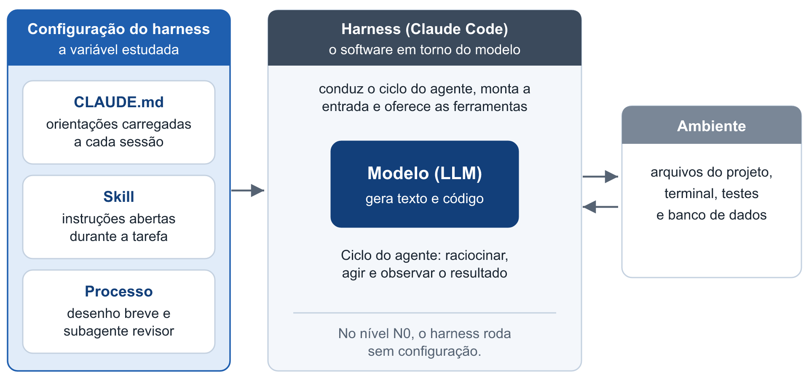
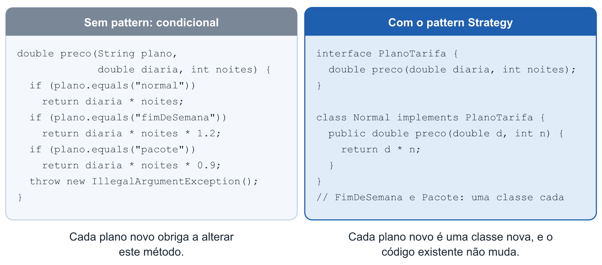
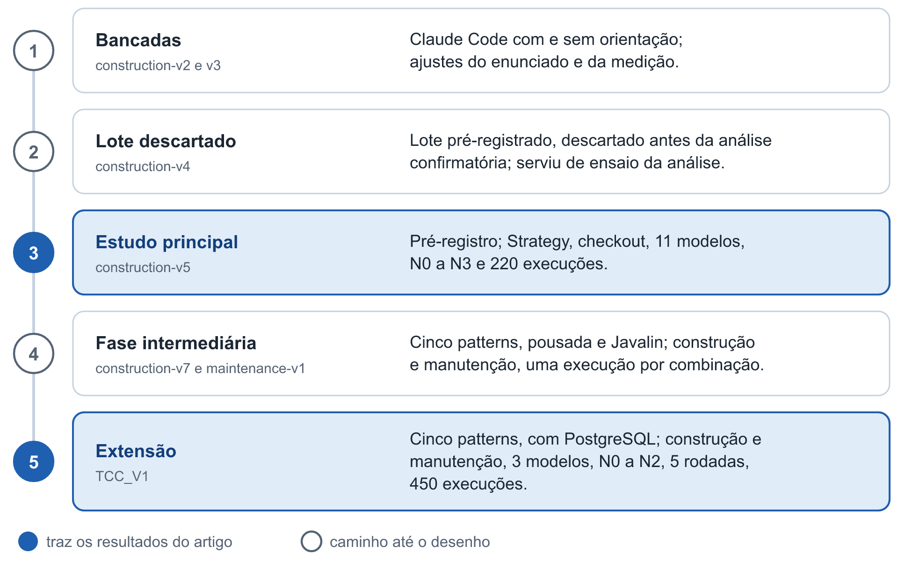
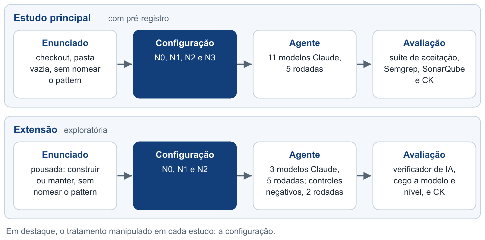
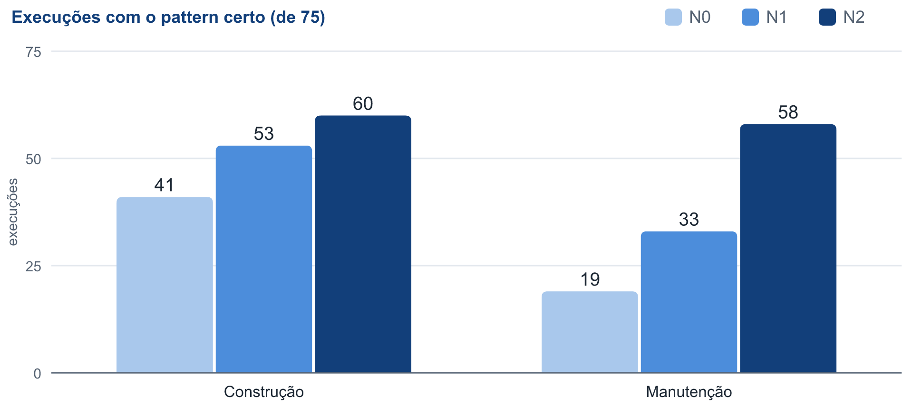
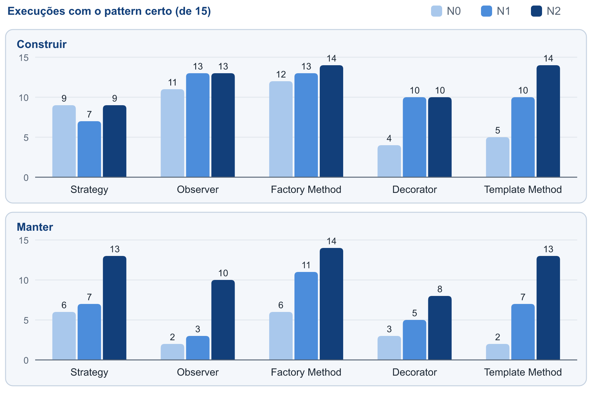

**Versão 40.** Seção 3: Zisa et al. (2026) também usam modelos de duas empresas (Gemini e GPT-4o), o que a comparação não dizia.

# Orientações de projeto e design patterns em agentes de programação: um estudo com pré-registro e sua extensão à manutenção

*Rascunho de 23/10/2026, com as cinco rodadas dos cinco patterns em 03/11/2026: o V5 como estudo principal e o TCC_V1
como extensão. Os números vêm dos
relatórios e do `DECISOES.md` de cada fase; os das cinco rodadas, de `rodadas-cinco-patterns.md`. Corrigido em 03/11/2026
com a leitura de textos publicados; preprints ficam de fora.*

## Resumo

Agentes de programação baseados em Grandes Modelos de Linguagem (LLMs) podem ser orientados por arquivos de projeto e
*skills*, que configuram o *harness* em volta do modelo. Este trabalho investiga como essas orientações mudam a forma como os agentes
aplicam *design patterns*. No estudo principal, com pré-registro, 11 modelos da família Claude construíram o mesmo
serviço de *checkout* em quatro níveis de orientação, com cinco réplicas (220 execuções). Um arquivo de princípios
levou o ponto mais difícil do padrão Strategy de 67% para 93% das execuções corretas, sem aumentar o exagero, sem piorar a correção e com menor complexidade cognitiva, em parte decorrente da própria troca de condicionais; o efeito veio dos seis modelos que não acertavam sozinhos. Uma extensão
exploratória, com cinco patterns, construção e manutenção, banco de dados e um verificador de qualidade calibrado (450
execuções), mostrou a mesma direção em nove das dez combinações de pattern e tarefa, e um efeito mais forte quando o
agente muda um código pronto (de 19 para 58 acertos em 75 com o arquivo e uma *skill* escrita para o estudo, contra 41 para 60 na construção; só com o arquivo, de 19 para 33, contra 41 para 53). As métricas de orientação a objetos, descritivas e analisadas depois dos resultados, sugerem o mecanismo: com
a orientação, o código troca condicionais por polimorfismo (mais interfaces e métodos abstratos), e o acoplamento médio
muda pouco.

## 1. Introdução

A Inteligência Artificial (IA) é a área da Computação dedicada a construir sistemas capazes de realizar tarefas que, em
geral, exigiriam inteligência humana [CITAR: definição de IA, fonte ainda não lida]. Entre esses sistemas, destacam-se
os Grandes Modelos de Linguagem (*Large Language Models*, LLMs), modelos treinados com grandes volumes de texto e
capazes de gerar texto a partir de uma entrada chamada *prompt*, inclusive código-fonte [Hou et al. 2024], e baseados na arquitetura Transformer [Vaswani et al. 2017; Brown et al. 2020]. Uma característica desses modelos é executar tarefas novas especificadas apenas por texto, sem ajuste de seus
parâmetros internos [Brown et al. 2020]. Assim, o que é escrito na entrada influencia o resultado produzido, e é sobre
esse ponto que este trabalho se concentra.

Quando um LLM passa a agir sobre um ambiente, surge a figura do agente: uma entidade que percebe o ambiente, toma
decisões e executa ações [Xi et al. 2025], em um ciclo de raciocinar, agir e observar o resultado [Yao et al. 2023]. Os
agentes de programação aplicam esse ciclo ao desenvolvimento de software: leem arquivos, escrevem código, executam
testes e usam o retorno obtido para decidir o passo seguinte. Esse laço iterativo com retorno do ambiente é o que os
distingue de um LLM usado de forma isolada [Liu et al. 2026]. O agente empregado neste trabalho é o Claude Code,
ferramenta da empresa Anthropic que recebe um pedido em linguagem natural e altera o projeto com autonomia [Anthropic
2026].

O modelo, contudo, não opera sozinho. As camadas de software em volta dele, que conduzem o ciclo do agente, montam a
entrada de cada chamada e oferecem as ferramentas disponíveis, formam o que se denomina *harness* [Galster et al. 2026].
Os desenvolvedores podem personalizar o *harness* de um projeto por meio de mecanismos de configuração, e é essa
configuração a variável estudada neste trabalho. Três mecanismos são considerados. O primeiro é o arquivo `CLAUDE.md`,
um texto com orientações do projeto que o Claude Code carrega a cada sessão, tratado como contexto, e não como regra
imposta [Anthropic 2026]. O segundo é a *skill*, um conjunto de instruções sobre um assunto cuja descrição fica sempre
disponível ao agente, enquanto o conteúdo só é carregado quando ela é usada [Anthropic 2026]. O terceiro é o processo,
aqui composto por um desenho breve anterior ao código e por um subagente revisor, isto é, um agente separado, com
contexto próprio, ao qual o agente principal delega uma tarefa [Anthropic 2026]. Essas orientações são persistentes
porque acompanham o projeto e valem para todos os pedidos, ao contrário do *prompt*, que vale para um único pedido. Em
repositórios públicos, os arquivos de contexto predominam, enquanto *skills* (5,5%) e subagentes (4,6%) ainda são pouco
adotados [Galster et al. 2026].

A Figura 1 resume a relação entre o modelo, o *harness* e a configuração estudada.

**Figura 1.** O modelo, o *harness* e a configuração estudada. Fonte: elaboração própria.

Essas orientações podem tratar de como o código deve ser organizado, e os padrões de projeto (*design patterns*, aqui
chamados de *patterns*) oferecem um caso propício para observar esse efeito. Um *pattern* é uma solução conhecida e
nomeada para um problema recorrente de projeto em orientação a objetos [Gamma et al. 1995]. O padrão Strategy, por
exemplo, coloca cada variação de um algoritmo em uma classe própria, atrás de uma interface comum, de modo que um novo
caso não obrigue a alterar uma cadeia de condicionais. Sua aplicação, porém, envolve uma decisão. Os próprios autores do
catálogo alertam que os *patterns* não devem ser aplicados indiscriminadamente, pois a flexibilidade custa indireção
[Gamma et al. 1995], e Fowler descreve como "generalidade especulativa" a flexibilidade criada para necessidades que
talvez nunca surjam [Fowler 2018]. Neste trabalho, o uso de um *pattern* onde ele não se justifica é chamado de exagero.
A evidência empírica com pessoas também não é uniforme: o efeito varia conforme o *pattern* e a tarefa [Prechelt et al.
2001; Vokáč et al. 2004], e ainda não há conhecimento suficiente para julgar quando cada um deve ser usado [Zhang e
Budgen 2012].

A decisão pode ocorrer em duas situações de desenvolvimento. Na construção, o agente parte de uma pasta vazia e cria o
sistema. Na manutenção, entendida como a modificação de um software existente que preserva suas funções principais
[Boehm 1976], o agente recebe um sistema pronto e um pedido de mudança. As duas situações são distintas porque, na
segunda, já existe um código que o agente pode apenas estender.

O tema é relevante porque o uso dessas ferramentas tem consequências observáveis sobre a qualidade do código. Em 806
repositórios que adotaram o Cursor, outra ferramenta de programação com IA, o ganho de velocidade durou cerca de dois
meses, enquanto o aumento de alertas de análise estática e da complexidade cognitiva persistiu [He et al. 2026]. Ao
mesmo tempo, o projeto de software recebe pouca atenção: em uma revisão de 395 artigos sobre LLMs em engenharia de
software, apenas 0,92% tratam dessa atividade [Hou et al. 2024]. Quanto às orientações persistentes, o efeito das regras
dadas a essas ferramentas é apontado como uma questão em aberto [Jiang e Nam 2026], e ainda faltam estudos controlados
sobre a contribuição de configurações mais ricas [Galster et al. 2026].

Diante desse cenário, este trabalho parte do seguinte problema de pesquisa: como a configuração do *harness* de um
agente de programação muda a forma como ele aplica *design patterns* quando o pedido não os menciona? Para responder a
essa pergunta, o objetivo geral é avaliar experimentalmente o efeito de orientações persistentes sobre a decisão do
agente de aplicar um *pattern*, tanto na construção quanto na manutenção. Foram realizados dois estudos. O estudo
principal conta com pré-registro, isto é, com o protocolo e as regras de decisão fixados antes da coleta dos dados
[Ernst e Baldassarre 2023]. Nele, 11 modelos da família Claude construíram o mesmo serviço de *checkout* em quatro
níveis de configuração, em 220 execuções, e o enunciado incluiu um controle negativo, ou seja, um ponto em que aplicar o
*pattern* seria exagero. A extensão, de caráter exploratório, abrange cinco *patterns*, três modelos e as tarefas de
construção e manutenção, em 450 execuções avaliadas por um verificador de IA calibrado.

Os objetivos específicos são os seguintes. No estudo principal, busca-se verificar como a configuração muda o uso do
*pattern* pedido (P1), o exagero e a correção do código (P2), como o efeito varia entre os modelos (P3) e como cada
componente da configuração contribui para ele (P4). Na extensão, busca-se verificar como o tipo de tarefa muda o efeito
em cinco *patterns* (P5), como respondem as demais dimensões de qualidade, a saber, o design do resto do código, arquitetura, testes, banco de dados e comportamento (P6), e quão estáveis são os resultados quando a mesma tarefa se repete (P7). Nos dois estudos,
descreve-se ainda como muda a estrutura orientada a objetos do código, em polimorfismo, tamanho das classes, acoplamento e, só no estudo principal, coesão (P8).

As contribuições deste trabalho são um experimento com pré-registro sobre o padrão Strategy, com 11 modelos e quatro
níveis de configuração; a extensão a cinco *patterns*, na construção e na manutenção, com banco de dados; um verificador
de qualidade em cinco dimensões, calibrado em casos de resposta conhecida; e a medida da estabilidade dos resultados em
cinco rodadas. Do ponto de vista prático, os resultados informam quem escreve orientações para agentes de programação
sobre o que esperar delas, e sobre o custo que podem trazer.

O restante deste artigo está organizado da seguinte forma: a Seção 2 apresenta os conceitos de orientação a objetos
usados para ler os resultados; a Seção 3 discute os trabalhos relacionados; a Seção 4 descreve o estudo principal; a
Seção 5 descreve a extensão; a Seção 6 responde às perguntas de pesquisa; a Seção 7 apresenta as limitações; e a Seção 8
conclui o trabalho.

## 2. Fundamentação: orientação a objetos e design patterns

Os cinco patterns estudados resolvem o mesmo problema de fundo: uma regra que muda conforme o caso (o plano de tarifa,
o tipo de hóspede, o interessado num aviso) e que vai ganhar casos novos. A resposta sem pattern é uma condicional
(`if` ou `switch`) que pergunta qual é o caso em cada lugar onde a regra aparece; cada caso novo obriga a mexer em todos
esses lugares. Os conceitos de orientação a objetos abaixo explicam por que a resposta com pattern é a esperada quando a variação vai crescer, e dão as
medidas usadas nos dois estudos.

**Encapsular o que varia.** A parte que muda de um caso para outro fica num objeto próprio, separada da parte estável
[Gamma et al. 1995]. É a ideia comum aos cinco patterns: o Strategy encapsula um algoritmo; o
Factory Method, a criação; o Observer, quem é avisado; o Decorator, um comportamento a mais em volta de outro; e o
Template Method, os passos que mudam dentro de uma sequência fixa.

**Polimorfismo no lugar da condicional.** Em vez de perguntar qual é o caso, o código chama um método, e cada caso
responde do seu jeito [Fowler 2018]. O mecanismo em Java é uma
interface (ou classe abstrata) com uma implementação por caso. Por isso, as classes da correção têm leitura direta em
orientação a objetos: **acerto** é a variação inteira atrás de uma interface, escolhida em um só lugar; **omissão** é a
condicional sobre o caso; **malfeito** é a interface que existe mas convive com condicionais sobre o caso.

A Figura 2 ilustra essa diferença com um exemplo simplificado, em que o preço de uma reserva depende do plano de tarifa.

**Figura 2.** A mesma regra com uma condicional e com o padrão Strategy (exemplo simplificado). Fonte: elaboração própria.

**O princípio aberto/fechado.** O caso novo deve entrar numa classe nova, sem mudar o código que já funciona. O princípio
vem de Meyer, que o resolve com herança [Meyer 1997]; a fórmula "aberto para
extensão, fechado para modificação", com interfaces, é de Martin [Martin 2003]. É o critério
que os textos dos cenários pressionam ao dizer que a variação vai crescer.

**Acoplamento e coesão.** Uma boa estrutura tem módulos pouco dependentes uns dos outros (baixo acoplamento) e cujos
elementos servem a um mesmo propósito (alta coesão) [Yourdon e Constantine 1978]. Os conceitos são
anteriores à orientação a objetos, e aplicá-los a classes é uma adaptação; a LCOM mede só um aspecto da coesão, o
compartilhamento de campos. Um pattern aplicado sem necessidade, o exagero, traz flexibilidade que custa indireção
[Gamma et al. 1995]; que isso apareça nas métricas de acoplamento é uma hipótese deste trabalho.

**As métricas.** Os dois estudos medem a estrutura com a ferramenta CK [Aniche 2015], que implementa versões das
métricas de Chidamber e Kemerer [Chidamber e Kemerer 1994], com regras próprias em alguns casos: **CBO** (com quantas outras classes uma classe se acopla), **LCOM** (no original, os pares
de métodos sem campo em comum menos os pares com algum em comum, com piso zero), **WMC** (a complexidade somada dos métodos
de uma classe), **RFC** (quantos métodos podem ser executados em resposta a uma mensagem: os da classe e os que eles chamam
diretamente) e **DIT** (a profundidade de herança). Somam-se as contagens de tipos (classes, interfaces, *enums*, *records*)
e de métodos abstratos, que mostram o uso de polimorfismo. Na versão usada da ferramenta (*commit* 8a1ef916), o CBO conta as dependências da classe, e o RFC, as chamadas únicas de método feitas nela, sem somar os métodos da própria classe [Aniche 2015].

## 3. Trabalhos relacionados

A capacidade de LLMs aplicarem *patterns* foi avaliada por Kim (2025), que comparou cinco modelos de empresas diferentes
na refatoração de dois programas Java sem *pattern*. O resultado foi medido contra propriedades de cada *pattern*
escritas em lógica de predicados, e a etapa que recebe nota nomeia o *pattern* e o local em que ele deve ser aplicado.
Kjellberg et al. (2026) investigaram estratégias para orientar 13 modelos de seis famílias a usar o padrão Singleton,
sempre nomeado no pedido e com a orientação dada no *prompt*, sem agente, sem controle negativo e sem manutenção. Zisa
et al. (2026) avaliaram a refatoração baseada em *patterns* com dois modelos, também com o *pattern* nomeado e sem
orientação persistente. O presente trabalho difere desses estudos em dois pontos: compara, para um mesmo modelo, níveis
de configuração, e não menciona o *pattern* no pedido, de modo que mede a decisão de usá-lo, e não apenas a qualidade da
implementação quando ele é solicitado. Em contrapartida, Kim (2025), Kjellberg et al. (2026) e Zisa et al. (2026) cobrem modelos de mais de
uma empresa, o que este trabalho não faz, e o critério por propriedades de Kim (2025) mostra qual parte do *pattern*
falhou, com uma resolução que as classes aqui adotadas não têm.

Ampatzoglou et al. (2026) estudaram a refatoração para *patterns* e princípios de projeto em um experimento em
cruzamento com dez desenvolvedores júniores. O uso do LLM aumentou a correção da implementação, enquanto os
participantes sem o LLM foram superiores na identificação do problema; na escolha da prática, não houve diferença. Neste
trabalho, não há uma pessoa conduzindo o modelo: um agente executa a tarefa sozinho, e avalia-se se a configuração o
leva a reconhecer a necessidade do *pattern*. No estudo principal, há ainda um ponto em que o *pattern* seria exagero,
situação ausente naquele estudo.

Os arquivos de contexto, como o `CLAUDE.md`, foram caracterizados por Chatlatanagulchai et al. (2026), em 2.303 arquivos
de 1.925 repositórios. O estudo descreve o que os desenvolvedores escrevem nesses arquivos, mas não mede, em experimento
controlado, o efeito deles sobre a qualidade do código. Arabat e Sayagh (2026) compararam 148 projetos antes e depois da
criação do arquivo, com resultado misto na aceitação de *pull requests* e sem medir o projeto do código, e Jiang e Nam
(2026) apontam o efeito de regras persistentes como questão em aberto. Este trabalho aborda essa questão ao manipular a
configuração e aplicar a mesma tarefa em cada nível.

Kim (2026) comparou três formas de organizar agentes (nove, quatro ou um), definidos por papel, objetivo e história, em
nove tarefas, das quais apenas uma é de código. Nenhuma configuração foi superior em todas as tarefas, e o autor sugere,
sem variar o modelo, que a capacidade do LLM pesa mais que a orquestração. Aqui, a variável não é a organização dos
agentes, mas o conteúdo de projeto das orientações, avaliado em vários modelos de uma mesma família.

Em conjunto, nenhum dos trabalhos lidos mede o efeito de orientações persistentes sobre a decisão de aplicar um
*pattern* não nomeado no pedido. Este trabalho faz essa medida em um estudo principal com pré-registro e com um controle
negativo para o exagero (220 execuções de 11 modelos), e em uma extensão a cinco *patterns*, na construção e na
manutenção, sem controle negativo (450 execuções).

## 4. Estudo principal: o Strategy com pré-registro

O trabalho passou por várias fases até chegar aos dois estudos que trazem os resultados deste artigo. Conforme a Figura 3, as bancadas e o lote descartado prepararam o estudo principal, e a fase intermediária preparou a extensão. Os números dessas fases não são somados aos dos dois estudos, porque o enunciado, o *framework*, o uso de banco de dados e a forma de correção mudaram entre elas. A Figura 4 compara o desenho dos dois estudos.

**Figura 3.** As fases do trabalho, até os dois estudos que trazem os resultados. Fonte: elaboração própria.

**Figura 4.** O desenho do estudo principal e o da extensão. Fonte: elaboração própria.

### 4.1 Método

**A tarefa.** O agente recebe uma pasta vazia e o enunciado de um serviço de *checkout* de uma loja online, a ser construído em
Java 21 e Spring Boot 4.1.1, escrito na voz do dono, que entende o básico de programação. O texto descreve as regras do negócio e, num anexo, o contrato da API
em linguagem simples, sem nenhuma palavra de arquitetura. Ele esconde quatro pontos que pedem o Strategy (frete, cupom,
forma de pagamento e o nível do clube de fidelidade, o mais difícil, chamado aqui de ponto do clube, em que um caso afeta
três regras) e um controle negativo (o seguro por região, em que só a porcentagem muda e o pattern seria exagero, chamado
aqui de ponto do seguro).

**Os níveis.** A escada acumula: **N0** o Claude Code sem configuração; **N1** um `CLAUDE.md` com princípios gerais, sem
nomear patterns; **N2** o N1 com uma *skill* pública de patterns [Grndlvl 2026]; **N3** o N2 com um processo (um
desenho curto antes do código e um subagente revisor do mesmo modelo). No pré-registro, que está congelado, essa
configuração é chamada de *harness*.

**Os modelos e as réplicas.** Os modelos Claude disponíveis no Claude Code em 10/10/2026, com exceção do Fable, deixado de fora pelo custo e por se esperar que já acertasse sem orientação, somam 11: Haiku 4.5 e 5.5,
Sonnet 4.5, 4.6, 5 e 5.5, Opus 4.6, 4.7, 4.8, 5 e 5.5. Cada modelo rodou os quatro níveis ao mesmo tempo, num quarteto
(para que horário e carga do servidor fossem iguais dentro do par), cinco vezes, em ordem sorteada: 220 execuções e 55
pares em cada comparação entre níveis vizinhos. O Claude Code, na versão 2.1.288, igual para todos os modelos, rodou como vem, com esforço *medium*, num contêiner.

**As medidas.** A **correção** é uma suíte de aceitação pela API, com 21 casos (12 contas e 9 recusas), verificada,
por escolha deste desenho, com 17 versões defeituosas escritas à mão, todas reprovadas por ela. O **desenho** é classificado pelo Semgrep [Semgrep 2026] (cada caso isolado; nenhuma condição
sobre o caso no cálculo), e a classificação foi conferida por um leitor humano, às cegas, em 44 pacotes. A
**qualidade** vem de métricas (complexidade cognitiva, linhas, classes, duplicação, pelo SonarQube [SonarSource 2026]; CBO, LCOM, WMC,
RFC e DIT, pelo CK), e o **custo**, dos tokens e do tempo. Das métricas de orientação a objetos, só o CBO e a LCOM
entraram nas hipóteses do pré-registro (a configuração muda o acoplamento e a coesão?); as demais são descritivas.

**As regras de decisão.** Cada hipótese tem uma regra escrita antes de rodar: direcional (a maioria dos modelos fora do
teto melhora, e nenhum piora), de não-inferioridade (o número de pares piores menos o de melhores não passa de 7 em 55), de alteração (sem direção) ou, na hipótese do modelo, de comparação entre modelos (o que menos acerta no N0 deve ter o maior saldo de pares). O "teto" é o modelo que já acerta nas cinco réplicas no nível de baixo da comparação (o N0, quando se compara o N1 com o N0): ali, a orientação só pode empatar ou
piorar.

### 4.2 Como o estudo foi protegido

Antes de medir, a bancada acumulou 119 execuções (62 até 06/10), que serviram para achar defeitos no enunciado, na suíte e na análise. Uma
primeira versão do lote (o V4) foi executada e descartada antes da análise confirmatória, porque o pré-registro dela separava os modelos
em dois lotes por um mal-entendido sobre quais entrariam nas conclusões; reescrevê-lo depois falsearia a data do
registro. O pré-registro do V5 foi congelado em 10/10, antes da primeira execução, com o *hash* de cada arquivo do
instrumento (122 arquivos) gravado em um repositório público (https://github.com/FLucasF/TCC, *commit* 54e13fc9), o que
permite verificar a data do registro. Antes do congelamento, os dados do V4 serviram apenas de ensaio geral da análise, para
testar o fluxo. O ensaio achou um defeito real no Semgrep (projetos numa subpasta não eram lidos), corrigido antes do
congelamento. O agente de IA que operou o ensaio teve acesso aos resultados; o autor viu apenas informações operacionais,
sem a direção de nenhum efeito.

### 4.3 Resultados

**Tabela 1.** O estudo principal por nível (55 execuções em cada).

| medida | N0 | N1 | N2 | N3 |
|---|---|---|---|---|
| ponto do clube certo | 67% | 93% | 93% | 98% |
| exagero no controle negativo (ponto do seguro) | 0% | 2% | 5% | 0% |
| suíte de aceitação inteira (21 casos) | 71% | 84% | 80% | 87% |
| complexidade cognitiva (média) | 33,7 | 22,9 | 23,5 | 22,5 |
| linhas de código (média) | 519 | 584 | 614 | 571 |
| custo médio por execução (US$) | 1,32 | 1,52 | 1,47 | 1,98 |

A conferência humana concordou com o Semgrep em 174 de 176 respostas, e as quatro perguntas de desenho atingiram a regra de
saída do pré-registro (ao menos 40 de 44 respostas iguais), de modo que a classificação do Semgrep vale para os 220 pacotes. Das cinco hipóteses principais (N1 contra N0), quatro foram apoiadas: o `CLAUDE.md` isola os casos do ponto do clube, não
piora a correção (em 55 pares, três a mais melhoraram do que pioraram, dentro do limite pré-registrado), reduz a complexidade e teve o maior saldo no Opus 4.7 (+5), um dos dois modelos que menos acertavam no N0; o outro, o Haiku 4.5, teve saldo +1, e a regra registrada antes dos dados exige, em caso de empate, que o maior saldo seja de um deles. A do exagero foi contrariada no sentido de que a configuração não muda o exagero (1 par diferente em 55).

O efeito veio dos modelos fora do teto. Cinco modelos (Sonnet 5.5, Opus 4.6, 4.8, 5 e 5.5) acertavam o ponto do clube nas cinco
réplicas sem orientação. Nos outros seis, o N1 teve 14 pares melhores e nenhum pior; o Opus 4.7 foi de 0 para 5 acertos
em 5, e o Haiku 4.5, o mais fraco, de 0 no N0 para 1 no N1 e 4 no N3. Na tendência de N0 a N3, publicada como informação e sem decidir nenhuma
hipótese, o acerto do ponto do clube subiu (teste de Page, p = 0,007) e a complexidade caiu (p < 0,001). A *skill* (N2 contra N1) ficou inconclusiva: dez dos 11 modelos já estavam no teto no N1, e ela não foi aberta espontaneamente em nenhuma das 110 execuções que a tinham. O processo (N3 contra N2) teve efeito apoiado no desenho, decidido por um único modelo fora do teto (o Haiku 4.5, com 3 pares melhores em 5), e no exagero; neste, a queda é pequena em números absolutos, de 3 execuções em 55 para nenhuma. O lote custou US$ 346 em equivalente de API.

**A estrutura orientada a objetos.** A Tabela 2 mostra as métricas do CK por nível.

**Tabela 2.** Métricas de orientação a objetos no estudo principal (55 execuções por nível).

| medida | N0 | N1 | N2 | N3 |
|---|---|---|---|---|
| tipos com nome (classes, interfaces, *enums*, *records*), média | 22,0 | 28,0 | 30,2 | 27,7 |
| interfaces, média | 1,8 | 2,9 | 3,4 | 2,9 |
| constantes de *enum* com corpo próprio e classes anônimas, média | 1,9 | 4,0 | 2,7 | 4,0 |
| WMC da maior classe, mediana | 35 | 24 | 22 | 25 |
| CBO médio do projeto, mediana | 2,43 | 2,48 | 2,59 | 2,35 |
| LCOM médio do projeto, mediana | 2,97 | 2,48 | 2,78 | 2,69 |
| LCOM médio do projeto, percentil 90 | 37,2 | 11,1 | 9,1 | 4,9 |
| DIT máximo, média | 3,8 | 3,6 | 3,8 | 3,8 |

Com a configuração, os projetos têm mais tipos e mais interfaces, e também mais constantes de *enum* com corpo próprio,
que é o Strategy escrito como *enum* (cada constante com o seu comportamento). A maior classe do projeto fica menor (o
WMC dela cai de 35 para 24 na mediana): a lógica que ficava concentrada numa classe com condicionais se espalha por
classes menores. O acoplamento médio não muda (o CBO fica perto de 2,5 em todos os níveis), e a herança também não (o
DIT máximo perto de 3,8). A hipótese pré-registrada do CBO e a da LCOM foram contrariadas, no sentido de que o
a configuração não muda o acoplamento nem a coesão médios de forma consistente entre os pares. A mediana da LCOM confirma
isso; o que muda é a cauda: os projetos com as classes menos coesas ficam mais raros com orientação (o percentil 90 cai de 37,2 para 11,1 no N1; seis projetos têm LCOM média de 37,2 ou mais no N0, um no N2 e nenhum no N1 e no N3).

## 5. Extensão: cinco patterns, construção e manutenção

### 5.1 Por que estender, e o caminho até o desenho

O estudo principal deixou três pontos abertos: o teto (cinco dos 11 modelos não tinham o que melhorar), um pattern só e
a manutenção, que estava fora do recorte. Uma fase intermediária mediu cinco patterns (Strategy, Observer, Factory
Method, Decorator, Template Method) num domínio novo, uma pousada, na manutenção e na construção, com uma execução por
combinação e a correção feita por uma IA calibrada. Ela trouxe quatro mudanças para o desenho final. O *framework* passou de Spring Boot, usado no estudo principal, para Javalin, ainda durante essa fase, porque o Spring entrega pronto parte do que se mede (eventos, contêiner de objetos, aspectos). O princípio "o próximo caso num lugar só" foi lido como "num método só" no Decorator, e o `CLAUDE.md` ganhou
duas precisões. E a *skill* pública, quando o agente a abria passando uma pergunta como argumento, levou um modelo a responder em texto e entregar a pasta vazia; a instrução passou de "consulte" para "use", e ela foi trocada, também por ser um catálogo extenso que não separa *patterns* vizinhos, por uma *skill* escrita para o trabalho, com um processo de
decisão curto, uma referência por pattern e exemplos fora do domínio da pousada. Por fim, três dos cinco enunciados
(Observer, Decorator e Template Method) ganharam uma frase, na voz do dono, que reforça que a variação vai crescer, sem
dizer como organizar o código; os do Strategy e do Factory Method ficaram iguais.

### 5.2 Método

O sistema é o de reservas da Pousada Maré Alta, em Java 21 com Javalin e os dados num PostgreSQL 18. Na **construção**,
o agente recebe uma pasta vazia e o enunciado do sistema inteiro, na voz do dono; os testes não são pedidos. Na
**manutenção**, recebe o sistema pronto, sem nenhum pattern, com o esquema em migrações e 26 testes, e um pedido de
mudança. Cada um dos cinco cenários pede um pattern sem dizer o nome. Os níveis são N0, N1 (o `CLAUDE.md`) e N2 (o
`CLAUDE.md` e a *skill*); os modelos, Claude Haiku 4.5, Sonnet 4.5 e Sonnet 5.5, com esforço *medium*, cada execução
com um banco só dela.

Cada projeto foi revisado por um agente (Claude Opus 5.5), às cegas quanto ao modelo e ao nível (ele recebe o enunciado, o *pattern* esperado e o projeto, sem o `CLAUDE.md` e a pasta `.claude/`), com uma *skill* por dimensão e um *script* de medição em arquitetura, testes, banco e comportamento: arquitetura (dependências e ciclos entre pacotes, pelo jdeps), design de baixo nível (a classe do pattern, que é acerto, alternativa equivalente, malfeito ou omissão, e uma nota para o design do resto do código), testes (contagem e cobertura, pelo JaCoCo [JaCoCo 2026]), banco (o esquema,
pelo `pg_dump`, e conferências simples) e comportamento (um roteiro de chamadas à API por cenário). Cada dimensão recebe **bom**, **com problemas** ou **ruim**. O verificador registra ainda o exagero, isto é, a estrutura sem necessidade fora da parte que o pattern resolve, como uma interface com uma só implementação que nada substitui. São, portanto, sete notas por execução. Antes de valer, o verificador foi calibrado em 26 casos de resposta
conhecida (as soluções de referência, com e sem o pattern, e seis exemplos estragados de propósito): as 52 notas esperadas conferiram, sendo 20 da classe do pattern, 20 do comportamento e 4 de cada uma destas: arquitetura, testes e banco. Cada combinação de tarefa, cenário, modelo e nível teve cinco rodadas, 450 execuções ao todo: o
piloto (90), depois as repetições do pattern que mais errou (Decorator) e do que mais acertou (Factory Method) (144), e
por fim as dos outros três (216). Fora da revisão, o mesmo CK do estudo principal (a mesma versão, conferida pelo
*hash*, com as mesmas regras de resumo) mediu as 449 execuções com código, como descrição.

### 5.3 Resultados

**Tabela 3.** Execuções boas por dimensão, tarefa e nível (cinco rodadas, 75 por nível; no pattern, acerto ou
alternativa).

| dimensão | Construir N0 | N1 | N2 | Manter N0 | N1 | N2 |
|---|---|---|---|---|---|---|
| pattern | 41 | 53 | 60 | 19 | 33 | 58 |
| design do resto do código | 15 | 23 | 20 | 14 | 25 | 25 |
| arquitetura | 16 | 9 | 16 | 58 | 57 | 68 |
| testes | 11 | 9 | 6 | 25 | 37 | 25 |
| banco | 0 | 0 | 0 | 65 | 62 | 66 |
| comportamento | 25 | 25 | 25 | 61 | 59 | 54 |

A Figura 5 destaca a primeira linha da Tabela 3: do N0 ao N2, as execuções com o *pattern* certo sobem de 41 para 60 na construção e de 19 para 58 na manutenção.

**Figura 5.** Execuções com o *pattern* certo por nível e tarefa, na extensão (75 por nível). Fonte: elaboração própria.

**Tabela 4.** Execuções com o pattern certo em cinco rodadas.

| pattern | tarefa | N0 | N1 | N2 |
|---|---|---|---|---|
| Strategy | construir | 9 de 15 | 7 de 15 | 9 de 15 |
| Strategy | manter | 6 de 15 | 7 de 15 | 13 de 15 |
| Observer | construir | 11 de 15 | 13 de 15 | 13 de 15 |
| Observer | manter | 2 de 15 | 3 de 15 | 10 de 15 |
| Factory Method | construir | 12 de 15 | 13 de 15 | 14 de 15 |
| Factory Method | manter | 6 de 15 | 11 de 15 | 14 de 15 |
| Decorator | construir | 4 de 15 | 10 de 15 | 10 de 15 |
| Decorator | manter | 3 de 15 | 5 de 15 | 8 de 15 |
| Template Method | construir | 5 de 15 | 10 de 15 | 14 de 15 |
| Template Method | manter | 2 de 15 | 7 de 15 | 13 de 15 |

Do N0 ao N2, o pattern certo aumenta em nove das dez combinações; a décima, o Strategy na construção, fica igual, e o
Sonnet 5.5 acerta ali as 15 execuções em qualquer nível. Por modelo, o Sonnet 5.5 vai de 22 a 25 acertos em 25 na
construção e de 11 a 25 na manutenção; o Sonnet 4.5, de 14 a 22 e de 5 a 20; o Haiku 4.5, de 5 a 13 e de 3 a 13.

Construindo, 59 das 225 execuções deixaram o mesmo quarto ser reservado duas vezes quando dois pedidos chegam juntos, e
16 não chegaram a esse teste; mantendo, nenhuma das 225 deixou, e todas aplicaram as migrações. O Sonnet 5.5 teve o
comportamento bom nas 150 execuções; o Haiku 4.5, construindo, não teve em nenhuma das 75, com a nota ruim em 71. O
exagero no restante do código, já que a extensão não tem cenário de controle, foi de 4, 5 e 9 execuções em 75 na
construção (N0, N1 e N2) e de 0, 1 e 2 na manutenção. O resultado da primeira
rodada (pattern certo ou não) se repetiu em 294 das 360 rodadas novas (82%), e 54 das 90 combinações deram o mesmo
resultado nas cinco rodadas.

A Figura 6 apresenta os mesmos dados da Tabela 4 por *pattern* e tarefa, e evidencia tanto a exceção do Strategy na construção quanto o maior ganho na manutenção.

**Figura 6.** Execuções com o *pattern* certo por *pattern*, nível e tarefa, na extensão (15 por combinação). Fonte: elaboração própria.

**A estrutura orientada a objetos.** A Tabela 5 mostra o CK por nível, e a Tabela 6 cruza o CK com a classe que o
verificador deu ao pattern, nas 449 execuções com código.

**Tabela 5.** Métricas de orientação a objetos na extensão (cinco rodadas, médias de 75 execuções por nível; 74 em
Construir N2, em que uma execução não escreveu código).

| medida | Construir N0 | N1 | N2 | Manter N0 | N1 | N2 |
|---|---|---|---|---|---|---|
| tipos com nome | 26,0 | 29,7 | 31,1 | 29,5 | 30,4 | 32,4 |
| interfaces | 1,39 | 1,51 | 1,66 | 0,37 | 0,40 | 0,80 |
| métodos abstratos | 0,07 | 0,47 | 2,03 | 0,09 | 0,69 | 1,17 |
| WMC da maior classe | 40,8 | 37,3 | 38,3 | 32,3 | 31,7 | 30,9 |
| CBO médio do projeto | 3,27 | 3,38 | 3,48 | 3,29 | 3,30 | 3,45 |

**Tabela 6.** Métricas de orientação a objetos pela classe do pattern (médias; cinco rodadas, 449 execuções com código).

| tarefa | classe | execuções | interfaces | métodos abstratos | tipos com nome | WMC da maior classe | CBO médio |
|---|---|---|---|---|---|---|---|
| construir | acerto | 126 | 1,84 | 1,44 | 30,4 | 37,4 | 3,45 |
| construir | alternativa equivalente | 28 | 2,43 | 0,21 | 34,8 | 33,2 | 3,29 |
| construir | malfeito | 29 | 1,07 | 0,10 | 28,8 | 43,2 | 3,42 |
| construir | omissão | 41 | 0,22 | 0 | 20,5 | 43,9 | 3,18 |
| manter | acerto | 99 | 0,61 | 1,48 | 31,6 | 31,5 | 3,46 |
| manter | alternativa equivalente | 11 | 1,09 | 0 | 34,2 | 30,0 | 3,06 |
| manter | malfeito | 60 | 0,77 | 0 | 31,3 | 30,9 | 3,33 |
| manter | omissão | 55 | 0 | 0 | 28,0 | 33,0 | 3,21 |

Os métodos abstratos sobem com a orientação nas duas tarefas, e mais com a *skill* (de 0,07 para 2,03 na construção; de
0,09 para 1,17 na manutenção): é o sinal das classes abstratas do Template Method e do Factory Method: no N2, a média é de 4,87 e 3,60 métodos abstratos no primeiro (construir e manter), de 4,20 e 2,13 no segundo, e de apenas 0,33 e 0 no Decorator. A maior
classe fica um pouco menor, e o acoplamento médio sobe pouco (cerca de 0,2 nas duas tarefas). A Tabela 6 mostra que as
métricas acompanham a leitura do verificador: os projetos com omissão quase não têm interfaces nem métodos abstratos; os
de acerto usam métodos abstratos; os de alternativa equivalente, que resolvem a variação com uma lista de regras (no Decorator) ou com um escritor genérico que recebe as partes que variam (no Template Method), usam
interfaces e quase nenhum método abstrato. O CBO médio não separa as classes (fica entre 3,0 e 3,5 em todas).

## 6. Discussão

Cada resposta diz de onde vem a evidência: do estudo principal, com pré-registro, ou da extensão, exploratória.

**P1. Como a configuração do *harness* muda o uso do pattern?** *(com pré-registro; na extensão, exploratória, na mesma direção)* Ela aumenta o uso
correto. No estudo principal, o ponto difícil do Strategy foi de 67% para 93% só com o `CLAUDE.md`. Na extensão, a
mesma direção aparece em nove das dez combinações de pattern e tarefa: na manutenção, de 19 para 33 e 58 acertos em 75;
na construção, de 41 para 53 e 60. A exceção merece registro, porque é o pattern do estudo principal: o Strategy na
construção ficou em 9, 7 e 9 acertos em 15. O enunciado e o domínio são outros, os três modelos são parte dos 11 do estudo principal, e o Sonnet 5.5 já acerta sozinho, de modo que sobram 10 execuções por nível para mostrar efeito; a extensão, portanto, não reproduz o efeito do
estudo principal nesse ponto.

**P2. Como ela muda o exagero e a correção?** *(com pré-registro no estudo principal; exploratória na extensão)* No estudo principal, o `CLAUDE.md` e a *skill* não mudam o exagero, que ficou entre 0% e 5% em todos os níveis; só a passagem do N2 para o N3 foi apoiada como queda, de 3 execuções em 55 para nenhuma. A correção não piora, e a complexidade cai;
em troca, as linhas sobem, as classes aumentam na média, embora a hipótese correspondente tenha ficado inconclusiva, e a duplicação também sobe (de 1,2% para 2,5% das linhas, com a hipótese de não repetir o comum contrariada). O código fica menos complexo e maior. A extensão pede cautela: com a *skill*, na
construção, o exagero chegou a 9 execuções em 75 (12%), contra 4 no N0, com 6 delas no Sonnet 4.5; na manutenção, foram
2 em 75. Os números são pequenos, mas a direção não é a de ausência de custo.

**P3. Como o efeito varia entre os modelos?** *(com pré-registro)* Ele se concentra nos modelos que não acertam
sozinhos: nenhum dos seis modelos fora do teto piorou no ponto do clube, embora, na correção, o Haiku 4.5 tenha piorado nos cinco pares (saldo -5), o que a não-inferioridade do conjunto não mostra; o maior ganho foi do Opus 4.7, que, empatado com o Haiku 4.5, era o que menos acertava o ponto do clube no N0 (0 de 5), abaixo de modelos menores como o Haiku 5.5 (3 de 5). Na extensão, o modelo pesa mais que a orientação nas outras
dimensões: o Sonnet 5.5 sem orientação supera o Haiku 4.5 com a *skill* em todas elas, salvo o banco na construção, em
que os dois têm zero. No próprio pattern, porém, a orientação alcança o modelo: mantendo, o Haiku 4.5 com a *skill*
(13 em 25) passa o Sonnet 5.5 sem orientação (11 em 25).

**P4. Como cada componente contribui?** *(com pré-registro, e matizado na extensão)* O `CLAUDE.md` faz a maior parte do
efeito. A *skill* pública não acrescentou efeito mensurável: a hipótese ficou inconclusiva, com dez dos 11 modelos já no teto no N1, e a *skill* não foi aberta em nenhuma execução; o processo (N3) melhorou o desenho em um único modelo fora do teto (o Haiku 4.5) e reduziu, de 3 execuções em 55 para nenhuma, o exagero. Na extensão, com a instrução de usar a *skill*, ela acrescentou acertos sobretudo na manutenção (de 33 para 58 em 75, contra 53 para 60 na construção), sem mudar o número de acertos do Decorator na construção (10 de 15 no N1 e no N2), embora tenha mudado sua forma (a forma literal do
Decorator apareceu com ela, nas dez rodadas do Sonnet 5.5 e em uma do Sonnet 4.5, e nunca sem ela). Na fase intermediária, com a *skill* pública e a instrução de consultá-la, ela mostrou um risco: aberta com uma pergunta, levou um modelo (o Sonnet 4.5) a responder em texto e parar sem programar. O risco voltou nas cinco rodadas,
com a *skill* escrita para o trabalho: construindo o Strategy, numa rodada, o Haiku 4.5 abriu a *skill* com os planos de
tarifa como argumento, anunciou que ia implementar e terminou ali, sem código.

**P5. Como o tipo de tarefa muda o efeito?** *(exploratória)* O efeito é maior na manutenção. Diante de um código que
já funciona, o agente sem orientação tende a acrescentar mais uma condição (19 acertos em 75 no N0, contra 41 na
construção), e a orientação reduz esse hábito, sobretudo com a *skill* (58 em 75 no N2, contra 60).

**P6. Como as outras dimensões respondem?** *(exploratória)* O design do resto do código acompanha a orientação (de 14 para 25 em 75 na manutenção e de 15 para 20 ou 23 na construção), enquanto arquitetura, testes, banco e comportamento oscilam sem direção clara. Nessas últimas, pesam o modelo e o ponto de partida: mantendo, o agente conserva a arquitetura, as migrações e as restrições do banco que a base já tem;
construindo, nenhuma das 225 execuções aplicou migrações (uma escreveu os arquivos, e o serviço não subiu). A configuração
fala de estrutura, e é ali que age.

**P7. Quão estáveis são os resultados?** *(exploratória)* O resultado da primeira rodada se confirmou em 82% das
repetições, o que mostra que uma execução isolada não basta. A variação acompanha o modelo (de 120 repetições, 89 no
Haiku 4.5, 96 no Sonnet 4.5 e 109 no Sonnet 5.5), e não o nível (96, 103 e 95 de 120 no N0, N1 e N2). Com orientação, o
Sonnet 5.5 repetiu o resultado em 19 das 20 combinações. Alguns erros são constantes: o Sonnet 5.5, mantendo sem
orientação, não acertou o Factory Method em nenhuma das cinco rodadas, e acertou nas dez com orientação.

**P8. Como muda a estrutura orientada a objetos?** *(descritiva, salvo o CBO e a LCOM do estudo principal)* A
orientação troca a condicional pelo polimorfismo, como a Seção 2 prevê: os projetos ganham interfaces (no estudo
principal), métodos abstratos (na extensão, sobretudo com a *skill*) e constantes de *enum* com comportamento próprio,
e os projetos com omissão quase não têm nenhum desses mecanismos. A complexidade sai da classe que concentrava as
condicionais e se distribui: a maior classe encolhe, e o projeto ganha classes. No estudo principal, essa troca não
aumentou o acoplamento médio, e a coesão média também não mudou de forma consistente; o que diminuiu foi a cauda de projetos com classes muito pouco coesas. Na extensão, o acoplamento médio sobe pouco (de 3,27 para 3,48 construindo, de
3,29 para 3,45 mantendo). Em termos do princípio aberto/fechado, o código com orientação tem a forma que o princípio prevê (uma classe nova atrás de uma interface), com pouca mudança nas dependências por classe, embora este trabalho não tenha medido o custo de acrescentar um caso novo. Como o número de classes sobe, o
total de dependências cresce: multiplicando o CBO médio pelos tipos, conta aproximada, o aumento em relação ao N0 fica entre cerca de 22% e 46% no estudo principal e entre cerca de 3% e 27% na extensão. O CBO médio, portanto, não basta para dizer que a estrutura nova não é exagero, e também não distingue as classes do
pattern, de modo que não serve sozinho para dizer se o pattern foi aplicado.

**A trajetória do estudo.** O desenho mudou várias vezes, e cada mudança tem data e motivo registrados; parte delas foi feita depois de observar resultados da fase anterior. O lote descartado (o V4) foi descartado antes da análise confirmatória; as mudanças da extensão vieram de problemas de método (o teto, o *framework* que entregava o pattern pronto, a *skill* que travava o agente) e também de resultados observados antes: as precisões do `CLAUDE.md`, a frase de três enunciados e a linha da *skill* no N2 da manutenção responderam a execuções anteriores, e a escolha dos *patterns* repetidos primeiro seguiu os acertos do piloto. O aumento do *pattern* certo apareceu na mesma direção nos dois estudos, com enunciados e correções diferentes e um subconjunto de três dos 11 modelos; a ausência de aumento do exagero, porém, foi verificada apenas no estudo principal, o
único com controle negativo.

## 7. Limitações

**De todo o experimento.**
- O vazamento implícito de dados de treino é uma ameaça em estudos com LLMs [Sallou et al. 2024]; como os *patterns* clássicos são amplamente documentados, é provável que estejam nos dados de treino dos modelos, de modo que aplicá-los pode ser repetição de memória, e não raciocínio. O controle negativo do estudo principal reduz essa ameaça apenas em parte.
- Um só fornecedor, por restrição de custo: todos os modelos executores e o verificador são da Anthropic, sem modelo aberto
  como linha de base, o que limita a generalização para outros fornecedores.

**Do estudo principal.**
- Uma só família de modelos e um só agente: não se separa o efeito da configuração do efeito do par formado pelo modelo e pelo agente.
- Um só leitor humano conferiu o Semgrep, e a releitura prevista no pré-registro não foi feita (desvio registrado).
- O enunciado traz o contrato da API, o que dá realismo menor em troca de uma correção igual para todos.
- A complexidade cognitiva foi escolhida como hipótese principal depois de um ensaio anterior, em que foi a métrica que mais mudou com a configuração; os dados do estudo principal são novos, mas a escolha da hipótese não foi independente daquele ensaio.

**Da extensão.**
- As orientações (o `CLAUDE.md` e a *skill*) foram escritas por quem conhece as tarefas e o critério, o que tende a
  favorecer os níveis com orientação.
- As orientações e três enunciados foram ajustados depois de observar a fase intermediária, e as duas precisões acrescentadas ao `CLAUDE.md` chegam mais perto de dois cenários (o Decorator e o Template Method) do que os princípios anteriores, o que tende a favorecer os níveis com orientação nesses cenários. A frase acrescentada aos
  enunciados reforça que a variação vai crescer e pode ter aumentado os acertos; como vale para os três níveis, ela não
  favorece nenhum deles, mas os números absolutos não se comparam com os da fase intermediária.
- Não há controle negativo na extensão: os cinco cenários pedem um *pattern*. O exagero foi medido apenas no restante
  do código, e não em um cenário em que o *pattern* não se justifica. Por isso, a extensão não mostra se a configuração
  leva o agente a se conter quando o *pattern* não cabe, ponto que só o estudo principal testa.
- O trabalho mede se o agente aplica o *pattern* esperado, e não se ele facilita as mudanças seguintes. O ganho de um
  *pattern* varia conforme o *pattern* e a tarefa [Prechelt et al. 2001; Vokáč et al. 2004], e ainda não há
  conhecimento suficiente para julgar quando cada um compensa [Zhang e Budgen 2012].
- A correção é feita por uma IA; foi calibrada (52 de 52, depois de uma primeira rodada com 50 de 52, após a qual os testes de duas soluções foram completados e entrou a regra de que cada defeito pesa em uma só coluna), mas a nota resume uma leitura, e a calibração não cobriu o design do resto do código nem o exagero; na classe do *pattern*, testou apenas acerto e omissão, sem malfeito nem alternativa equivalente, e, no comportamento, apenas casos com a nota bom. Um segundo modelo da mesma
  empresa (Claude Fable 5.1), com o mesmo agente e as mesmas *skills*, revisou às cegas 30 execuções sorteadas, e
  195 de 210 notas coincidiram com as do verificador oficial. A classe do *pattern* e a arquitetura coincidiram em 30 de
  30; comportamento e exagero, em 29; banco, em 27; testes, em 26; e design, em 24 (kappa de Cohen de 0,53, o mais
  baixo). Nas 15 diferenças, o segundo modelo foi sempre um degrau mais brando, de modo que as demais notas do verificador
  oficial podem ser um pouco mais severas do que as de outro avaliador. Isso mostra que a leitura se repete, e não que está
  certa: modelos podem concordar entre si sem concordar com humanos [Wang et al. 2025], e
  trocar todos os avaliadores humanos é arriscado [Ahmed et al. 2025]. Não substitui um avaliador humano nem um
  modelo de outra empresa.
- As repetições do Factory Method e do Decorator são de 22/10, e as dos outros três *patterns*, de 01 e 02/11, com a mesma imagem. Dentro de cada cenário e rodada, os níveis rodaram em um intervalo de até 10 horas, o que preserva a comparação entre níveis, mas dificulta a comparação entre *patterns*. A escolha de quais repetir primeiro foi feita depois de ver o piloto.
- Cinco rodadas por combinação: o número veio do custo, e não de um cálculo de poder, e fica abaixo do piso de dez repetições sugerido para algoritmos randomizados [Arcuri e Briand 2014]. Por isso, a extensão descreve as
  diferenças, sem teste de significância.
- O ambiente não tinha Docker dentro do contêiner do agente, o que derrubou os testes de integração que dependiam dele.

**Das métricas de orientação a objetos.**
- Só o CBO e a LCOM do estudo principal têm hipótese no pré-registro; as outras métricas, e todas as da extensão, foram
  analisadas depois de conhecer os resultados e entram como descrição.
- As médias por projeto escondem a distribuição entre as classes; por isso, a LCOM é mostrada com a mediana e o
  percentil 90, e a maior classe é medida à parte.
- Na LCOM de Chidamber e Kemerer, o valor zero não indica coesão máxima [Chidamber e Kemerer 1994], e ela
  não teve relação significativa com falhas em Basili et al., cuja amostra é de 180 classes C++ de alunos [Basili et al. 1996]. Os números dela comparam níveis, e não valem como limite absoluto.
- A complexidade cognitiva conta as condicionais por construção [Campbell 2018]. Por isso, a queda dela com a
  orientação não é evidência independente da mudança de desenho. Ela indica esforço de leitura, e não correção [Muñoz Barón et al. 2020].

## 8. Conclusão

O estudo principal, com pré-registro, mostra que um arquivo de princípios aumenta o uso correto do padrão Strategy
(de 67% para 93%), sem aumentar o exagero, sem piorar a correção e com menor complexidade cognitiva, em parte decorrente da própria troca de condicionais, e que o efeito vem dos
modelos que não acertam sozinhos. A extensão, com cinco rodadas, mostra a mesma direção em nove das dez combinações de
pattern e tarefa, com a exceção do Strategy na construção; o efeito é mais forte quando o agente muda um código pronto,
e nas outras dimensões de qualidade o modelo e o ponto de partida pesam mais que a orientação. Na construção com a
*skill*, o exagero sobe de 4 para 9 execuções em 75. As métricas de orientação a objetos, descritivas e analisadas depois dos resultados, sugerem o mecanismo: a
orientação troca condicionais por polimorfismo e distribui a complexidade por mais classes, com pouca mudança no
acoplamento médio. Como trabalhos futuros, ficam outras famílias de modelos e de agentes; a leitura humana das notas do
verificador; cenários de controle negativo na extensão; e a medida do ganho do *pattern*, pedindo um novo caso sobre o
código gerado e contando quantos lugares precisam mudar e quantos comportamentos antigos se quebram.

## Referências

[CITAR: uma definição de IA, fonte ainda não lida]

Ahmed, T.; Devanbu, P.; Treude, C. e Pradel, M. (2025). Can LLMs Replace Manual Annotation of Software Engineering Artifacts? *MSR 2025*, 526-538.

Ampatzoglou, A.; Arvanitou, E.-M.; Almpanopoulos, S.; Mittas, N.; Chatzigeorgiou, A. (2026). AI-assisted code refactoring: Where can it be helpful and where do humans outperform it? *Journal of Systems and Software*, 238, 112862. doi:10.1016/j.jss.2026.112862

Anthropic (2026). *How Claude remembers your project*; *Extend Claude with skills*; *Create custom subagents*. https://code.claude.com/docs/en. Acesso em 02/11/2026.

Aniche, M. (2015). *Java code metrics calculator (CK)*. https://github.com/mauricioaniche/ck/. Acesso em 03/11/2026.

Arabat, A. e Sayagh, M. (2026). Toward Instructions-as-Code: Understanding the Impact of Instruction Files on Agentic Pull Requests. *MSR '26*, 969-973. doi:10.1145/3793302.3793601

Arcuri, A. e Briand, L. (2014). A Hitchhiker's guide to statistical tests for assessing randomized algorithms in software engineering. *Software Testing, Verification and Reliability*, 24(3), 219-250. doi:10.1002/stvr.1486

Basili, V. R.; Briand, L. C. e Melo, W. L. (1996). A validation of object-oriented design metrics as quality indicators. *IEEE TSE*, 22(10), 751-761. doi:10.1109/32.544352

Boehm, B. W. (1976). Software Engineering. *IEEE Transactions on Computers*, C-25(12), 1226-1241.

Brown, T. B. et al. (2020). Language Models are Few-Shot Learners. *NeurIPS 2020*.

Campbell, G. A. (2018). Cognitive complexity: an overview and evaluation. *TechDebt '18*, 57-58. doi:10.1145/3194164.3194186

Chatlatanagulchai, W. et al. (2026). Agent READMEs: An Empirical Study of Context Files for Agentic Coding. *ACM TOSEM*. doi:10.1145/3840295

Chidamber, S. R. e Kemerer, C. F. (1994). A metrics suite for object oriented design. *IEEE TSE*, 20(6), 476-493. doi:10.1109/32.295895

Ernst, N. A. e Baldassarre, M. T. (2023). Registered reports in software engineering. *Empirical Software Engineering*, 28(2), 55. doi:10.1007/s10664-022-10277-5

Fowler, M. (2018). *Refactoring: Improving the Design of Existing Code*. 2. ed. Addison-Wesley.

Galster, M. et al. (2026). Configuring Agentic AI Coding Tools: An Exploratory Study. *AIware '26*, 11-20. doi:10.1145/3805760.3814887

Gamma, E.; Helm, R.; Johnson, R. e Vlissides, J. (1995). *Design Patterns: Elements of Reusable Object-Oriented Software*. Addison-Wesley.

Grndlvl (2026). *software-patterns*, skill gof-patterns, commit 85e94a3. https://github.com/grndlvl/software-patterns. Acesso em 03/11/2026.

He, H.; Miller, C.; Agarwal, S.; Kästner, C. e Vasilescu, B. (2026). Speed at the Cost of Quality: How Cursor AI Increases Short-Term Velocity and Long-Term Complexity in Open-Source Projects. *MSR '26*, 181-193. doi:10.1145/3793302.3793349

Hou, X. et al. (2024). Large Language Models for Software Engineering: A Systematic Literature Review. *ACM TOSEM*, 33(8), art. 220. doi:10.1145/3695988

JaCoCo (2026). *Java Code Coverage Library*. https://www.jacoco.org/jacoco/. Acesso em 03/11/2026.

Jiang, S. e Nam, D. (2026). Beyond the Prompt: An Empirical Study of Cursor Rules. *MSR '26*, 397-409. doi:10.1145/3793302.3793367

Kim, D.-K. (2025). Comparative analysis of design pattern implementation validity in LLM-based code refactoring. *Journal of Systems and Software*, 230, 112519. doi:10.1016/j.jss.2025.112519

Kim, D.-K. (2026). Artifact validity under varying agent configurations in LLM-assisted software development: A comparative analysis. *Information and Software Technology*, 192, 108022. doi:10.1016/j.infsof.2026.108022

Kjellberg, V.; Fotrousi, F. e Staron, M. (2026). Strategies for Guiding LLMs to Use Software Design Patterns: A Case of Singleton. *PROMISE 2026*. doi:10.1145/3803846.3807469

Liu, J. et al. (2026). Large Language Model-Based Agents for Software Engineering: A Survey. *ACM TOSEM*. doi:10.1145/3796507

Martin, R. C. (2003). *Agile Software Development: Principles, Patterns, and Practices*. Prentice Hall.

Meyer, B. (1997). *Object-Oriented Software Construction*. 2. ed. Prentice Hall.

Muñoz Barón, M.; Wyrich, M. e Wagner, S. (2020). An Empirical Validation of Cognitive Complexity as a Measure of Source Code Understandability. *ESEM '20*, 1-12. doi:10.1145/3382494.3410636

Prechelt, L.; Unger, B.; Tichy, W. F.; Brössler, P. e Votta, L. G. (2001). A controlled experiment in maintenance: comparing design patterns to simpler solutions. *IEEE TSE*, 27(12), 1134-1144. doi:10.1109/32.988711

Sallou, J.; Durieux, T. e Panichella, A. (2024). Breaking the Silence: the Threats of Using LLMs in Software Engineering. *ICSE-NIER '24*, 102-106. doi:10.1145/3639476.3639764

Semgrep (2026). *Semgrep*. https://semgrep.dev. Acesso em 03/11/2026.

SonarSource (2026). *SonarQube*. https://www.sonarsource.com/products/sonarqube/. Acesso em 03/11/2026.

Vaswani, A. et al. (2017). Attention is All you Need. *NIPS 2017*, 5998-6008.

Vokáč, M.; Tichy, W.; Sjøberg, D. I. K.; Arisholm, E. e Aldrin, M. (2004). A Controlled Experiment Comparing the Maintainability of Programs Designed with and without Design Patterns: A Replication in a Real Programming Environment. *Empirical Software Engineering*, 9(3), 149-195. doi:10.1023/B:EMSE.0000027778.69251.1f

Wang, R.; Guo, J.; Gao, C.; Fan, G.; Chong, C. Y. e Xia, X. (2025). Can LLMs Replace Human Evaluators? An Empirical Study of LLM-as-a-Judge in Software Engineering. *Proc. ACM Softw. Eng.*, 2(ISSTA), art. ISSTA086. doi:10.1145/3728963

Xi, Z. et al. (2025). The rise and potential of large language model based agents: a survey. *Science China Information Sciences*, 68(2), 121101. doi:10.1007/s11432-024-4222-0

Yao, S. et al. (2023). ReAct: Synergizing Reasoning and Acting in Language Models. *ICLR 2023*.

Yourdon, E. e Constantine, L. L. (1978). *Structured Design: Fundamentals of a Discipline of Computer Program and Systems Design*. 2. ed. Yourdon Press.

Zhang, C. e Budgen, D. (2012). What Do We Know about the Effectiveness of Software Design Patterns? *IEEE TSE*, 38(5), 1213-1231. doi:10.1109/tse.2011.79

Zisa, B.; Passaro, L. e Soldani, J. (2026). Design Pattern-Based Code Refactoring with LLMs. *SANER 2026*, 222-227. doi:10.1109/saner67736.2026.00033
